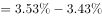

# 综合分析判断题（选非题）——时间口径核对、限额与余额比较、限额差计算

考点：[[20-考点/资料分析/综合/综合分析判断题（选非题）——时间口径核对、限额与余额比较、限额差计算|综合 / 综合分析判断题（选非题）——时间口径核对、限额与余额比较、限额差计算]]
材料：[[15-材料/资料分析/260067 2019年6月及2019年上半年全国|260067 2019年6月及2019年上半年全国]]

**问法模型**：'不能从上述资料推出的是'→逐项用材料数据验证，找出时间口径缺失或无法还原的那一项

## 推理链
1. 第1步：A项提取最后一段数据：一般债务余额118397亿元<一般债务限额133089.22亿元，专项债务余额87080亿元<专项债务限额107685.08亿元，两项均控制在限额内，A可推出
2. 第2步：B项提取第四段1至6月平均发行利率：一般债券与专项债券各有一个具体利率值（完整版试卷给出），二者相差0.1个百分点，B可推出
3. 第3步：C项需要2019年5月新增债券与置换和再融资债券的平均发行期限，但材料第二段仅给出2019年6月数据：新增债券10.4年、置换债券和再融资债券13.4年
4. 第4步：平均发行期限不是发行额流量指标，不能套用6月发行额的同比/环比增速还原5月数值，材料也无5月任何期限数据，故5月期限长短无法判断，C不能推出
5. 第5步：D项用最后一段两个限额相减：133089.22-107685.08=25404.14亿元，与选项一致，D可推出
6. 第6步：本题选'不能推出'的一项，故正确答案为C

**最快解法**：⚡ 口径秒杀法：C项问'2019年5月'的期限，材料只有'2019年6月'的期限数据（10.4年、13.4年），期限非流量、无增速可还原，直接锁定C；其余三项用简单比大小（A）与一次减法（D）验证即可

## 易错点
- ⚠ 时间口径偷换：材料第二段是2019年6月当月的期限数据，C项问5月，切勿因6月新增10.4年<置换13.4年就顺手外推到5月
- ⚠ 指标性质混淆：平均发行期限（单位：年）与债券发行额（亿元）是不同指标，发行额的同比/环比增速不能用来还原期限数据
- ⚠ 概念错位：A项中限额是年度额度上限、余额是6月末时点存量，二者比较对象别张冠李戴；D项限额相减注意保留两位小数（25404.14）

## 母题抽象
> 🧩 当综合分析题某选项的时间口径（月份/时段）在材料中找不到、且该指标不能用增速还原（如期限、利率这类特征值）时，该选项即'不能推出'的答案

**同类特征**：不能从上述资料推出的是、选非题、2019年5月、平均发行期限、限额之内、平均发行利率、限额差

## 相关题
- [[10-真题/资料分析/综合/250219 综合分析选非题（图表数据可推断性判断）|250219]]（深圳市考 2008，相关度1）
- [[10-真题/资料分析/综合/10297333 综合分析选非题（同比增速逐年比较+年均增长量+比重百分点还原）|10297333]]（浙江 2025，相关度1）
- [[10-真题/资料分析/综合/14355349 综合分析-选非题（增长率计算比较+人均值计算）|14355349]]（浙江 2024，相关度1）
- [[10-真题/资料分析/综合/17097816 综合判断·选非题（增长率与增长量偷换）|17097816]]（山西 2024，相关度1）
- [[10-真题/资料分析/综合/2052088 综合分析-选非题（趋势判断+增速排序+增长量比较+增长率计算逐项核对）|2052088]]（吉林 2017，相关度1）

---

### 题干
不能从上述资料推出的是：

### 选项
- A. 截至2019年6月末，地方政府一般债务余额和专项债务余额都控制在限额之内
- B. 2019年1至6月，地方政府一般债券的平均发行利率高于专项债券0.1个百分点
- C. 2019年5月，地方政府新增债券的平均发行期限比置换债券和再融资债券短　✅
- D. 2019年地方一般债务限额比专项债务限额多25404.14亿元

### 官方解析

A项：定位文字材料最后一段“2019年······一般债务限额133089.22亿元，专项债务限额107685.08亿元。截至2019年6月末······一般债务118397亿元，专项债务87080亿元”，由于118397亿元133089.22亿元、87080亿元107685.08亿元，说明都控制在限额之内，正确；

B项：定位文字材料第四段“2019年1至6月，······其中一般债券，专项债券”，则一般债券平均发行利率专项债券平均发行利率个百分点，正确；

C项：定位文字材料第二段“2019年6月，······其中新增债券10.4年，置换债券和再融资债券13.4年”，只有2019年6月的年份数据，无法计算出2019年5月的数据，故无法推出，错误；

D项：定位文字材料最后一段“2019年······其中，一般债务限额133089.22亿元，专项债务限额107685.08亿元”，一般债务限额专项债务限额亿元，正确。

本题为选非题，故正确答案为C。

### 给定材料

        2019年6月，全国发行地方政府债券8996亿元，同比增长，环比增长。其中，发行一般债券3178亿元，同比减少，环比增长，发行专项债券5818亿元，同比增长，环比增长；按用途划分，发行新增债券7170亿元，同比增长，环比增长，发行置换债券和再融资债券1826亿元，同比减少，环比增长。

        2019年6月，地方政府债券平均发行期限11.1年，其中新增债券10.4年，置换债券和再融资债券13.4年；地方政府债券平均发行利率，其中新增债券，置换债券和再融资债券。

        2019年1至6月，全国发行地方政府债券28372亿元，同比增长。其中，发行一般债券12858亿元，同比增长，发行专项债券15514亿元，同比增长；按用途划分，发行新增债券21765亿元，同比增长，发行置换债券和再融资债券6607亿元，同比减少。

        2019年1至6月，地方政府债券平均发行期限9.3年，其中一般债券11.2年，专项债券7.8年；地方政府债券平均发行利率，其中一般债券，专项债券。

        2019年全国地方政府债务限额为240774.3亿元。其中，一般债务限额133089.22亿元，专项债务限额107685.08亿元。截至2019年6月末，全国地方政府债务余额205477亿元，其中，一般债务118397亿元，专项债务87080亿元。

