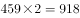

# 综合分析题（基期可求性判断+环比降幅比较+现期倍数比较+现期比重计算混合验证）

考点：[[20-考点/资料分析/综合/综合分析题（基期可求性判断+环比降幅比较+现期倍数比较+现期比重计算混合验证）|综合 / 综合分析题（基期可求性判断+环比降幅比较+现期倍数比较+现期比重计算混合验证）]]
材料：[[15-材料/资料分析/260069 2019年5月全国12358价格监管|260069 2019年5月全国12358价格监管]]

**问法模型**：题干为'能够从上述资料推出的是'的四选一综合判断 → 对四个选项逐项套用对应小模型（同比基期可求性、环比降幅比较、2倍临界比较、前三占比计算），排除错误项锁定正确项

## 推理链
1. 第1步：从文字段取数：2019年5月受理总量37576件，其中价格举报4192件、价格投诉2059件、价格咨询31325件（各项环比降幅百分数在文本中空缺）；前十省市北京5786、江苏3528、上海2499件；从行业表取数：教育927件、旅游459件
2. 第2步（A项）：A项问2018年5月（同比基期）举报与投诉数量多少，但材料只给出现期量和环比降幅，无法还原同比基期量，A项无法推出，排除
3. 第3步（B项）：依完整材料比较举报/投诉/咨询三者环比降幅，降幅最大的是价格举报（4192件）而非价格咨询（31325件），B项错误，排除
4. 第4步（C项）：旅游459×2=918件，教育927件>918件，即927÷459≈2.02倍，教育超过旅游的2倍，与'不超过2倍'矛盾，C项错误，排除
5. 第5步（D项）：排名前三省市为北京5786+江苏3528+上海2499=11813件
6. 第6步：11813÷37576≈31.4%，低于阈值1/3（≈33.3%），D项正确，故选D

**最快解法**：⚡ 排除法+截位直除（比较法）：C项先算459×2=918与927比较即排除；A项因同比基期不可求直接排除；D项算出前三合计11813后，用37576÷3≈12525>11813直接判定比重<1/3，无需精算直除，锁定D

## 易错点
- ⚠ 基期口径混淆：A项问2018年5月（同比基期），材料只有环比降幅，若拿环比降幅去还原同比基期必错，应先判'基期可求性'再计算
- ⚠ C项2倍临界陷阱：927÷459≈2.02倍仅略超2倍，必须精确计算459×2=918再比较，粗估容易误判成'不超过2倍'而错选C
- ⚠ B项降幅≠现期量：环比降幅大小取决于增长率而非现期量大小，不能因咨询31325件最多就认为其降幅最大；且给定文本降幅数值空缺，判断须依完整材料；另注意行业表中'其他'7439件与'其他商品价格'206件是两个不同指标，易串行读错

## 母题抽象
> 🧩 当题干出现'能够从上述资料推出的是'时，按'先排除不可求/数据缺失项，再精算临界项，最后算简单比重项'的顺序逐项验证：基期问题先判可求性（同比口径缺口径直接排除），倍数用'分母×2与分子比较'，占比用'总量÷3与部分和比较'秒判

**同类特征**：能够从上述资料推出的是、综合判断四选一、同比基期（2018年5月）数量比较、环比下降幅度最大、不超过2倍临界表述、排名前三省市占比低于某分数

## 相关题
- [[10-真题/资料分析/综合/4818017 综合判断题（基期量逆推+比重计算+数据可得性检验）|4818017]]（青海 2022，相关度2）
- [[10-真题/资料分析/综合/5509996 综合判断题（排除法）+倍数计算（排名前三之和÷后三之和）|5509996]]（江西 2023，相关度2）
- [[10-真题/资料分析/综合/13319330 综合分析（可推出判断），涉及增长n倍求基期量、年均增速时间口径、'四成以上'方向词甄别、增长倍数比较|13319330]]（江苏 2025，相关度1）
- [[10-真题/资料分析/综合/2024180 综合分析判断（增长率比较＋基期比重计算＋无中生有排除）|2024180]]（重庆 2016，相关度1）
- [[10-真题/资料分析/综合/2051138 综合判断（顺差比较+基期回推+单价计算混合验证）|2051138]]（黑龙江 2017，相关度1）

---

### 题干
能够从上述资料推出的是：

### 选项
- A. 
2018年5月，平台受理价格举报数量多于价格投诉数量

- B. 
2019年5月，平台受理价格咨询数量环比下降幅度最大

- C. 
2019年5月，平台受理教育行业数量不超过旅游行业的2倍

- D. 
2019年5月，平台受理量排名前三的省（市）占总数的比重低于
　✅

### 官方解析

A项：定位文字材料“2019年5月，······价格举报4192件，环比下降；价格投诉2059件，环比下降”，已知现期量、环比增长率，无法求同比基期量，A项无法推出，错误；

B项：定位文字材料“2019年5月，······价格举报4192件，环比下降；价格投诉2059件，环比下降；价格咨询31325件，环比下降”，平台受理数量环比下降幅度最大的为价格举报，并非价格咨询，错误；

C项：定位表格材料“2019年5月，平台受理教育行业数量为927件，受理旅游行业数量为459件”，927件（件），即平台受理教育行业数量超过旅游行业的2倍，错误；

D项：定位文字材料“2019年5月，全国12358价格监管平台受理价格举报、投诉、咨询共计37576件······平台受理量排名前十的省（市）依次是北京（5786件）、江苏（3528件）、上海（2499件）······”前三的省（市）为北京（5786件）、江苏（3528件）、上海（2499件），合计11813件，则2019年5月，平台受理量排名前三的省（市）占总数的比重为，低于，正确。

故正确答案为D。

### 给定材料

        2019年5月，全国12358价格监管平台受理价格举报、投诉、咨询共计37576件，同比下降，环比下降。其中，价格举报4192件，环比下降；价格投诉2059件，环比下降；价格咨询31325件，环比下降。平台受理量排名前十的省（市）依次是北京（5786件）、江苏（3528件）、上海（2499件）、重庆（2486件）、河南（2469件）、陕西（2440件）、浙江（2321件）、天津（1571件）、福建（1483件）、广西（1309件）。平台受理量行业分布如下表所示：

> [!warning] 疑点（官方解析可能有误，待人工复核）
> 给定文本中所有同比/环比降幅百分数均空缺，A、B项官方结论（尤其'环比下降幅度最大的为价格举报'）依赖完整材料数据，在本文本内无法独立复核；D项阈值公式为图片（latex:sm519gGbZFCOyRrLfZ8VUA）未显示具体数值，依官方解析'比重低于'及计算结果11813/37576≈31.4%推断阈值为1/3（成立），不影响答案D的判定

<!-- CODEX-ANSWER-REVIEW:BEGIN -->
### 本次独立复核

**复核状态：** `confirmed`（独立复算确认答案）

**计分答案：** D（可计分）

**复核解析：**

前三省市平台受理量11813，占总量37576的11813/37576≈31.44%，低于题给35%阈值，D成立。教育行业459，旅游行业927，未超过其2倍；其余选项缺少2018跨年基数或咨询分项环比序列。

**相关信息：**

独立复核：按题干定义逐项检验，关键基数、比值、增速与图表读数写明以便复算。

**题源依据：** [固定版本原题](https://github.com/Mentat-Uran/kaogongzhentizhengliu/blob/84ab93d4b64b61d897bece8a1c0a5bab06b4feb2/10-%E7%9C%9F%E9%A2%98/%E8%B5%84%E6%96%99%E5%88%86%E6%9E%90/%E7%BB%BC%E5%90%88/2616172%20%E7%BB%BC%E5%90%88%E5%88%86%E6%9E%90%E9%A2%98%EF%BC%88%E5%9F%BA%E6%9C%9F%E5%8F%AF%E6%B1%82%E6%80%A7%E5%88%A4%E6%96%AD%2B%E7%8E%AF%E6%AF%94%E9%99%8D%E5%B9%85%E6%AF%94%E8%BE%83%2B%E7%8E%B0%E6%9C%9F%E5%80%8D%E6%95%B0%E6%AF%94%E8%BE%83%2B%E7%8E%B0%E6%9C%9F%E6%AF%94%E9%87%8D%E8%AE%A1%E7%AE%97%E6%B7%B7%E5%90%88%E9%AA%8C%E8%AF%81%EF%BC%89.md)；固定内容 commit `84ab93d4b64b61d897bece8a1c0a5bab06b4feb2`，Markdown blob `17124f858f0dc0ca61c21dabc91870e364b8d9a8`。
<!-- CODEX-ANSWER-REVIEW:END -->
