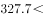
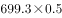
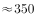
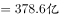
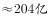
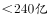

# 综合分析·选非题（混合增速居中判定+比重乘基数+半数比较+饼图占比直读）

考点：[[20-考点/资料分析/综合/综合分析·选非题（混合增速居中判定+比重乘基数+半数比较+饼图占比直读）|综合 / 综合分析·选非题（混合增速居中判定+比重乘基数+半数比较+饼图占比直读）]]
材料：[[15-材料/资料分析/264432 2018年M省进出口总值1034.4|264432 2018年M省进出口总值1034.4]]

**问法模型**：题干为'不能从上述资料中推出的是'的选非型综合分析→逐项验证四个选项，三个能推出、一个与资料矛盾或不可得，锁定该项作答

## 推理链
1. 第1步：从文字段①提取总量数据——2018年M省进出口总值1034.4亿元、出口378.6亿元，隐含进口总值=1034.4−378.6=655.8亿元，且进口体量(655.8)＞出口体量(378.6)。
2. 第2步：A项套混合居中原则——总值增速是进口增速与出口增速按体量加权的混合增速，必介于两者之间；因出口增速（原卷数值）高于总值增速，故进口增速必低于总值增速（即选项公式所给值），A能推出。
3. 第3步：B项直接口算比较——对'一带一路'沿线国家进出口699.3亿元，其一半为699.3÷2=349.65亿元；对蒙古国外贸进出口327.7亿元＜349.65亿元，B能推出。
4. 第4步：C项直读图1（出口结构饼图）——边境小额贸易占比8%、加工贸易占比8%，两者占比相等，C能推出。
5. 第5步：D项转化为临界占比——钢材、机电产品、农产品合计占出口总值的比重r（原卷给出），'合计出口额超过240亿元'等价于r＞240÷378.6≈63.4%；按官方解析代入原卷占比计算，378.6×r＜240，与选项'超过240亿元'矛盾，D不能推出。
6. 第6步：本题为选非题，A、B、C均可从资料推出，唯有D与资料计算结果矛盾，故正确答案为D。

**最快解法**：⚡ 考场三步秒杀：①纯读取项先行——B口算699.3÷2≈349.65＞327.7为真、C直读图1'边贸8%=加工8%'为真，排除；②A套混合居中'总值增速介于进口与出口增速之间'即判真，排除；③D用临界占比法：240÷378.6≈63.4%，原卷前三商品合计占比未达63.4%（即378.6×占比不足240），与选项矛盾，锁定D。

## 易错点
- ⚠ 选非题看错问法：题干求'不能推出'，A、B、C均为真表述作干扰，惯性按'选正确项'作答极易误选；
- ⚠ 混合增速方向误判：'总值增速介于进口与出口增速之间'只给区间，谁高谁低必须落到出口增速具体数值；且进口权重(655.8)＞出口权重(378.6)，混合值更贴近进口增速，不能想当然认为进口增速高；
- ⚠ D项硬算378.6×占比费时易错：应先换临界占比240/378.6≈63.4%再比较；且前三商品占比出自文字段②，与图1饼图贸易方式占比（一般84%/加工8%/边贸8%）口径完全不同，严禁互串。

## 母题抽象
> 🧩 当综合分析题出现'不能从资料中推出/无法推出'的选非问法时，先用直读与口算秒掉纯读取项（饼图占比相等、半数比较），再用混合居中原则判增速类选项、用临界值法（目标额÷基数=临界占比）验证金额类选项，锁定唯一与资料矛盾或数据不可得项。

**同类特征**：不能从上述资料中推出、选非型综合分析、跨文字段与饼图拼数据、混合居中原则判增速、低于一半（半数比较）、占比×基数验证金额上限

## 相关题
- [[10-真题/资料分析/综合/14355349 综合分析-选非题（增长率计算比较+人均值计算）|14355349]]（浙江 2024，相关度1）
- [[10-真题/资料分析/综合/2719459 综合分析选非题（现期比重+现期平均数+单位换算混合验证）|2719459]]（国考 2021，相关度1）
- [[10-真题/资料分析/综合/19283743 综合分析-选非题（平均数增长率+增长量比较+比重临界值验证）|19283743]]（国考 2025，相关度1）
- [[10-真题/资料分析/综合/13504445 综合判断选非题（基期增长量计算+混合增长率比重比较+两期平均数比较+总量构成差）|13504445]]（河北 2025，相关度1）
- [[10-真题/资料分析/综合/16593091 综合判断选非题（基期值+两期平均数比较+比重计算+两期比重变化）|16593091]]（新疆 2024，相关度1）

---

### 题干
关于2018年M省进出口情况，不能从上述资料中推出的是：

### 选项
- A. 
进口总值同比增速低于

- B. 
对蒙古国外贸进出口总值低于对“一带一路”沿线国家外贸进出口总值的一半

- C. 
外贸出口中边境小额贸易与加工贸易所占比例相等

- D. 
钢材、机电产品、农产品三者合计出口额超过240亿元
　✅

### 官方解析

A项：定位文字材料第一段，2018年M省进出口总值达到1034.4亿元，比上年增长，其中，出口378.6亿元，增长；根据“混合居中原则”，进出口总值的增长率介于进口增长率和出口增长率之间，故进口总值同比增速小于，正确。

B项：定位文字材料第二段，2018年M省对“一带一路”沿线国家外贸进出口为699.3亿元，蒙古国外贸进出口为327.7亿元，则，正确。

C项：定位图1，2018年M省分类型出口贸易占比中，边境小额贸易与加工贸易占比均为，故两者所占比例相等，正确。

D项：定位文字材料第二段，钢材、机电产品、农产品三者合计占同期出口总值的，定位文字材料第一段，2018年M省出口总值378.6亿元，因此三者合计出口额，错误。

本题为选非题，故正确答案为D。

### 给定材料

        2018年，M省进出口总值达到1034.4亿元，比上年增长。其中，出口378.6亿元，增长；M省加工贸易进出口总值比上年增长。与“一带一路”沿线国家贸易保持快速增长，其中对蒙古国、越南、德国、荷兰进出口分别比上年增长、1.4倍、和。全省实际利用外资31.6亿美元，比上年增长。

        煤、锯材、铜矿砂为进口值前三的商品，三者合计占同期进口总值的；钢材、机电产品、农产品为出口值前三的商品，三者合计占同期出口总值的。2018年M省对“一带一路”沿线国家外贸进出口699.3亿元，增长，占同期外贸进出口总值的。其中对蒙古国外贸进出口327.7亿元，增长。

> [!warning] 疑点（官方解析可能有误，待人工复核）
> 所提供文本中进出口总值增速、出口增速、加工贸易增速、四国增速、前三商品合计占比、沿线国家增速及占比等具体数值均显示为空缺，A项公式值与D项占比无法从本文本直接读取，上述判定以原卷完整数据及官方解析为准；官方答案D与解析逻辑自洽，不影响作答。

<!-- CODEX-ANSWER-REVIEW:BEGIN -->
### 本次独立复核

**复核状态：** `resolved`（答案与解析已核定）

**计分答案：** D（可计分）

**复核解析：**

A成立：总进出口增长率9.9%是进口、出口按基期额加权的平均；出口增长14.4%高于总增速，所以进口增速必低于9.9%，也低于10%。B成立：699.3/2=349.65亿元，大于蒙古贸易额327.7亿元。C成立：两类出口方式占比均为8%。D错误：出口前三类金额合计=378.6×53.9%≈204.0亿元，未超过240亿元。题目问不能推出，唯一答案D。

**修订材料：**

恢复固定公式图：进出口总值同比增长9.9%，出口增长14.4%；进口前三类商品合计占进口55.8%，出口前三类（钢材、机电产品、农产品）合计占出口53.9%；“一带一路”贸易增长14.6%、占进出口总额67.6%；蒙古贸易额327.7亿元，“一带一路”贸易总额699.3亿元；边境小额贸易和加工贸易各占出口8%。

**相关信息：**

资料分析—混合增长率与比重；加权平均落在分项增速区间内，合计额乘占比求分项总额。

**题源依据：** [固定版本原题](https://github.com/Mentat-Uran/kaogongzhentizhengliu/blob/84ab93d4b64b61d897bece8a1c0a5bab06b4feb2/10-%E7%9C%9F%E9%A2%98/%E8%B5%84%E6%96%99%E5%88%86%E6%9E%90/%E7%BB%BC%E5%90%88/2662212%20%E7%BB%BC%E5%90%88%E5%88%86%E6%9E%90%C2%B7%E9%80%89%E9%9D%9E%E9%A2%98%EF%BC%88%E6%B7%B7%E5%90%88%E5%A2%9E%E9%80%9F%E5%B1%85%E4%B8%AD%E5%88%A4%E5%AE%9A%2B%E6%AF%94%E9%87%8D%E4%B9%98%E5%9F%BA%E6%95%B0%2B%E5%8D%8A%E6%95%B0%E6%AF%94%E8%BE%83%2B%E9%A5%BC%E5%9B%BE%E5%8D%A0%E6%AF%94%E7%9B%B4%E8%AF%BB%EF%BC%89.md)；固定内容 commit `84ab93d4b64b61d897bece8a1c0a5bab06b4feb2`，Markdown blob `c9878668faf525aabdbc88fef0e76f1814aea6f8`。
<!-- CODEX-ANSWER-REVIEW:END -->
