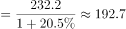
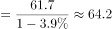

# 综合判断（选非题）——顺逆差判定＋基期量回算

考点：[[20-考点/资料分析/综合/综合判断（选非题）——顺逆差判定＋基期量回算|综合 / 综合判断（选非题）——顺逆差判定＋基期量回算]]
材料：[[15-材料/资料分析/265237 2017年我国文化产品和文化服务进出|265237 2017年我国文化产品和文化服务进出]]

**问法模型**：题干为‘根据所给资料，下列表述错误的是’的选非题→逐项核对A–D：A/B/D用材料原文关键词定性佐证，C项套用‘顺差=出口＞进口’定义并以基期量=现期/(1±r)回算2016年文化服务出口、进口后比大小。

## 推理链
1. 第1步：题干为选非题，要求找出错误表述；A、B、D三项可直接用材料原文关键词佐证，C项需回算2016年基期量。
2. 第2步：A项——材料第二段：前五大市场为美国、中国香港、荷兰、英国、日本，另有‘一带一路’沿线进出口176.2亿美元同比增长、金砖国家43亿美元同比增长，国际市场多元格局成立，A表述正确。
3. 第3步：B项——材料第二段：出口技术含量有所提升，高附加值的游艺器材和娱乐用品、广播电影电视设备出口占比提升2个百分点，出口结构更趋优化，B表述正确。
4. 第4步：C项——材料第三段：2017年文化服务进口232.2亿美元（同比增长）、出口61.7亿美元（同比下降）；顺差定义为出口额＞进口额，且问的是2016年，须先做基期回算。
5. 第5步：代入基期公式：2016年出口=61.7/(1−降幅)≈64.2亿美元，2016年进口=232.2/(1+增速)≈192.7亿美元（数值取自官方解析，本版材料增速数值空缺）。
6. 第6步：64.2亿美元＜192.7亿美元，2016年文化服务为贸易逆差而非顺差，C表述错误。
7. 第7步：D项——第三段2017年文化服务进口232.2亿美元同比明显增长，‘进口增势明显’成立，D表述正确；选非题故选错误项C，与官方答案一致。

**最快解法**：⚡ 定义＋量级定性秒杀：C项锁定‘顺差=出口＞进口’，2017年文化服务进口232.2亿美元≈出口61.7亿美元的3.8倍，且进口增长、出口下降，2016年回算后进口（≈192.7亿）必仍远大于出口（≈64.2亿）→必为逆差→C错；A/B/D用原文关键词（前五大市场＋‘一带一路’176.2亿＋金砖43亿／高附加值占比提升2个百分点／进口同比增长）直接判对，全程几乎无需精算。

## 易错点
- ⚠ 选非题审题坑：题干问‘错误的是’，易惯性误选表述正确的A/B/D，应逐项验真后锁定唯一错误项。
- ⚠ 顺逆差方向＋基期口径坑：顺差=出口＞进口；2017年进口232.2亿已达出口61.7亿的约3.8倍且‘进口升、出口降’，2016年回算后（64.2对192.7）仍为逆差，勿因‘出口仅小幅下降’就臆断2016年可能顺差。
- ⚠ 负增长回算公式坑：出口同比下降时2016年出口=61.7/(1−降幅)≈64.2亿，若误用(1+降幅)会算成约59.4亿，虽不改变逆差结论但数值口径均错；另勿把官方解析文字中的‘亿元’当成材料单位（应为亿美元）。

## 母题抽象
> 🧩 当综合判断题出现‘某年进出口出现顺差/逆差’表述时，先锁定义‘顺差=出口＞进口’，再用基期量=现期/(1+增速)（下降项除以(1−降幅)）回算上年出口与进口比大小，并用现期量级差（如232.2对61.7）作定性校验秒判。

**同类特征**：选非题（下列表述错误的是）、顺差/逆差定义判定、基期量回算（2016年）、同比下降项用(1−降幅)、文化服务进口232.2亿/出口61.7亿、定性佐证与定量回算混合

## 相关题
（暂无）

---

### 题干
根据所给资料，下列表述错误的是：

### 选项
- A. 2017年我国文化产品出口国际市场呈多元格局
- B. 2017年我国文化产品出口结构更趋优化
- C. 2016年我国文化服务进出口出现顺差　✅
- D. 2017年我国文化服务进口增势明显

### 官方解析

A项：定位文字材料第二段可知，美国、中国香港、荷兰、英国和日本为中国文化产品进出口前五大市场，我国与“一带一路”沿线国家进出口额达到176.2亿美元，同比增长；与金砖国家进出口额43亿美元，同比增长。由此可见我国文化产品出口国际市场呈现多元格局，正确；

B项：定位文字材料第二段可知，出口的技术含量有所提升，具有较高附加值的游艺器材和娱乐用品、广播电影电视设备出口同比增长，占比提升2个百分点至。由此可见，我国文化产品出口结构更趋优化，正确；

C项：贸易顺差，即出口额进口额，定位材料第三段，文化服务方面，进口232.2亿美元，同比增长，出口61.7亿美元，同比下降。根据公式基期量，则2016年进口额亿元；2016年出口额亿元，则2016年文化服务出口额64.2亿元文化服务进口额192.7亿元，为贸易逆差，错误；

D项：定位文字材料第三段可知，文化服务方面，进口232.2亿美元，同比增长，可知进口增势明显，正确。

本题为选非题，故正确答案为C。

### 给定材料

        2017年，我国文化产品和服务进出口总额1265.1亿美元，同比增长。其中，文化产品进出口总额971.2亿美元，同比增长。文化服务进出口总额293.9亿美元，同比增长。

        文化产品方面，出口881.9亿美元，同比增长；进口89.3亿美元，同比下降。出口的技术含量有所提升，具有较高附加值的游艺器材和娱乐用品、广播电影电视设备出口同比增长，占比提升2个百分点至。美国、中国香港、荷兰、英国和日本为中国文化产品进出口前五大市场，进出口额合计占比为。这样比较上年下降1.8个百分点。我国与“一带一路”沿线国家进出口额达到176.2亿美元，同比增长，占比提高1.2个百分点至；与金砖国家进出口额43亿美元，同比增长。

        文化服务方面，进口232.2亿美元，同比增长。其中视听及相关产品许可费、著作权等研发成果使用费进口分别同比增长和。出口61.7亿美元，同比下降；其中处于核心层的文化和娱乐服务、研发成果、使用费、视听及相关产品许可费等三项服务出口15.4亿美元，同比增长，占比增提升5.7个百分点至。

> [!warning] 疑点（官方解析可能有误，待人工复核）
> 本版材料原文各同比增速数值多处空缺，官方解析回算所依据的增速（由64.2与192.7可反推：进口约+20.5%、出口约−3.9%）在原卷中应有完整数值，作答前须按原卷补齐；另官方解析文字将2016年出口/进口额写作‘64.2亿元/192.7亿元’，单位应为‘亿美元’，系解析笔误，不影响答案C的判定。
