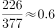
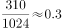
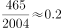
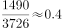
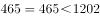
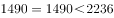
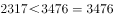
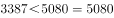

# 综合分析题（逐项定性判断：比值趋势比较、比例变化判断、同行数据比较、无中生有排除）

考点：[[20-考点/资料分析/综合/综合分析题（逐项定性判断：比值趋势比较、比例变化判断、同行数据比较、无中生有排除）|综合 / 综合分析题（逐项定性判断：比值趋势比较、比例变化判断、同行数据比较、无中生有排除）]]
材料：[[15-材料/资料分析/267195 以B市为例介绍社会保险制度背景（缴费|267195 以B市为例介绍社会保险制度背景（缴费]]

**问法模型**：'以下说法正确的是'四选一综合判断 → 逐项定位表格对应列：A算逐节点比值看单调性、B看比例两列变化方向、C同行横向比三险种下限、D查材料是否提及

## 推理链
1. 第1步：题干'每5年调整一次'与表格1994/1999/2004/2009/2014/2019五个节点结构对应，只需逐项在节点上验证，无需插值。
2. 第2步（A项）：取养老基数下限÷上年社平工资：1994年226/377≈0.60，1999年310/1024≈0.30，2004年465/2004≈0.23，2009年1490/3726≈0.40，2014年2317/5793≈0.40，2019年3387/8467≈0.40。
3. 第3步：2009年比值0.40＞2004年0.23，比值中途回升，并非'逐渐缩小'，A错误。
4. 第4步（B项）：单位缴纳比例19%→19%→20%→20%→20%→16%，个人缴纳比例5%→5%→8%→8%→8%→8%，前期均上升、仅后期下降，非'逐渐降低'，B错误。
5. 第5步（C项）：同行横向比较三个下限：2004年工伤465=养老465、医疗生育1202＞465；2009年工伤1490=养老1490、医疗2236＞1490；2014年工伤3476＞养老2317、医疗3476＞2317；2019年工伤5080＞养老3387、医疗5080＞3387，四个节点均满足'不低于'，C正确。
6. 第6步（D项）：材料文字与表格均只给出城镇人员数据，未提及农业户口人员缴费情况，属无中生有，D错误。
7. 第7步：综合得出正确答案为C。

**最快解法**：⚡ 逐项排除法：A项只算2004年465/2004≈0.23与2009年1490/3726≈0.40两个比值，发现回升即排除；B项扫一眼比例列5%→8%上升即排除；D项'农业户口'材料未提直接排除；C项无需计算，同一行内比大小即可（注意'不低于'含相等，2004/2009年工伤=养老）。

## 易错点
- ⚠ '始终不低于'包含'相等'：2004年（465=465）与2009年（1490=1490）工伤下限恰与养老下限相等，误以为必须严格大于会错判C
- ⚠ A项比值并非单调下降：2004年是低点0.23，2009年回升至0.40，只看前三个节点（0.60→0.30→0.23）的下降趋势会误选A
- ⚠ 时间范围与数据缺口：C项只考核2004-2019年，1994、1999年医疗生育下限为'-'（无该险种数据），不参与比较；B项覆盖1994-2019全程，不能只看2019年16%<20%的下降段而忽略前期上升

## 母题抽象
> 🧩 当题干出现'以下说法正确的是'且选项涉及趋势判断、数据比较时，先用'无中生有'和'单调性破绽'快速排除两三项，再对剩余项做同行横向数据比较验证，注意'不低于/不少于'类措辞包含相等情形。

**同类特征**：以下说法正确的是、每5年调整一次、基数下限与上年社平工资比值、缴纳比例逐渐降低、始终不低于、综合判断四选一

## 相关题
- [[10-真题/资料分析/综合/2172883 综合分析（正误判断）——单位面积产量（平均数）比较+总量拆分验证+增长率倍数验证|2172883]]（广州市考 2018，相关度2）
- [[10-真题/资料分析/综合/10204453 综合分析判断（读数比较+增长量比较+年均增长率比较+区间增速比较）|10204453]]（广东 2024，相关度1）
- [[10-真题/资料分析/综合/2024180 综合分析判断（增长率比较＋基期比重计算＋无中生有排除）|2024180]]（重庆 2016，相关度1）
- [[10-真题/资料分析/综合/2172123 综合分析（当期值加总比较+负增长判基期高低+当月值序列判趋势+基期还原超阈值判断）|2172123]]（广州市考 2018，相关度1）
- [[10-真题/资料分析/综合/2393970 综合分析-逐项判断（基期量计算-增速方向比较-混合增长率-两数差值）|2393970]]（青海 2019，相关度1）

---

### 题干
如果B市社保缴费基数，每5年调整一次，则根据上述资料，以下说法正确的是（    ）。

### 选项
- A. 1994-2019年，B市城镇人员养老保险缴纳基数下限与上年社会平均工资的比值逐渐缩小
- B. 1994-2019年，B市城镇人员养老保险的企业缴纳比例和个人缴纳比例逐渐降低
- C. 2004-2019年，B市城镇人员的工伤和医疗生育保险缴纳基数下限始终不低于养老基数下限　✅
- D. 2009-2019年，B市城镇人员与农业户口人员的各项保险缴纳差距逐渐缩小

### 官方解析

A项：定位表格可知，历年B市城镇人员养老保险缴纳基数下限与上年社会平均工资，则两者比值如下：1994年：，1999年：，2004年：，2009年：，2009年的比值2004年，并非逐渐缩小，错误；

B项：定位表格可知，B市城镇人员养老保险的个人缴纳比例1994年为，1999年为，增加了，并非逐渐降低，错误；

C项：定位表格可知，2004-2019年B市城镇人员的养老、工伤和医疗生育保险缴纳基数下限，2004年：元/月，2009年：元/月，2014年：元/月，2019年：元/月，即工伤和医疗生育保险缴纳基数下限始终不低于养老基数下限，正确；

D项：材料中未提及农业户口人员的各项保险缴纳情况，无法推出，错误。

故正确答案为C。

### 给定材料

        社会保险包括了养老保险，工伤保险，医疗生育保险等，是社会保障体系的重要组成部分。其在整个社会保障体系中居于核心地位，社会保险是一种缴费型的社会保障，资金主要由用人单位和劳动者缴纳（一般而言，各类社会保险的缴纳费用缴费基数缴纳比例），政府财政给予补贴并承担最终责任。

        在经历了一段时间的摸索后，我国的社会保障制度在上世纪90年代进入了创新式的改革、发展时期。1995年3月1日，国务院发出《关于深化企业职工养老保险制度改革的通知》，确定了社会统筹与个人账户相结合的养老保险制度，职工基本养老保险制度在全国范围内正式实行统账结合模式。

        近年来，随着我国经济发展出现一系列新形式新情况，企业对进一步降低社保费率的呼声较强，党中央、国务院提出新的要求。2019年《政府工作报告》明确提出，各地可将养老保险单位缴费比例降至。2019年，B市率先降低养老保险单位缴费比例。预计今后每年可减轻该市企业社保费缴费负担超百亿元。

