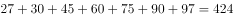
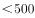

# 综合分析题（四选一逐项判断：同比增量比较＋比重比较＋累计求和＋逐年大小验证）

考点：[[20-考点/资料分析/综合/综合分析题（四选一逐项判断：同比增量比较＋比重比较＋累计求和＋逐年大小验证）|综合 / 综合分析题（四选一逐项判断：同比增量比较＋比重比较＋累计求和＋逐年大小验证）]]
材料：[[15-材料/资料分析/269187 2013～2019年我国LED产业总|269187 2013～2019年我国LED产业总]]

**问法模型**：『能够从上述资料中推出的是』→ 对A/B/C/D四个选项分别套用增量公式（现期−基期）、比重公式（部分÷整体）、累计加总、逐行逐年对比，排除三个错误项锁定正确项

## 推理链
1. 第1步：A项提取总产值数据：2014年3507、2015年4245、2016年5216亿元，2015年同比增量=4245−3507=738亿元，2016年=5216−4245=971亿元，971>738，2016年增量高于2015年，A错误
2. 第2步：B项『5年前』即2019年−5=2014年：2019年封装占比=959/7548≈12.7%，2014年=517/3507≈14.7%，12.7%<14.7%，比重下降，B错误（亦可看倍数：封装517→959约1.85倍<总产值3507→7548约2.15倍，分母涨得快则占比降）
3. 第3步：C项汽车照明2013~2019年产值为27、30、45、60、75、90、97亿元，累计=27+30+45+60+75+90+97=424亿元<500亿元，C错误
4. 第4步：D项逐年代入两行数据：景观照明435/475/478/579/799/1007/1108，背光应用340/435/475/519/513/505/503，7年中每一年景观照明均高于背光应用（最接近的2015年为478>475），D正确
5. 第5步：与选项对照，A、B、C均被数据否定，故选D

**最快解法**：⚡ 综合题四项并联速算：A项相邻年直接相减（738 vs 971，口算）；B项用『分子倍数vs分母倍数』代替比重直除（959/517≈1.85＜7548/3507≈2.15⇒占比下降）；C项截位加总27+30+45+60+75+90+97≈424，与500差距明显；D项两行并排扫一眼，只需盯紧2014、2015两个贴近年份（475>435、478>475）即可确认全高于

## 易错点
- ⚠ 『5年前』基期定位陷阱：2019年的5年前是2014年（3507/517），若误用2013年（2576/403，占比约15.6%）结论方向不变但口径错；此类时间倒推务必先算年份
- ⚠ B项分母口径：『占行业总产值』分母是总产值（7548/3507），不是应用市场（6388/2852），材料『其中』两层嵌套易混淆
- ⚠ C项『累计』是7年求和（424亿元），勿与年均增速、年均产值混淆；D项须逐年全部验证，2015年478与475仅差3亿元，凭量级粗看极易误判

## 母题抽象
> 🧩 当综合分析题出现『能够从上述资料中推出的是』时，按固定模型逐项验证：增量题相邻年相减、比重题用分子分母倍数比较代替直除、累计题截位加总、『每年均高于』题只需核验数值最贴近的临界年份，四项中先扫数据特征明显的D类大小比较往往最快锁定答案

**同类特征**：能够从上述资料中推出的是、同比增量低于/高于、占行业总产值比重高于5年前、累计产值规模、每年…均高于、四选一逐项判断

## 相关题
- [[10-真题/资料分析/综合/5408644 综合分析-逐项判断正误（基期量计算、月均比较、平均数、比重临界值）|5408644]]（四川 2022，相关度2）
- [[10-真题/资料分析/综合/19283943 综合分析判断题（倍数比较+求和判断+隐含平均每场座位数反推）|19283943]]（国考 2025，相关度1）
- [[10-真题/资料分析/综合/1796162 综合判断（月均计算、平均运输距离、比重对比、增长量比较逐项验证）|1796162]]（贵州 2016，相关度1）
- [[10-真题/资料分析/综合/2133504 综合判断题（现期比重+现期平均数多项验证，一对三错）|2133504]]（国考 2018，相关度1）
- [[10-真题/资料分析/综合/2444706 综合判断题（增长量+比重+倍数逐项验证）|2444706]]（四川 2019，相关度1）

---

### 题干
关于2013～2019年我国LED产业，能够从上述资料中推出的是（    ）。

### 选项
- A. 2016年总产值同比增量低于2015年
- B. 2019年封装产值占行业总产值比重高于5年前水平
- C. 7年间汽车照明应用累计产值规模超过500亿元
- D. 每年景观照明应用的产值均高于背光应用产值　✅

### 官方解析

A项：定位统计表可得，2014~2016年，我国LED产业总产值分别为3507、4245、5216亿元，根据增长量，2015年LED产业总产值同比增量为亿元，2016年为亿元，2016年总产值同比增量高于2015年，错误；

B项：定位统计表可得，2019年，我国LED产业总产值为7548亿元，封装产值为959亿元；2014年总产值为3507亿元，封装产值为517亿元。2019年封装产值占行业总产值比重为，2014年所占比重为，可知2019年封装产值占行业总产值比重低于5年前水平，错误；

C项：定位统计表可得，2013~2019年，汽车照明产值分别为27、30、45、60、75、90、97亿元，累计产值规模为亿元亿元，错误；

D项：定位统计表可得，2013~2019年景观照明应用产值分别为435、475、478、579、799、1007、1108亿元，背光应用产值分别为340、435、475、519、513、505、503亿元，每年景观照明应用产值均高于背光应用产值，正确。

故正确答案为D。

### 给定材料

> [!warning] 疑点（官方解析可能有误，待人工复核）
> 官方解析中A、B、C项的具体计算数值在文本中缺失未显示（如『同比增量为亿元』『比重为』后无数字），但经复算738/971、12.7%/14.7%、424亿元等结果与其结论完全一致，不影响答案D的判定
