# 综合判断题——数据缺失判断+两段增量倍数比较+比重计算+平均每条线路客运量最值与排名验证

考点：[[20-考点/资料分析/综合/综合判断题——数据缺失判断+两段增量倍数比较+比重计算+平均每条线路客运量最值与排名验证|综合 / 综合判断题——数据缺失判断+两段增量倍数比较+比重计算+平均每条线路客运量最值与排名验证]]
材料：[[15-材料/资料分析/269188 2019年全国地铁（城轨交通）运营规|269188 2019年全国地铁（城轨交通）运营规]]

**问法模型**：“能够从上述资料中推出的是”→四项逐一定量验证：数据缺失项直接判推不出、增量倍数作差相除、比重用全国口径分母、平均数用同分母比分子，排除三项锁定唯一正确项

## 推理链
1. 第1步：A项需以文字段“地铁5181公里占城轨交通总里程的□%（材料中数值空缺）”反推总里程=5181÷比重，因比重缺失无法计算，A推不出
2. 第2步：B项从柱状图取数：2019年5181公里、2016年3169公里、2013年2073公里，两段增量为5181-3169=2012公里、3169-2073=1096公里
3. 第3步：2012÷1096≈1.84<2，未达“两倍以上”，B错误
4. 第4步：C项线路长度前3城为上海669.5+北京637.6+广州489.4=1796.5公里，占全国5181公里的1796.5÷5181≈34.7%，达不到选项阈值，C错误
5. 第5步：D项算平均每条线路客运量=客运量÷条数：4条组最小苏州3.6÷4=0.9、5条组最小天津4.7÷5=0.94、7条组最小重庆6.1÷7≈0.87，其余城市客运量均大于条数即均值>1，不可能是最小
6. 第6步：全表均值最小者为重庆（0.87亿人次/条），其客运量6.1亿人次在13城中排第10（前面依次为39.4、38.7、32.9、17.8、14.0、12.4、10.4、9.5、6.3共9城），属前10位，D正确

**最快解法**：⚡ 分组最值法（同分母比分子）：按条数相同城市分组，组内只挑客运量最小者做一次除法（苏州3.6÷4=0.9、天津4.7÷5=0.94、重庆6.1÷7≈0.87），三个商直接比大小定重庆最小；再用“客运量>条数⇒均值>1”口算排除其余城市，最后正向数重庆客运量排名

## 易错点
- ⚠ A项中“占城轨交通运营线路总里程的”比重数值在材料里空缺，切忌脑补一个百分比硬算，正确处理是判“材料不足、推不出”
- ⚠ B项比较的是两个区间增量（作差后相除）的倍数而非增长率，2012÷1096≈1.84易口算误判为超2倍
- ⚠ C项分母是文字段全国地铁的5181公里，不能把表中13城线路长度求和当分母（表仅部分城市）
- ⚠ D项重庆6.1÷7≈0.87与苏州3.6÷4=0.9极接近，必须精算；重庆客运量排名恰为第10，南京10.4、西安9.5、杭州6.3都排在它前面，漏数会误判其不在前10

## 母题抽象
> 🧩 当题干出现“能够从上述资料中推出的是”时，逐项匹配模型：遇材料数据缺失项直接排除，增量倍数用“末-中 vs 中-初”作差相除，比重题锁定全国口径分母，“平均每条最少”用同分母比分子的分组最值法，最后核对排名边界（恰第N位是否算前N位）

**同类特征**：能够从上述资料中推出的是、综合判断四选一、增量是两倍以上、平均每条运营线路客运量、排名前10位、材料比重数值缺失

## 相关题
- [[10-真题/资料分析/综合/4628161 综合判断题（基期量+比重+结构差额+平均数四模型逐项验证）|4628161]]（新疆 2021，相关度2）
- [[10-真题/资料分析/综合/2448411 综合判断题（两期平均数比较+区间累计求和+同比增量比较+增长量验算）|2448411]]（国考 2020，相关度2）
- [[10-真题/资料分析/综合/2448579 综合判断题（现期比重直验+增长量验证）|2448579]]（国考 2020，相关度2）
- [[10-真题/资料分析/综合/2097116 综合判断题（基期量估算+数据缺口排除）|2097116]]（四川 2017，相关度2）
- [[10-真题/资料分析/综合/2097178 综合判断题（现期比重+比重比较+多期求和+趋势判断混合验证）|2097178]]（重庆 2017，相关度2）

---

### 题干
能够从上述资料中推出的是：

### 选项
- A. 
2019年全国城轨交通运营线路总里程不到6000公里

- B. 
2019年全国地铁运营线路长度相比2016年增量是2016年相比2013年增量的两倍以上

- C. 
表中2019年末地铁运营线路长度排名前3的城市地铁运营线路长度之和占全国总量的以上

- D. 
表中2019年平均每条运营线路客运量最少的城市，地铁客运量在表中各城市排前10位
　✅

### 官方解析

A项，定位文字材料第一段“2019年全国地铁运营线路长度达5181公里，占城轨交通运营线路总里程的”，可得2019年全国城轨交通运营线路总里程为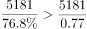公里，错误。

B项，定位柱状图材料可知，2019年、2016年、2013年地铁运营线路长度分别为5181公里、3169公里、2073公里，因此，2019年全国地铁营运线路长度相比2016年的增量为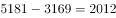公里，而2016年相比2013年的增量为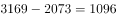公里。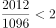倍，错误。

C项，定位表格材料，2019年末地铁运营线路长度排前3的城市是上海、北京、广州，其运营长度分别为669.5公里、637.6公里，489.4公里，三者占全国的比重为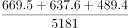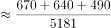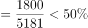，错误。

D项，定位表格材料，平均每条地铁运营线路客运量为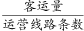。对运营线路条数相同的，我们只需要找客运量最小的即可。有4条运营线路的城市中，客运量最小的是苏州，平均客运量为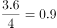亿人次/条；有5条运营线路的城市中，客运量最小的是天津，平均客运量为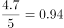亿人次/条；有7条运营线路的城市中，客运量最小的是重庆，平均客运量为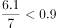亿人次/条；观察其他城市的客运量都是大于运营线路条数，即平均客运量1亿人次/条。因此，平均每条地铁运营线路客运量最小的是重庆，其客运量6.1亿人次在表格城市中排名第10，排名在前10位，正确。

故正确答案为D。

### 给定材料

        2019年全国地铁运营线路长度达5181公里，占城轨交通运营线路总里程的。

        2019年末，我国城轨交通配属地铁列车6178列，全年实现地铁客运量227.76亿人次。

> [!warning] 疑点（官方解析可能有误，待人工复核）
> 官方解析中关键算式（A项总里程、B项增量倍数、C项比重阈值、D项平均值的公式图片）在给定文本中缺失无法显示，仅能依据残留文字与表格数据复算：复算结果B约1.84倍、C约34.7%均与官方“错误”结论一致，不影响D项及答案判定
