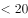
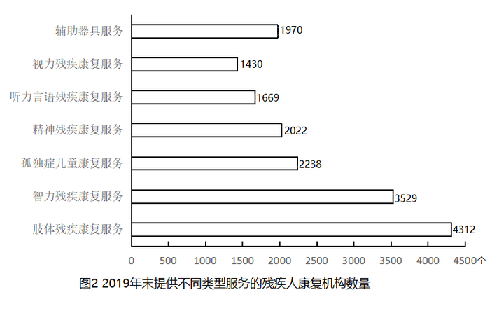

# 综合判断题（比重判断+月均增长量+平均数单位换算多重验证）

考点：[[20-考点/资料分析/综合/综合判断题（比重判断+月均增长量+平均数单位换算多重验证）|综合 / 综合判断题（比重判断+月均增长量+平均数单位换算多重验证）]]
材料：[[15-材料/资料分析/269189 全国残疾人康复事业发展情况：2014|269189 全国残疾人康复事业发展情况：2014]]

**问法模型**：题干'能够从上述资料中推出的是'→综合判断题，对A~D逐项代入对应公式（比重=部分/整体、月均增量=(期末-期初)/12、单位面积投资=总投资/总规模）验证，找唯一正确项

## 推理链
1. 第1步：A项取文字数据：2019年得到基本康复服务1043.0万人，其中0～6岁残疾儿童18.1万人，占比=18.1/1043.0≈1.7%，远低于选项所设百分数，排除A
2. 第2步：B项取图1数据：2015年末7111个-2014年末6914个=2015年全年新增197个，月均新增=197/12≈16.4个/月<20个，排除B
3. 第3步：C项跨图拼接：提供孤独症儿童康复服务机构2238个（图2）÷机构总数9775个（文字）≈22.9%，未超过选项所设百分数，排除C
4. 第4步：D项取文字第二段：已竣工残疾人综合服务设施2341个、总建设规模584.5万平方米、总投资183.1亿元，平均每平方米投资=183.1亿元/584.5万平方米
5. 第5步：量级换算后直除：183.1亿元=1831000万元，1831000/584.5≈3133，即约3133元/平方米
6. 第6步：3133元落在3000～4000元区间内，D正确，故选D

**最快解法**：⚡ 截位直除+单位量级处理：183.1亿元÷584.5万平方米=(183.1/584.5)×10⁴元/㎡≈0.313×10⁴≈3133元/㎡，直接落在3000~4000之间；其余三项快速排除：B项197/12≈16.4<20、A项18.1/1043≈1.7%、C项2238/9775≈22.9%均不满足

## 易错点
- ⚠ D项单位换算陷阱：'亿元/万平方米'若不做量级处理，183.1/584.5≈0.31会错3~4个数量级，正确做法是亿元=10⁴万，得3133元/平方米
- ⚠ C项分母陷阱：图2七类机构数存在重复计数（之和远超9775），分母只能用文字中的总数9775个
- ⚠ B项口径陷阱：月均新增必须用相邻两年末存量之差197个再除以12个月，不能拿年末存量7111直接除；A项'其中18.1万人'是1043.0万的部分，分子分母勿错配

## 母题抽象
> 🧩 当题干出现'能够从上述资料中推出的是'时，用排除法逐项验证：比重选项算部分/整体、月均选项算(期末-期初)/月数、含'亿元/万平方米'混合单位的平均数先统一量级再截位直除，优先从单位换算类选项切入找正确项

**同类特征**：能够从上述资料中推出的是、占比在...以上/超过...（判断比重）、平均每月新增（月均增长量）、平均每平方米投资额、亿元与万平方米混合单位换算、四选项分跨文字与两图数据

## 相关题
- [[10-真题/资料分析/综合/19283943 综合分析判断题（倍数比较+求和判断+隐含平均每场座位数反推）|19283943]]（国考 2025，相关度1）
- [[10-真题/资料分析/综合/1796162 综合判断（月均计算、平均运输距离、比重对比、增长量比较逐项验证）|1796162]]（贵州 2016，相关度1）
- [[10-真题/资料分析/综合/2133504 综合判断题（现期比重+现期平均数多项验证，一对三错）|2133504]]（国考 2018，相关度1）
- [[10-真题/资料分析/综合/2444706 综合判断题（增长量+比重+倍数逐项验证）|2444706]]（四川 2019，相关度1）
- [[10-真题/资料分析/综合/2571728 综合分析逐项判断（等差递推求和＋单位换算＋比值估算）|2571728]]（山东 2020，相关度1）

---

### 题干
能够从上述资料中推出的是：

### 选项
- A. 
2019年，全国得到基本康复服务的0～6岁残疾儿童占得到基本康复服务的残疾儿童及持证残疾人的以上

- B. 
2015年，全国平均每月新增残疾人康复机构20家以上

- C. 
2019年末，全国残疾人康复机构中，超过提供孤独症儿童康复服务

- D. 
截至2019年末，全国已竣工的各级残疾人综合服务设施平均每平方米的投资额在3000～4000元之间
　✅

### 官方解析

A项：定位文字材料第一段，2019年，1043.0万残疾儿童及持证残疾人得到基本康复服务，其中包括0~6岁残疾儿童18.1万人，则2019年，全国得到基本康复服务的0~6岁残疾儿童占比为，错误；

B项：定位图形材料1，2014年、2015年全国已有残疾人康复机构分别为6914个、7111个，可知2015年，平均每月新增残疾人康复机构为家，错误；

C项：定位文字材料第一段可得，2019年末，全国已有残疾人康复机构9775个，定位图形材料2可得，2019年末提供孤独症儿童康复服务机构2238个，则2019年末，提供孤独症儿童康复服务的机构占比为，错误；

D项：定位文字材料第二段，至2019年末，全国已竣工的各级残疾人综合服务设施2341个，总建设规模584.5万平方米，总投资183.1亿元。可知全国已竣工的各级残疾人综合服务设施平均每平方米的投资额为，在3000~4000元之间，正确。

故正确答案为D。

### 给定材料

        截至2019年末，全国已有残疾人康复机构9775个，比2018年增长739个。2019年，1043.0万残疾儿童及持证残疾人得到基本康复服务，其中包括0～6岁残疾儿童18.1万人。

        截至2019年末，全国已竣工的各级残疾人综合服务设施2341个，总建设规模584.5万平方米，总投资183.1亿元；已竣工各级残疾人康复设施1006个，总建设规模414.2万平方米，总投资132.2亿元。

