# 综合判断题（两期作差＋混合增长率＋两期比重比较＋逆差计算）

考点：[[20-考点/资料分析/综合/综合判断题（两期作差＋混合增长率＋两期比重比较＋逆差计算）|综合 / 综合判断题（两期作差＋混合增长率＋两期比重比较＋逆差计算）]]
材料：[[15-材料/资料分析/269190 2019年我国服务进出口（上半年与全|269190 2019年我国服务进出口（上半年与全]]

**问法模型**：题干为'能够从上述资料中推出的是'的综合判断问法 → 对四个选项分别套用对应模型独立验证：求'下半年'量先作'全年－上半年'差，判'比重高于上年同期'用两期比重比较（部分增速vs总量增速），由出口+进口构成的部分其增速用混合增速'居中不正中'界定，逐一排除得唯一正确项

## 推理链
1. 第1步：A项——2019年下半年服务进口额=全年34588.9-上半年16790.8=17798.1亿元；2018年下半年进口额=2018全年进口额-2018上半年进口额（须按原文同比增速反推基期），官方比较结论为2019年下半年进口额低于上年同期、并非正增长，A排除
2. 第2步：B项——电信、计算机和信息服务进出口总额由其出口与进口两部分构成，其同比增速为混合增速，必介于出口增速与进口增速之间（'居中不正中'）
3. 第3步：B项续——该混合增速高于知识密集型服务进出口额的同比增速（部分增速＞总量增速），由两期比重比较结论'部分增速高于总量增速⇒比重上升'，判定2019年上半年该领域占知识密集型服务进出口总额的比重高于上年同期，B正确
4. 第4步：C项——非知识密集型进口=16790.8-4249.8=12541.0亿元，非知识密集型出口=9333.7-4674.1=4659.6亿元，逆差=12541.0-4659.6=7881.4亿元＞7000亿元，C排除
5. 第5步：D项——下半年知识密集型出口额=9916.8-4674.1=5242.7亿元，服务出口额=19564.0-9333.7=10230.3亿元，出口占比≈51%；下半年知识密集型进口额=8860.9-4249.8=4611.1亿元，服务进口额=17798.1亿元，进口占比≈26%；出口占比反而高于进口占比，'低于'说法错误，D排除
6. 第6步：综上四项仅B能从资料中推出，与官方答案一致

**最快解法**：⚡ 综合判断按'先扫可秒杀项'顺序：C项两步作差口算（约12600-4600=8000＞7000）直接排除；D项作差后估算两个比重（≈51% vs ≈26%）直接排除；A项按官方判定'下半年进口低于上年同期'排除；B项无需算数，两句口诀锁定——分子增速为混合增速'居中不正中'＋'部分增速＞总量增速⇒比重上升'，直接选B

## 易错点
- ⚠ A、D中'下半年'数据材料未直接给出，必须用'全年-上半年'作差（如服务出口19564.0-9333.7=10230.3），误把全年数据当下半年答题会全盘皆错
- ⚠ B项双重层级陷阱：分子（电信计算机信息服务进出口总额）增速须按混合增速'居中不正中'界定范围，不能任取出口或进口增速之一；分母是'知识密集型服务进出口总额'这一层级，与服务进出口总额、服务出口总额不能混配
- ⚠ C项逆差=进口-出口且'非知识密集型'需进口、出口两端分别作差，方向搞反或漏作差即错；另本文本增速与占比数值全部空缺，A、B的严格数值验证须回原卷补读增速

## 母题抽象
> 🧩 当综合判断题出现'下半年/某区间'特征时先用'全年-上半年'作差，出现'比重高于（低于）上年同期'时用'部分增速vs总量增速'两期比重口诀，当部分量由出口+进口构成时其增速用混合增速'居中不正中'界定，先排除可口算项再锁定定性可判的选项

**同类特征**：能够从上述资料中推出的是（综合判断四选一）、下半年（全年-上半年作差）、占…比重高于上年同期水平（两期比重比较）、出口与进口构成、混合增速居中不正中、贸易逆差（进口-出口）、同比下降/同比减少的定性表述

## 相关题
- [[10-真题/资料分析/综合/2144607 综合判断题：占比↔天数换算、口径包含关系构造上界、间隔增速(1+r)²、增量可求性逐项验证|2144607]]（选调 2018，相关度1）
- [[10-真题/资料分析/综合/10297091 综合判断题（增长量计算+两期比重比较+余量求比重+个数差求基期，逐项排除）|10297091]]（天津 2025，相关度1）
- [[10-真题/资料分析/综合/1746810 综合判断题（正确项核心为混合增长率居中比较单季增速，兼查两期平均数、比重、间隔倍数）|1746810]]（国考 2016，相关度1）
- [[10-真题/资料分析/综合/17900765 综合分析正误判断（混合比重居中＋两期比重结论＋累计差分求单季＋月平均计算）|17900765]]（江苏 2024，相关度1）
- [[10-真题/资料分析/综合/2133514 综合判断四选一（A基期数据链缺失判断、B跨段差值、C同比降幅比较、D两期比重升降比较）|2133514]]（国考 2018，相关度1）

---

### 题干
能够从上述资料中推出的是：

### 选项
- A. 2019年下半年，我国服务进口额同比为正增长
- B. 2019年上半年，电信、计算机和信息服务进出口总额占知识密集型服务进出口总额的比重高于上年同期水平　✅
- C. 2019年上半年，非知识密集型服务进出口贸易逆差低于7000亿元
- D. 2019年下半年，我国知识密集型服务出口额占服务出口额的比重低于知识密集型服务进口额占服务进口额的比重

### 官方解析

A项：根据材料第一、二段可得“2019年上半年，服务进口总额16790.8亿元，同比下降；2019年全年，服务进口总额34588.9亿元，同比减少”，则2019年下半年，服务进口额为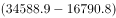亿元；2018年下半年，服务进口额为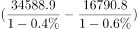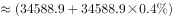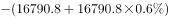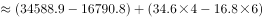，因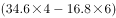，则2018年下半年，服务进口额亿元。即2019年下半年，服务进口额低于上年同期，并非正增长，错误；

B项：根据材料第三段可得“2019年上半年，知识密集型服务进出口额同比增长；电信、计算机和信息服务出口同比增长，进口同比增长”，结合混合增长率结论“居中不正中”，即进出口同比增速应介于进口和出口同比增速之间，则电信、计算机和信息服务进出口额同比增速应大于，小于。再结合两期比重比较结论“若部分量增速（）高于总量增速（），比重上升”，（大于）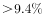，则比重高于上年同期水平，正确；

C项：根据材料第一、三段可得“2019年上半年，服务出口总额9333.7亿元，进口总额16790.8亿元；知识密集型服务出口额4674.1亿元，进口额4249.8亿元”，则2019年上半年，非知识密集型服务进口额为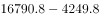亿元，出口额为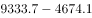亿元，贸易逆差为12600-4600=8000&gt;7000亿元，错误；

D项：根据材料第一、二段可得“2019年上半年，服务出口总额9333.7亿元，进口总额16790.8亿元；2019年全年，服务出口总额19564.0亿元，进口总额34588.9亿元”，则2019年下半年，服务出口额为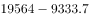亿元，进口额为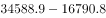亿元。

根据材料第三、四段可得“2019年上半年，知识密集型服务出口总额4674.1亿元，进口总额4249.8亿元；2019年全年，知识密集型服务出口总额9916.8亿元，进口总额8860.9亿元”，则2019年下半年，知识密集型服务出口额为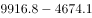亿元，进口额为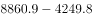亿元。则2019年下半年，知识密集型服务出口额占服务出口额比重为，知识密集型服务进口额占服务进口额比重为，前者应高于后者，错误。

故正确答案为B。

### 给定材料

        2019年上半年，我国服务进出口总额达到26124.6亿元，同比增长。其中，出口总额9333.7亿元，同比增长；进口总额16790.8亿元，同比下降。服务进出口总额占对外贸易总额的比重达到，比2018年全年高出0.5个百分点。

        2019年全年，我国服务进出口总额54152.9亿元，同比增长。其中，出口总额19564.0亿元，同比增长；进口总额34588.9亿元，同比减少。

        2019年上半年，我国知识密集型服务进出口额8923.9亿元，同比增长，其中，知识密集型服务出口额4674.1亿元，同比增长；进口额4249.8亿元，同比增长。从具体领域看，知识产权使用费出口同比增长；电信、计算机和信息服务出口同比增长，进口同比增长；其他商业服务（含技术、专业和管理咨询服务、研发成果转让费及委托研发等）出口同比增长；金融服务出口同比增长，进口同比增长。

        2019年全年，我国知识密集型服务进出口额18777.7亿元，同比增长，其中，知识密集型服务出口额9916.8亿元，同比增长；进口额8860.9亿元，同比增长。从具体领域看，个人文化娱乐服务，电信、计算机和信息服务，金融服务进出口总额分别同比增长、、。

> [!warning] 疑点（官方解析可能有误，待人工复核）
> 官方解析A、B项引用的关键数字（2018年基期进口额、各同比增速）在本文本及解析原文中均空缺缺失：仅凭'上半年进口同比下降、全年进口同比减少'两个定性条件，逻辑上无法唯一推出'2019年下半年进口额低于上年同期'（该结论取决于全年降幅与上半年降幅之差的符号），A项排除依赖原卷增速数值；此属数据口径完整性问题，不影响官方答案B的判定

<!-- CODEX-ANSWER-REVIEW:BEGIN -->
### 本次独立复核

**复核状态：** `resolved`（答案与解析已核定）

**计分答案：** B（可计分）

**复核解析：**

1. 第1步：A项——2019年下半年服务进口额=全年34588.9-上半年16790.8=17798.1亿元；2018年下半年进口额=2018全年进口额-2018上半年进口额（须按原文同比增速反推基期），官方比较结论为2019年下半年进口额低于上年同期、并非正增长，A排除
2. 第2步：B项——电信、计算机和信息服务进出口总额由其出口与进口两部分构成，其同比增速为混合增速，必介于出口增速与进口增速之间（'居中不正中'）
3. 第3步：B项续——该混合增速高于知识密集型服务进出口额的同比增速（部分增速＞总量增速），由两期比重比较结论'部分增速高于总量增速⇒比重上升'，判定2019年上半年该领域占知识密集型服务进出口总额的比重高于上年同期，B正确
4. 第4步：C项——非知识密集型进口=16790.8-4249.8=12541.0亿元，非知识密集型出口=9333.7-4674.1=4659.6亿元，逆差=12541.0-4659.6=7881.4亿元＞7000亿元，C排除
5. 第5步：D项——下半年知识密集型出口额=9916.8-4674.1=5242.7亿元，服务出口额=19564.0-9333.7=10230.3亿元，出口占比≈51%；下半年知识密集型进口额=8860.9-4249.8=4611.1亿元，服务进口额=17798.1亿元，进口占比≈26%；出口占比反而高于进口占比，'低于'说法错误，D排除
6. 第6步：综上四项仅B能从资料中推出，与官方答案一致

**最快解法**：⚡ 综合判断按'先扫可秒杀项'顺序：C项两步作差口算（约12600-4600=8000＞7000）直接排除；D项作差后估算两个比重（≈51% vs ≈26%）直接排除；A项按官方判定'下半年进口低于上年同期'排除；B项无需算数，两句口诀锁定——分子增速为混合增速'居中不正中'＋'部分增速＞总量增速⇒比重上升'，直接选B

**相关信息：**

考点：综合判断题（两期作差＋混合增长率＋两期比重比较＋逆差计算）。来源：2021年国家公务员录用考试《行测》题（地市级网友回忆版）；2021年。> 🧩 当综合判断题出现'下半年/某区间'特征时先用'全年-上半年'作差，出现'比重高于（低于）上年同期'时用'部分增速vs总量增速'两期比重口诀，当部分量由出口+进口构成时其增速用混合增速'居中不正中'界定，先排除可口算项再锁定定性可判的选项

**同类特征**：能够从上述资料中推出的是（综合判断四选一）、下半年（全年-上半年作差）、占…比重高于上年同期水平（两期比重比较）、出口与进口构成、混合增速居中不正中、贸易逆差（进口-出口）、同比下降/同比减少的定性表述

**题源依据：** [固定版本原题](https://github.com/Mentat-Uran/kaogongzhentizhengliu/blob/84ab93d4b64b61d897bece8a1c0a5bab06b4feb2/10-%E7%9C%9F%E9%A2%98/%E8%B5%84%E6%96%99%E5%88%86%E6%9E%90/%E7%BB%BC%E5%90%88/2719414%20%E7%BB%BC%E5%90%88%E5%88%A4%E6%96%AD%E9%A2%98%EF%BC%88%E4%B8%A4%E6%9C%9F%E4%BD%9C%E5%B7%AE%EF%BC%8B%E6%B7%B7%E5%90%88%E5%A2%9E%E9%95%BF%E7%8E%87%EF%BC%8B%E4%B8%A4%E6%9C%9F%E6%AF%94%E9%87%8D%E6%AF%94%E8%BE%83%EF%BC%8B%E9%80%86%E5%B7%AE%E8%AE%A1%E7%AE%97%EF%BC%89.md)；固定内容 commit `84ab93d4b64b61d897bece8a1c0a5bab06b4feb2`，Markdown blob `3d66804870e0826204196a5b4406e31c6113449e`。
<!-- CODEX-ANSWER-REVIEW:END -->
