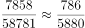
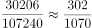
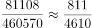
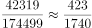
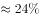
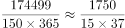
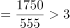
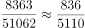
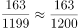

# 综合分析选非题（现期比重+现期平均数+单位换算混合验证）

考点：[[20-考点/资料分析/综合/综合分析选非题（现期比重+现期平均数+单位换算混合验证）|综合 / 综合分析选非题（现期比重+现期平均数+单位换算混合验证）]]
材料：[[15-材料/资料分析/269199 2019年全国四大海区（渤海、黄海、|269199 2019年全国四大海区（渤海、黄海、]]

**问法模型**：题干问'不能从上述资料中推出的是'（选非题）→ 对A~D逐项套用现期比重（部分÷总体）与现期平均数（总量÷排口数÷天数）模型验证，排除能推出的三项，剩余即答案

## 推理链
1. 第1步：提取条件：表2中综合类总磷898吨、总计总磷1199吨；表1中四海区污水量与化学需氧量：渤海58781万吨/7858吨、黄海107240/30206、东海460570/81108、南海174499/42319；南海排口150个；表2中生活类总氮8363吨/总计51062吨、生活类总磷163吨/总计1199吨
2. 第2步：A项用现期比重模型：898÷1199≈74.9%，与选项给定的分界分数对照，'以下'成立，A可推出
3. 第3步：B项用'平均每吨污水的COD=COD÷污水量'模型：渤海7858/58781≈0.134、黄海30206/107240≈0.282、东海81108/460570≈0.176、南海42319/174499≈0.243，黄海最高，B可推出
4. 第4步：C项用现期平均数模型并换算单位：174499万吨=17.4499亿吨，÷150个排口÷365天≈3.19万吨/日≈31900吨/日，远超3000-4000吨区间，C推不出
5. 第5步：D项用现期比重模型：生活类总氮占比8363/51062≈16.4%，生活类总磷占比163/1199≈13.6%，16.4%＞13.6%，前者更高，D可推出
6. 第6步：A、B、D均能推出，仅C不能推出，本题为选非题，故正确答案为C

**最快解法**：⚡ 考场最快解法：直接验证C项（唯一含单位换算与日均口径的选项）——截位直除：174499万吨÷(150×365)≈174499÷54750≈3.19（万吨/日/个），3.19万吨=31900吨，明显不在3000-4000吨之间，秒锁C，其余选项无需细算

## 易错点
- ⚠ 量级换算陷阱：污水量单位是'万吨'，174499÷150÷365≈3.19万吨=31900吨，若不乘10000换算，会把'3.19'误当吨数落入3000-4000区间的错觉，误判C可推出
- ⚠ 日均口径陷阱：'日均'必须再÷365天，漏除天数会得到每排口年排放量约1163万吨，无法与'日均3000-4000吨'正确比对
- ⚠ 选非题方向陷阱：思维定势找'正确'项易误选；B项'平均每吨污水'的分母是污水量（万吨）而非排口数，勿与'平均每排口'模型混用；D项总氮/总磷列相邻（生活类氨氮980易串列），勿取错列

## 母题抽象
> 🧩 当题干出现'不能从资料中推出'的选非综合题时，优先检验含单位换算或额外口径（如日均÷365）的选项作突破口，用现期比重=部分÷总体、现期平均数=总量÷份数逐项验证，唯一不成立的即为答案

**同类特征**：不能从上述资料中推出、选非题、四大海区、平均每吨污水、日均污水排放量、总磷/总氮占比比较

## 相关题
- [[10-真题/资料分析/综合/14355349 综合分析-选非题（增长率计算比较+人均值计算）|14355349]]（浙江 2024，相关度2）
- [[10-真题/资料分析/综合/19283743 综合分析-选非题（平均数增长率+增长量比较+比重临界值验证）|19283743]]（国考 2025，相关度2）
- [[10-真题/资料分析/综合/13504445 综合判断选非题（基期增长量计算+混合增长率比重比较+两期平均数比较+总量构成差）|13504445]]（河北 2025，相关度2）
- [[10-真题/资料分析/综合/16593091 综合判断选非题（基期值+两期平均数比较+比重计算+两期比重变化）|16593091]]（新疆 2024，相关度2）
- [[10-真题/资料分析/综合/4004839 综合分析选非题（倍数计算、基期比重、基期量、增速计数逐项验证）|4004839]]（新疆 2021，相关度2）

---

### 题干
关于2019年直排海污染源状况，不能从上述资料中推出的是：

### 选项
- A. 
由综合类排口排放的总磷占所有排口排放总磷的以下

- B. 
平均每吨排往黄海的污水化学需氧量为四大海区中最高

- C. 
平均每个直排南海的污水排口日均污水排放量在3000-4000吨之间
　✅
- D. 
通过生活类排口排放的总氮量占所有排口总氮排放量的比重，高于通过生活类排口排的总磷量占所有排口总磷排放量的比重 

### 官方解析

A项：根据表2可知，综合类排口排放的总磷为898吨，所有排口排放总磷为1199吨，占比为。正确；

B项：根据表1可知，四大海区平均每吨污水化学需氧量分别为：渤海：；黄海：；东海：；南海：。比较可知，黄海最高。正确；

C项：根据表1可知，2019年，南海排水口有150个，污水排放量为174499万吨，全年共有365天，则平均每个污水排口日均排放量为万吨，并非在3000-4000吨之间。错误；

D项：根据表2可知，通过生活类排口排放的总氮量为8363吨，所有排口总氮排放量为51062吨，占比为；通过生活类排口排放的总磷量为163吨，所有排口总磷排放量为1199吨，占比为，前者高于后者。正确。

本题为选非题，故正确答案为C。

### 给定材料

注：化学需氧量：废水、废水处理厂出水和污水中，能被强氧化剂氧化的物质的氧当量。化学需氧量越高，表示水中有机污染物越多，污染越严重。总氮：水中各种形态无机和有机氮的总量。氨氮：水中以游离氨和铵离子形式存在的氮，是总氮的组成部分之一。

