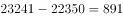
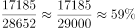
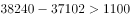
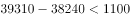
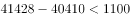
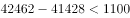
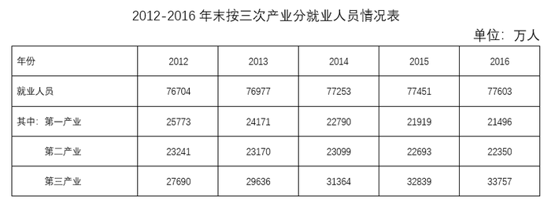

# 综合判断题（逐年增长量比较为主，辅以增减核查与比重临界值判断）

考点：[[20-考点/资料分析/综合/综合判断题（逐年增长量比较为主，辅以增减核查与比重临界值判断）|综合 / 综合判断题（逐年增长量比较为主，辅以增减核查与比重临界值判断）]]
材料：[[15-材料/资料分析/269904 全国就业人员总量与结构（2017年文|269904 全国就业人员总量与结构（2017年文]]

**问法模型**：'能够从上述资料中推出的是'的综合判断题 → 对A/B/C/D四个选项逐项定位验证（递增核查、减少量做差、比重与临界值比较、逐年增量比较），排除三项选出唯一正确项

## 推理链
1. 第1步：A项定位表2'有限责任公司'行，数据为3787/6069/6315/6389/6381/6367万人，2015→2016→2017年依次减少，并非逐年递增，排除
2. 第2步：B项定位表1'第二产业'行，2012年23241万人、2016年22350万人，减少量=23241-22350=891万人，未超过1000万人，排除
3. 第3步：C项由文字段取数：2017年外出农民工17185万人÷农民工总量28652万人≈59.98%，用28652×60%=17191.2>17185验证，比重略低于六成，'占六成以上'不成立，排除
4. 第4步：D项定位表2'城镇就业人员'行37102/38240/39310/40410/41428/42462，逐年做差求增量
5. 第5步：各年增量分别为2013年38240-37102=1138万、2014年1070万、2015年1100万、2016年1018万、2017年1034万
6. 第6步：2013年增量1138万人为五年最大，'增长最多的年份是2013年'成立，D正确

**最快解法**：⚡ 先难后易逐项排除：A项只看表2末三年6389→6381→6367递减即排除；B项口算23241-22350=891<1000排除；C项用特殊值法验证临界值：28652×60%=17191.2>17185，比重≈59.98%不足六成排除；D项逐年做差（1138/1070/1100/1018/1034）取最大即锁定2013年

## 易错点
- ⚠ A项'逐年递增'要求每一年都比上一年多，只看2012年3787到2017年6367的整体上升会误判为正确，实际2016、2017年在下降
- ⚠ C项比重59.98%与临界值60%极其接近，不精确验证（28652×60%=17191.2>17185）容易误判为'六成以上'成立
- ⚠ D项'增长最多'是增量比较而非增速比较，总量最大的2017年（42462万）增量1034万并非最大；且需注意表1只到2016年、表2到2017年，两表时间终点不同，B项用表1、D项用表2，定位不能混淆

## 母题抽象
> 🧩 当题干出现'能够从上述资料中推出的是'时，按'先易后难'逐项核查：'逐年递增/递减'看是否每一期都增（警惕只看首尾），'减少超过X'做差与阈值直接比较，'占…以上'用分母×临界值与分子对照精确判断，'增长最多的年份'逐年做差取最大而非看总量

**同类特征**：能够从上述资料中推出的是、逐年递增、减少超过、占…以上、增长最多的年份、逐项排除定一真

## 相关题
- [[10-真题/资料分析/综合/5430296 综合判断题（比重逐年变化+三年累计加总比较+增速最值定位+占比超20%验证）|5430296]]（浙江 2023，相关度2）
- [[10-真题/资料分析/综合/19283943 综合分析判断题（倍数比较+求和判断+隐含平均每场座位数反推）|19283943]]（国考 2025，相关度1）
- [[10-真题/资料分析/综合/1796162 综合判断（月均计算、平均运输距离、比重对比、增长量比较逐项验证）|1796162]]（贵州 2016，相关度1）
- [[10-真题/资料分析/综合/2133504 综合判断题（现期比重+现期平均数多项验证，一对三错）|2133504]]（国考 2018，相关度1）
- [[10-真题/资料分析/其他/2374811 简单查找比较（表格直接读数比大小）|2374811]]（广东 2019，相关度1）

---

### 题干
能够从上述资料中推出的是：

### 选项
- A. 
2012-2017年，全国有限责任公司城镇就业人员逐年递增

- B. 
2016年，全国第二产业就业人员比2012年减少超过1000万人

- C. 
2017年，外出农民工约占全国农民工总量的以上

- D. 
2013-2017年，全国城镇就业人员数量增长最多的年份是2013年
　✅

### 官方解析

A项：定位表格材料可知，2012年-2017年全国有限责任公司城镇就业人员数量，其中2015年为6389万人，2016年为6381万人，2017年为6367万人，2015-2017年逐年递减，错误；

B项：定位表格材料可知，2016年与2012年全国第二产业就业人员数量分别为22350万人、23241万人，则2016年全国第二产业就业人员比2012年减少万人，未超过1000万人，错误；

C项：定位文字材料可知，2017年全国农民工总量28652万人，其中外出农民工17185万人。则2017年外出农民工约占全国农民工总量的比重为，非以上，错误；

D项：定位表格材料可知，2012年-2017年全国城镇就业人员数量。则各年份城镇就业人员数量增长：2013年，万人；2014年，万人；2015年，万人；2016年，万人；2017年，万人。所以2013年全国城镇就业人员数量增长最多，正确。

故正确答案为D。

### 给定材料

        截止2017年末，全国就业人员77640万人，比上年末增加37万人；其中城镇就业人员42462万人，比上年末增加1034万人。全国就业人员中，第一产业就业人员占；第二产业就业人员占；第三产业就业人员占。2017年全国农民工总量28652万人，比上年增加481万人，其中外出农民工17185万人。

> [!warning] 疑点（官方解析可能有误，待人工复核）
> C项选项中的比重公式为图片未显示具体数值，结合官方解析'非以上，错误'推断该临界值应为六成（60%）；17185/28652≈59.98%确实略低于60%，解析结论无误，仅提示该处依赖图片数据
