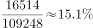
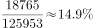
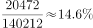
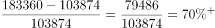

# 综合判断题（比重逐年变化+跨行求差+增幅比较）

考点：[[20-考点/资料分析/综合/综合判断题（比重逐年变化+跨行求差+增幅比较）|综合 / 综合判断题（比重逐年变化+跨行求差+增幅比较）]]
材料：[[15-材料/资料分析/270127 2011—2018年我国部分财政指标|270127 2011—2018年我国部分财政指标]]

**问法模型**：『下列说法正确的有几个』→ 对3个小项分别独立验证：比重趋势找反例、地方收入=国家−中央再换算单位、增幅=增量/基期做截位直除比较

## 推理链
1. 第1步：小项(1)提取两行数据：中央财政支出16514→32708亿元，国家财政支出109248→220904亿元，比重=中央支出/国家支出逐年算
2. 第2步：2013年占比20472/140212≈14.6%，2014年占比22570/151786≈14.9%，2014年不降反升，『逐年降低』被推翻，(1)错误
3. 第3步：小项(2)表中无地方财政收入行，用地方=国家−中央：2011年=103874−51327=52547亿元
4. 第4步：单位换算6万亿元=60000亿元，52547亿元=5.25万亿元<6万亿元，『均超过』不成立，(2)错误
5. 第5步：小项(3)增幅=（现期−基期）/基期：中央财政收入增幅=(85456−51327)/51327=34129/51327≈66.5%
6. 第6步：国家财政收入增幅=(183360−103874)/103874=79486/103874≈76.5%，66.5%<76.5%，(3)正确
7. 第7步：正确的只有(3)共1个，对照选项选C

**最快解法**：⚡ 逐项找反例提速：①比重升降看增速差——2014年中央支出增速22570/20472−1≈10.2%＞国家支出增速151786/140212−1≈8.3%，比重上升，(1)即错，无需算满8年；②『均超过』类只需查最早年份——2011年地方收入103874−51327=52547亿<60000亿，(2)即错；③截位直除比增幅——34129/51327≈0.665＜79486/103874≈0.765，(3)对

## 易错点
- ⚠ 小项(1)只验证2011-2013年在下降就贸然判定成立，必须逐年核验，2014年占比14.6%→14.9%回升即为反例
- ⚠ 小项(2)三重陷阱叠加：表中无『地方财政收入』现成行须国家−中央跨行求差、题干『6万亿元』须换算成60000亿元与表内亿元口径对齐、『均超过』只需一个反例年份即可否定
- ⚠ 小项(3)『增幅』指增长率而非增长量，且中央财政收入（51327→85456）与国家财政收入（103874→183360）两行数据易串行

## 母题抽象
> 🧩 当题干出现『下列说法正确的有几个』综合判断时，逐项独立验证并优先找反例：比重趋势用『分子增速vs分母增速』判断升降、『均超过』类只查一个可疑年份（注意单位换算与国家−中央求差）、增幅比较用增量/基期截位直除

**同类特征**：综合判断题『正确的有几个』、比重逐年降低/升高趋势、地方=国家−中央跨行求差、万亿元与亿元单位换算、增幅（增长率）大小比较、中央与国家同指标两行对照

## 相关题
（暂无）

---

### 题干
根据上表，下列说法正确的有（    ）个。
（1）2011-2018年，中央财政支出占国家财政支出比重逐年降低
（2）2011-2018年，地方财政收入均超过6万亿元
（3）与2011年相比，2018年中央财政收入的增幅小于国家财政收入的增幅

### 选项
- A. 3
- B. 2
- C. 1　✅
- D. 0

### 官方解析

（1）定位统计表，可知2011年-2018年中央及国家财政支出。2011年占比为；2012年占比为；2013年占比为；2014年占比为，不满足逐年降低趋势，错误。

（2）定位统计表，可知2011年-2018年中央及国家财政收入。地方财政收入国家财政收入中央财政收入，2011年地方财政收入为亿元万亿元，不满足均超过，错误。

（3）定位统计表，可知2011年中央及国家财政收入分别为51327亿元、103874亿元；2018年中央及国家财政收入分别为85456亿元、183360亿元。中央财政收入增幅为，国家财政收入增幅为，中央财政收入的增幅小于国家财政收入的增幅，正确。

因此只有（3）表述正确。

故正确答案为C。

### 给定材料

