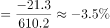
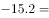
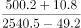
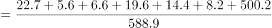
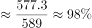

# 综合判断题（正确项为增长量残差拆分，兼考降幅计算、单产两期比较、比重区间）

考点：[[20-考点/资料分析/综合/综合判断题（正确项为增长量残差拆分，兼考降幅计算、单产两期比较、比重区间）|综合 / 综合判断题（正确项为增长量残差拆分，兼考降幅计算、单产两期比较、比重区间）]]
材料：[[15-材料/资料分析/270449 2019年全国棉花产量与种植面积的总|270449 2019年全国棉花产量与种植面积的总]]

**问法模型**：题干为'能够从上述材料中推出的是'→综合判断题，逐项套用对应模型（A降幅、B增长量残差、C单产比较、D比重区间），验证出一项为真即可收卷

## 推理链
1. 第1步：文字段提取面积变化量：全国3339.2千公顷同比减少15.2千公顷、新疆同比增加49.2千公顷、长江流域减少32.4千公顷、黄河流域减少28.1千公顷
2. 第2步：残差规则：全国增长量=新疆+长江+黄河+其他地区增长量之和
3. 第3步：其他地区增长量=-15.2-49.2+32.4+28.1=-3.9千公顷<0，即其余地区同比下降，B项成立
4. 第4步：验A：全国产量降幅=21.3÷(588.9+21.3)=21.3÷610.2≈3.5%，未超过选项所给阈值，A错
5. 第5步：验C：新疆2019单产500.2÷2540.5≈0.197（万吨/千公顷），2018单产=(500.2+10.8)÷(2540.5-49.2)=511.0÷2491.3≈0.205，分子小分母大故2019年单产更低，C错
6. 第6步：验D：前7省区产量合计22.7+5.6+6.6+19.6+14.4+8.2+500.2=577.3万吨，占全国577.3÷588.9≈98.0%，不在选项所给区间内，D错
7. 第7步：仅B项可由材料推出，故选B

**最快解法**：⚡ 残差法（增长量拆分）：其他地区变化量=全国(−15.2)−新疆(+49.2)−长江(−32.4)−黄河(−28.1)=−3.9千公顷，符号为负即同比下降，直接锁定B；A/C/D分别用'降幅21.3÷610.2≈3.5%很小''分子小分母大单产必降''合计577.3÷588.9≈98%'口算排除

## 易错点
- ⚠ 残差符号方向：新疆是'增加49.2'为正、两流域'减少'为负，移项时'减负得正'（+32.4、+28.1），符号一错就得不到-3.9千公顷
- ⚠ A项基期陷阱：降幅必须以基期产量610.2万吨（588.9+21.3）为分母得≈3.5%，若误用现期588.9作分母得≈3.6%，可能误判A为正确
- ⚠ C项量级陷阱：万吨÷千公顷直接相除即可同口径比较（0.197 vs 0.205），换算吨/公顷时注意比值需×10；D项须将7省产量逐一相加（含新疆500.2）得577.3万吨，勿漏新疆或误认比重落入选项低区间

## 母题抽象
> 🧩 当题干为'能够推出的是'且选项涉及未直接给出的某区域/部分的变化量时，用'整体变化量=各部分变化量之和'反解残差，残差正负号即定性结论；其余选项按降幅、单产、比重各自模型快速排除

**同类特征**：能够从上述材料中推出的是（综合判断问法）、除……外其余地区同比变化（残差拆分特征）、同比下降/增长的定性判断、降幅超过某阈值（增长率计算）、单产高于上年（平均数两期比较）、产量占全国总产量的……之间（比重区间）

## 相关题
（暂无）

---

### 题干
能够从上述材料中推出的是：

### 选项
- A. 
2019年全国棉花产量降幅超过

- B. 
2019年除新疆、长江流域和黄河流域外，其余地区棉花种植面积同比下降
　✅
- C. 
2019年新疆棉花单产高于2018年水平

- D. 
2019年棉花种植面积排名前7的省区，棉花产量占全国总产量的-之间

### 官方解析

A项：定位文字材料可得：2019年，全国棉花产量588.9万吨，比上年减少21.3万吨。故2019年全国棉花产量增长率，降幅为，小于，错误；

B项：定位文字材料可得：2019年，全国棉花种植面积比上年减少15.2千公顷；新疆的棉花种植面积比上年增加49.2千公顷，长江流域比上年减少32.4千公顷，黄河流域比上年减少28.1千公顷。根据“全国增长量新疆增长量长江流域增长量黄河流域增长量其他地区增长量”可得：其他地区增长量，解得其他地区增长量为-3.9千公顷，即棉花种植面积同比下降，正确；

C项：定位文字材料可得：2019年，新疆棉花产量500.2万吨，比上年减少10.8万吨；新疆的棉花种植面积比上年增加49.2千公顷。定位表格材料可得：2019年，新疆棉花种植面积2540.5千公顷。单产即单位面积产量，2019年为，2018年为，前者分子小且分母大，故2019年2018年，即单产低于2018年水平，错误；

D项：定位文字材料可得：2019年，全国棉花产量588.9万吨。定位表格材料可得：2019年棉花种植面积排名前7的省区的棉花产量。故所求比重，并非-之间，错误。

故正确答案为B。

### 给定材料

        2019年，全国棉花产量588.9万吨，比上年减少21.3万吨。其中，新疆棉花产量500.2万吨，比上年减少10.8万吨；全国棉花种植面积为3339.2千公顷，比上年减少15.2千公顷。新疆的棉花种植面积比上年增加49.2千公顷。长江流域棉花种植面积比上年减少32.4千公顷，同比下降。黄河流域棉花种植面积比上年减少28.1千公顷，同比下降。

