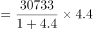
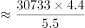
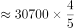
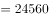
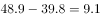
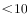

# 综合判断题（核心验证点：'比基期增长n倍'求增长量，辅以数据可得性排查）

考点：[[20-考点/资料分析/综合/综合判断题（核心验证点：'比基期增长n倍'求增长量，辅以数据可得性排查）|综合 / 综合判断题（核心验证点：'比基期增长n倍'求增长量，辅以数据可得性排查）]]
材料：[[15-材料/资料分析/270494 党的十八大以来我国居民收入与消费状况|270494 党的十八大以来我国居民收入与消费状况]]

**问法模型**：'能够从上述资料中推出的是'的综合判断问法→逐项排查：能算的项用模型验证数值，材料缺口径/缺年份数据的项直接排除，核心模型为'比基期增长n倍'时增长量=现期−现期/(1+n)

## 推理链
1. 第1步：A项取数第二段：2019年全国人均消费支出21559元，材料仅给出比2012年的增幅（空缺值），未给2019年同比增速或增长量，无法倒推2018年支出，A排除
2. 第2步：B项取数第三段：材料只给2019年与2000年的恩格尔系数比较（全国降14.0、城镇降11.0、农村降18.3个百分点），没有2018年任何数据，无法比较2018年城乡降幅，B排除
3. 第3步：C项取数第二段：2019年全国人均可支配收入30733元，比2000年增长4.4倍，即2019=2000×(1+4.4)=2000×5.4
4. 第4步：套公式增长量=现期−现期/(1+n)：2000年=30733÷5.4≈5691元，增长量=30733−5691≈25042元（等价于30733×4.4/5.4）
5. 第5步：25042元>24000元，'增加24000元以上'成立，C正确
6. 第6步：D项取数第四段：农村人均住房48.9−城镇39.8=9.1平方米，未超过10平方米，D排除

**最快解法**：⚡ 公式法+截位直除：'增长4.4倍'⇒基期=30733÷5.4≈5700（截位直除），增量≈30733−5700≈25033>24000，C成立；其余三项用'缺数据排除法'A、B缺2018年数据秒排，D直减48.9−39.8=9.1<10秒排

## 易错点
- ⚠ '增长4.4倍'≠'是4.4倍'：若误把2019当2000的4.4倍，则基期=30733÷4.4≈6985元，增量≈23748元<24000元，会误判C错误——这是本题最大陷阱
- ⚠ A项时间口径陷阱：材料给的增幅基准是2012年（且为空缺），不是2018年；倒推2018年需要2019年同比增速，材料未提供，不能拿年均增速或2012年增幅冒用
- ⚠ B项主体/年份偷换：材料只给'2019比2000'的降幅（11.0对18.3个百分点），极易被误读为2018年城乡降幅比较而错选；D项48.9−39.8=9.1接近10，粗心直除或凑整易误判'超过10平方米'

## 母题抽象
> 🧩 当综合判断题出现'现期比基期增长n倍'时，增长量=现期×n/(1+n)（勿忘分母加1），先粗算核心项定答案，其余选项用'材料是否提供所需年份/口径数据'快速排除

**同类特征**：能够从上述资料中推出的是、增长4.4倍、人均可支配收入30733元、2018年（材料未给的年份）、恩格尔系数降幅、人均住房建筑面积城乡之差

## 相关题
- [[10-真题/资料分析/综合/19283943 综合分析判断题（倍数比较+求和判断+隐含平均每场座位数反推）|19283943]]（国考 2025，相关度1）
- [[10-真题/资料分析/综合/1796162 综合判断（月均计算、平均运输距离、比重对比、增长量比较逐项验证）|1796162]]（贵州 2016，相关度1）
- [[10-真题/资料分析/综合/2133504 综合判断题（现期比重+现期平均数多项验证，一对三错）|2133504]]（国考 2018，相关度1）
- [[10-真题/资料分析/综合/2444706 综合判断题（增长量+比重+倍数逐项验证）|2444706]]（四川 2019，相关度1）
- [[10-真题/资料分析/综合/2571728 综合分析逐项判断（等差递推求和＋单位换算＋比值估算）|2571728]]（山东 2020，相关度1）

---

### 题干
能够从上述资料中推出的是：

### 选项
- A. 2018年全国居民人均消费支出超过21000元
- B. 2018年全国城镇居民恩格尔系数降幅大于农村居民
- C. 2019年全国居民人均可支配收入比2000年增加24000元以上　✅
- D. 2019年全国农村居民人均住房建筑面积比城镇居民多10平方米以上

### 官方解析

A项：定位文字材料第二段可得，2019年，全国居民人均消费支出21559元，比2012年增长，年均增长。材料并未给出2019年全国居民人均消费支出的同比增长率或增长量，无法计算出2018年全国居民人均消费支出，错误；

B项：定位文字材料第三段可得，2019年与2000年恩格尔系数的变化关系，材料并未给出2019年与2018年恩格尔系数的变化关系，故数据不足，无法推出，错误；

C项：定位文字材料第二段可得，2019年，全国居民人均可支配收入30733元，比2000年增长4.4倍。根据公式：增长量元元，正确；

D项：定位文字材料第四段可得，2019年，城镇居民人均住房建筑面积为39.8平方米，农村居民人均住房建筑面积为48.9平方米。则2019年全国农村居民人均住房建筑面积比城镇居民多平方米平方米，错误。

故正确答案为C。

### 给定材料

        党的十八大以来，我国居民收入水平持续较快增长，消费水平稳步提高，消费结构优化升级，生活质量明显提升，人民生活正阔步迈向全面小康。

        2019年，全国居民人均可支配收入30733元，比2000年增长4.4倍。全国居民人均消费支出21559元，比2012年增长，年均增长。其中，城镇居民人均消费支出28063元，比2012年增长；农村居民人均消费支出13328元，比2012年增长。

        2019年全国居民恩格尔系数（人均食品支出占人均消费支出的比重）为，比2000年下降14.0个百分点。其中，城镇居民恩格尔系数为，农村居民恩格尔系数为，分别比2000年下降11.0和18.3个百分点。

        2019年，全国居民平均每百户拥有彩色电视机120.6台、洗衣机96.0台、电冰箱100.9台、空调115.6台、汽车35.3辆。城镇居民人均住房建筑面积为39.8平方米，比2002年增长；农村居民人均住房建筑面积为48.9平方米，比2000年增长。全国居民人均交通通信支出2862元，比2000年年均增长，占人均消费支出的比重较2000年提高6.1个百分点。全国居民人均医疗保健支出1902元，比2000年年均增长，占人均消费支出的比重较2000年提高2.9个百分点。

