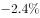
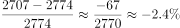
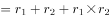
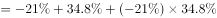
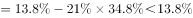
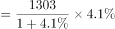
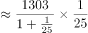
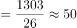
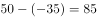

# 综合分析正误判断（现期增长率计算＋间隔增长率＋两期比重升降＋增长量带符号作差）

考点：[[20-考点/资料分析/综合/综合分析正误判断（现期增长率计算＋间隔增长率＋两期比重升降＋增长量带符号作差）|综合 / 综合分析正误判断（现期增长率计算＋间隔增长率＋两期比重升降＋增长量带符号作差）]]
材料：[[15-材料/资料分析/270495 2013-2019年全球卫星产业收入|270495 2013-2019年全球卫星产业收入]]

**问法模型**：'关于2019年……能够从上述资料中推出的是'→对A~D逐项套用对应模型验证：A用增长率=（现期−基期）/基期直除，B用间隔增长率r=r1+r2+r1×r2，C用'部分增速与总量增速比大小定比重升降'，D用增长量带符号作差，排除三项锁定答案。

## 推理链

**最快解法**：⚡ 

## 易错点

## 母题抽象
> 🧩 

**同类特征**：

## 相关题
（暂无）

---

### 题干
关于2019年全球卫星产业，能够从上述资料中推出的是：

### 选项
- A. 
卫星产业收入增速为
　✅
- B. 
卫星发射服务业收入比2017年提高13.8个百分点

- C. 
卫星产业收入占全球太空经济的比重同比上升3.0个百分点

- D. 
卫星通信服务业收入的同比增加额与地面设备制造业相差16亿美元

### 官方解析

A项：根据本篇材料第4题的计算结果，2019年全球卫星产业收入增速为，正确；

B项：定位图形材料可得：2018年卫星发射服务业收入增速为，2019年增速为。则所求间隔增长率，即2019年比2017年提高不到，错误；

C项：根据本篇材料第4题的计算结果，2019年全球卫星产业收入增速为；定位文字材料可得：2019年全球太空经济规模较2018年增长。根据两期比重比较结论，部分量增长率（）小于总量增长率（），2019年比重下降，并非同比上升，错误；

D项：定位文字材料可得：2019年，卫星通信服务业较上年减少35亿美元；地面设备制造业的收入为1303亿美元，较上年增长。则地面设备制造业收入的同比增长量亿美元，两者相差亿美元，并非16亿美元，错误。

故正确答案为A。

### 给定材料

        2019年全球太空经济规模增至3660亿美元，较2018年增长，其中全球卫星产业收入为2707亿美元。在全球卫星产业收入中，卫星制造业的收入为125亿美元，较上年减少70亿美元；卫星发射服务业的收入为49亿美元，较上年下降；卫星通信服务业的收入为1230亿美元，较上年减少35亿美元；地面设备制造业的收入为1303亿美元，较上年增长。

