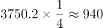
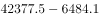
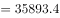
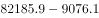
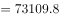
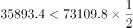

# 综合判断（基期值减法反推＋倍数比较，逐项排除）

考点：[[20-考点/资料分析/综合/综合判断（基期值减法反推＋倍数比较，逐项排除）|综合 / 综合判断（基期值减法反推＋倍数比较，逐项排除）]]
材料：[[15-材料/资料分析/270497 2019年江苏省保险业运行情况（保费|270497 2019年江苏省保险业运行情况（保费]]

**问法模型**：『能够从上述资料中推出的是』→四选一综合判断：对含『2018年末』的选项用『基期值=现期值−增加额』减法反推再作×2倍数比较，对缺更早基期数据的增速项和与材料方向矛盾的结论项直接排除。

## 推理链
1. 第1步：D项取数——表格中2019年末短期贷款余额42377.5亿元、比上年末增加6484.1亿元；中长期贷款余额82185.9亿元、比上年末增加9076.1亿元
2. 第2步：公式——基期值=现期值−增加额（2018年末余额=2019年末余额−比上年末增加额）
3. 第3步：代入——2018年末短期贷款=42377.5−6484.1=35893.4亿元，中长期贷款=82185.9−9076.1=73109.8亿元
4. 第4步：倍数比较——35893.4×2=71786.8<73109.8（即35893.4÷73109.8≈49.1%），2018年末短期贷款余额确实不到中长期贷款的一半，D项成立
5. 第5步：排除A项——表格仅给2019年末余额与对2018年的增加额，最多反推2018年末值，无2017年末数据，『2018年消费贷款增速』（需以2017年末为基数）无法推出
6. 第6步：排除B项——按原文各险种收入增速比较，2019年收入同比增幅最大的是健康险，而非寿险
7. 第7步：排除C项——保费总收入3750.2亿元的四分之一为937.55亿元，保险赔付998.6>937.55（口算998.6×4=3994.4>3750.2），赔付总额超过保费收入的四分之一
8. 第8步：四个选项中仅D项可从资料推出，故选D

**最快解法**：⚡ 减法反推＋倍数口算：D项做两次减法42377.5−6484.1≈35893、82185.9−9076.1≈73110，再口算35893×2=71786<73110即『不到一半』成立；其余快速排除——C项口算998.6×4≈3994>3750（赔付超四分之一），A项因缺2017年末数据增速不可求，B项按原文为健康险增幅最大。

## 易错点
- ⚠ 增量/增速混淆+时间口径错位：表格第2列『比上年末增加』是增量，A项若用6117.2÷(39396.2−6117.2)与4531.0÷(33056.1−4531.0)比较，算出的是2019年增速而非题目问的『2018年增速』（后者需2017年末基数），切勿误判A可选
- ⚠ D项反推方向：须用『现期−增量』（42377.5−6484.1）做减法，勿把增加额当增速做除法（除法模型现期÷(1+增速)在此无增速可用）
- ⚠ C项粗估陷阱：998.6÷3750.2≈26.6%仅略高于25%，需精确算出3750.2÷4=937.55再比较（或998.6×4=3994.4>3750.2），放缩过粗易误判『不到四分之一』；且『保费收入』与『保险赔付』是两套独立指标，不可取混

## 母题抽象
> 🧩 当题干出现『能够从上述资料中推出的是』且选项含『2018年（末）…』表述时，优先用『基期=现期−增量』减法反推并配合×2/×4倍数口算验证倍数类结论；若选项所需增速对应更早一期（如2018年增速）而材料只有现期值与一期增量，该增速类选项必然不可推出，直接排除。

**同类特征**：能够从上述资料中推出的是、比上年末增加（增量列非增速）、2018年末余额反推、不到…的一半、不到…的四分之一、同比增幅最大的险种

## 相关题
- [[10-真题/资料分析/综合/19283943 综合分析判断题（倍数比较+求和判断+隐含平均每场座位数反推）|19283943]]（国考 2025，相关度1）
- [[10-真题/资料分析/综合/1796162 综合判断（月均计算、平均运输距离、比重对比、增长量比较逐项验证）|1796162]]（贵州 2016，相关度1）
- [[10-真题/资料分析/综合/2133504 综合判断题（现期比重+现期平均数多项验证，一对三错）|2133504]]（国考 2018，相关度1）
- [[10-真题/资料分析/综合/2444706 综合判断题（增长量+比重+倍数逐项验证）|2444706]]（四川 2019，相关度1）
- [[10-真题/资料分析/综合/2571728 综合分析逐项判断（等差递推求和＋单位换算＋比值估算）|2571728]]（山东 2020，相关度1）

---

### 题干
能够从上述资料中推出的是：

### 选项
- A. 2018年江苏省消费贷款增速大于住房贷款
- B. 2019年江苏省收入同比增幅最大的险种是寿险
- C. 2019年江苏省保险赔付总额不到保费总收入的四分之一
- D. 2018年末江苏省短期贷款余额不到中长期贷款余额的一半　✅

### 官方解析

A项：定位表格材料，已知2019年的绝对值和比上年末增加的数据，可推出2018年的量，但无法推出2017年的数据，因此无法推出2018年对应增速，错误。

B项：定位文字材料可知：（2019年）全年保费收入3750.2亿元，比上年增长。其中，财产险收入940.9亿元，增长；寿险收入2215.3亿元，增长；健康险收入508.8亿元，增长；意外伤害险收入85.2亿元，增长。比较可知，2019年收入同比增幅最大的险种是健康险，错误。

C项：定位文字材料可知：（2019）全年保费收入3750.2亿元，比上年增长。······全年保险赔付998.6亿元，比上年增长。亿元，998.6亿元940亿元，即保险赔付总额超过保费总收入的四分之一，错误。

D项：定位表格材料可知：2019年末江苏省短期贷款余额为42377.5亿元，比上年末增加6484.1亿元；2019年末江苏省中长期贷款余额为82185.9亿元，比上年末增加9076.1亿元。2018年末江苏省短期贷款余额为亿元，中长期贷款余额为亿元，，即2018年末江苏省短期贷款余额不到中长期贷款余额的一半，正确。

故正确答案为D。

### 给定材料

        2019年江苏省金融信贷规模扩大，保险行业发展较快。全年保费收入3750.2亿元，比上年增长。其中，财产险收入940.9亿元，增长；寿险收入2215.3亿元，增长；健康险收入508.8亿元，增长；意外伤害险收入85.2亿元，增长。全年保险赔付998.6亿元，比上年增长。其中，财产险赔付534.5亿元，增长；寿险赔付294.3亿元，下降，健康险赔付144.8亿元，增长；意外伤害险赔付25.0亿元，增长。年末金融机构人民币存贷款情况见下表。

> [!warning] 疑点（官方解析可能有误，待人工复核）
> 官方解析B项结论『健康险增幅最大』依赖文字段各险种增速数值，而本档案文字材料中增速百分比空缺（仅见方向），B项无法从所给文本直接复现验证；C项解析文字存在乱码（其本意应为3750.2÷4=937.55、998.6>937.55）。以上为文本传输缺口，不影响正确答案D的判定。

<!-- CODEX-ANSWER-REVIEW:BEGIN -->
### 本次独立复核

**复核状态：** `resolved`（答案与解析已核定）

**计分答案：** D（可计分）

**复核解析：**

1. 第1步：D项取数——表格中2019年末短期贷款余额42377.5亿元、比上年末增加6484.1亿元；中长期贷款余额82185.9亿元、比上年末增加9076.1亿元
2. 第2步：公式——基期值=现期值−增加额（2018年末余额=2019年末余额−比上年末增加额）
3. 第3步：代入——2018年末短期贷款=42377.5−6484.1=35893.4亿元，中长期贷款=82185.9−9076.1=73109.8亿元
4. 第4步：倍数比较——35893.4×2=71786.8<73109.8（即35893.4÷73109.8≈49.1%），2018年末短期贷款余额确实不到中长期贷款的一半，D项成立
5. 第5步：排除A项——表格仅给2019年末余额与对2018年的增加额，最多反推2018年末值，无2017年末数据，『2018年消费贷款增速』（需以2017年末为基数）无法推出
6. 第6步：排除B项——按原文各险种收入增速比较，2019年收入同比增幅最大的是健康险，而非寿险
7. 第7步：排除C项——保费总收入3750.2亿元的四分之一为937.55亿元，保险赔付998.6>937.55（口算998.6×4=3994.4>3750.2），赔付总额超过保费收入的四分之一
8. 第8步：四个选项中仅D项可从资料推出，故选D

**最快解法**：⚡ 减法反推＋倍数口算：D项做两次减法42377.5−6484.1≈35893、82185.9−9076.1≈73110，再口算35893×2=71786<73110即『不到一半』成立；其余快速排除——C项口算998.6×4≈3994>3750（赔付超四分之一），A项因缺2017年末数据增速不可求，B项按原文为健康险增幅最大。

**相关信息：**

考點：综合判断（基期值减法反推＋倍数比较，逐项排除）。來源：2021年江苏省公务员录用考试《行测》题（B类）（网友回忆版）；2021年。> 🧩 当题干出现『能够从上述资料中推出的是』且选项含『2018年（末）…』表述时，优先用『基期=现期−增量』减法反推并配合×2/×4倍数口算验证倍数类结论；若选项所需增速对应更早一期（如2018年增速）而材料只有现期值与一期增量，该增速类选项必然不可推出，直接排除。

**同类特征**：能够从上述资料中推出的是、比上年末增加（增量列非增速）、2018年末余额反推、不到…的一半、不到…的四分之一、同比增幅最大的险种

**题源依据：** [固定版本原题](https://github.com/Mentat-Uran/kaogongzhentizhengliu/blob/84ab93d4b64b61d897bece8a1c0a5bab06b4feb2/10-%E7%9C%9F%E9%A2%98/%E8%B5%84%E6%96%99%E5%88%86%E6%9E%90/%E7%BB%BC%E5%90%88/2742056%20%E7%BB%BC%E5%90%88%E5%88%A4%E6%96%AD%EF%BC%88%E5%9F%BA%E6%9C%9F%E5%80%BC%E5%87%8F%E6%B3%95%E5%8F%8D%E6%8E%A8%EF%BC%8B%E5%80%8D%E6%95%B0%E6%AF%94%E8%BE%83%EF%BC%8C%E9%80%90%E9%A1%B9%E6%8E%92%E9%99%A4%EF%BC%89.md)；固定内容 commit `84ab93d4b64b61d897bece8a1c0a5bab06b4feb2`，Markdown blob `1d9be6f9e25061f973287bf5ee8ba095eefcd953`。
<!-- CODEX-ANSWER-REVIEW:END -->
