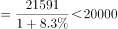
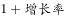

# 综合分析题（基期量计算＋基期占比比较＋增速计数比较＋比重趋势读图）

考点：[[20-考点/资料分析/综合/综合分析题（基期量计算＋基期占比比较＋增速计数比较＋比重趋势读图）|综合 / 综合分析题（基期量计算＋基期占比比较＋增速计数比较＋比重趋势读图）]]
材料：[[15-材料/资料分析/270515 2019年我国海洋经济统计：一张表给|270515 2019年我国海洋经济统计：一张表给]]

**问法模型**：'能够从上述资料中推出的是'四选一综合判断 → 逐项套模型验证：A基期量=现期/(1+增速)、B基期量大者占比大、C增速与总体增速7.5%逐行比大小数个数、D读图判比重升降趋势

## 推理链
1. 第1步：A项从表中提取海洋科研教育管理服务业2019年产值为21591亿元、增速8.3%，代入基期量公式得2018年产值=21591/1.083≈19936亿元<20000亿元，'超过20000亿元'不成立，A错误
2. 第2步：B项2019年主要海洋产业中滨海旅游业18086亿元远超其他行业（次大海洋交通运输业仅6427亿元），反推2018年基期18086/1.093≈16548亿元仍为最大，主要海洋产业总量35724亿元固定时部分量大者占比大，故2018年占比最大的是滨海旅游业而非海洋渔业，B错误
3. 第3步：C项以主要海洋产业总体增速7.5%为比较基准，逐行核对12个细分行业增速：海洋生物医药业8.0%、海洋船舶工业11.3%、滨海旅游业9.3%三个高于7.5%（海洋化工业7.3%、海洋电力业7.2%、海水利用业7.4%均低于7.5%），恰好3个，C正确
4. 第4步：D项读分组柱状图，2016—2019年海洋第二产业占海洋生产总值比重依次为39.7%、37.7%、36.5%、35.8%，逐年下降、无任何回升，并非'有升有降'，D错误
5. 第5步：综上四项中仅C能从资料推出，与官方答案C一致

**最快解法**：⚡ 综合分析题优先做'零计算'选项：C项直接将12个行业增速与7.5%比大小数个数（8.0/11.3/9.3三个达标）；D项直接读图看39.7→37.7→36.5→35.8单调下降即排除；A项用放缩直除验证：1.083×20000=21660>21591，故基期值<20000秒排；B项18086对6427碾压性大、且增速仅9.3%不影响地位，直接锁定滨海旅游业排除。全程约40秒。

## 易错点
- ⚠ 比重≠增速：图中35.8%等是占海洋生产总值的比重而非增速，D项必须用图判趋势，误把表格增速当比重或反之会错判D项
- ⚠ C项比较基准易错：应与主要海洋产业总体增速7.5%比，若误用海洋生产总值增速6.2%会数出6个（7.3/8.0/7.2/7.4/11.3/9.3），若误用海洋产业增速7.8%虽同为3个但口径错
- ⚠ A项数值逼近临界：19936与20000仅差64亿元，粗算或四舍五入易误判为'超过'，须用放缩法精确判断
- ⚠ B项问的是2018年占比，严格说应比基期量而非2019年现期值，且注意海洋渔业4715并非主要海洋产业中最大，勿被'渔业'惯性思维带偏

## 母题抽象
> 🧩 当题干出现'能够从上述资料中推出的是/说法正确的是'且四个选项分属基期量、占比、增速计数、比重趋势时，先做读图/数数的零计算选项锁定候选，再用'分母×临界值与现期比大小'的放缩直除快速排除基期量选项，最后对剩余项用基期量排序或趋势读图复核，逐一给出错误理由。

**同类特征**：能够从上述资料中推出的是、四选一综合判断、基期量=现期/(1+r)、增速高于总体增速的产业有几个、比重有升有降（趋势判断）、跨表图联动验证

## 相关题
- [[10-真题/资料分析/综合/1746812 综合判断题（逐项验证：比重计算、双指标排序比较、同比方向判断）|1746812]]（国考 2016，相关度2）
- [[10-真题/资料分析/综合/10942304 综合判断（增长量计算+单位换算；两期比重比较；下降速度比较）|10942304]]（山东 2024，相关度2）
- [[10-真题/资料分析/综合/12536418 综合判断题（基期量计算+增长量计算+差额变化比较+两期比重比较混合考查）|12536418]]（四川 2024，相关度2）
- [[10-真题/资料分析/综合/15833800 综合判断（年均平均数+同比增量递增+最值查找+增长率多模型混合验证）|15833800]]（贵州 2026，相关度2）
- [[10-真题/资料分析/综合/2187843 综合判断题（混合增长率居中原理+现期比重+总量减部分差值）|2187843]]（山东 2018，相关度2）

---

### 题干
能够从上述资料中推出的是：

### 选项
- A. 
2018年，我国海洋科研教育管理服务业产值超过20000亿元

- B. 
在我国主要海洋产业中，2018年产值占比最大的是海洋渔业

- C. 
在我国主要海洋产业中，2019年产值增速高于的产业有3个
　✅
- D. 
2016—2019年，我国海洋第二产业增加值占海洋生产总值的比重有升有降

### 官方解析

A项：定位表格材料，根据公式“基期量”，则2018年我国海洋科研教育管理服务业产值亿元，错误；

B项：定位表格材料，根据公式“基期量”，在我国主要海洋产业中，2019年滨海旅游业产值（18086亿元）远大于其他产业，（）部分差距不大，故2018年滨海旅游业产值最大。因我国主要海洋产业总产值一定，如果部分量大，占比则大，故2018年产值占比最大的是滨海旅游业，错误；

C项：定位表格材料，在我国主要海洋产业中，产值增速高于的产业有海洋生物医药业（）、海洋船舶工业（）、滨海旅游业（），共计3个，正确；

D项：定位图形材料，2016—2019年，我国海洋第二产业增加值占海洋生产总值的比重逐年降低，并非有升有降，错误；

故正确答案为C。

### 给定材料

> [!warning] 疑点（官方解析可能有误，待人工复核）
> C项中的公式为图片（img latex串）无法直读数值，依官方解析列出海洋生物医药业(8.0%)、海洋船舶工业(11.3%)、滨海旅游业(9.3%)共3个反推，该公式应为'主要海洋产业总体增速7.5%'；此为材料呈现问题而非解析错误，且即使按海洋产业增速7.8%作基准结论同为3个，不影响答案C。

<!-- CODEX-ANSWER-REVIEW:BEGIN -->
### 本次独立复核

**复核状态：** `confirmed`（独立复算确认答案）

**计分答案：** C（可计分）

**复核解析：**

以2019年增速阈值7.5%比较，超过者为海洋生物医药8.0%、海洋船舶工业11.3%、滨海旅游9.3%，共3个，C成立。2018科研教育管理服务业反推约19936亿元未超过2万；海洋渔业非最大份额；第二产业占比2016—2019逐年下降，并非有升有降。

**相关信息：**

独立复核：按题干定义逐项检验，关键基数、比值、增速与图表读数写明以便复算。

**题源依据：** [固定版本原题](https://github.com/Mentat-Uran/kaogongzhentizhengliu/blob/84ab93d4b64b61d897bece8a1c0a5bab06b4feb2/10-%E7%9C%9F%E9%A2%98/%E8%B5%84%E6%96%99%E5%88%86%E6%9E%90/%E7%BB%BC%E5%90%88/2742218%20%E7%BB%BC%E5%90%88%E5%88%86%E6%9E%90%E9%A2%98%EF%BC%88%E5%9F%BA%E6%9C%9F%E9%87%8F%E8%AE%A1%E7%AE%97%EF%BC%8B%E5%9F%BA%E6%9C%9F%E5%8D%A0%E6%AF%94%E6%AF%94%E8%BE%83%EF%BC%8B%E5%A2%9E%E9%80%9F%E8%AE%A1%E6%95%B0%E6%AF%94%E8%BE%83%EF%BC%8B%E6%AF%94%E9%87%8D%E8%B6%8B%E5%8A%BF%E8%AF%BB%E5%9B%BE%EF%BC%89.md)；固定内容 commit `84ab93d4b64b61d897bece8a1c0a5bab06b4feb2`，Markdown blob `b7cac2d568793a4931d731e7b53a5e3f14e53d9b`。
<!-- CODEX-ANSWER-REVIEW:END -->
