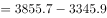
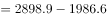
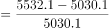
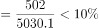
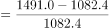
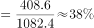
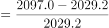
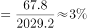
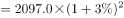

# 综合判断题（同比增量比较、增长率临界判断、两地合计验证、保持增速的现期预测）

考点：[[20-考点/资料分析/综合/综合判断题（同比增量比较、增长率临界判断、两地合计验证、保持增速的现期预测）|综合 / 综合判断题（同比增量比较、增长率临界判断、两地合计验证、保持增速的现期预测）]]
材料：[[15-材料/资料分析/270538 2011～2018年全国7个地区（华|270538 2011～2018年全国7个地区（华]]

**问法模型**：『能够从上述资料中推出的是』→ 四个选项分别套用对应增长模型逐项排除：增量比较（相邻两年累计值作差）、增速与'一成'（10%）临界比较、两行加总与阈值逐年验证'首次'、按2018年增速外推2年（乘(1+r)²）后比较大小。

## 推理链
1. 第1步：A项从表中取2014年华北3855.7、2013年3345.9，同比增量=3855.7-3345.9=509.8万千瓦；再取西北2014年2898.9、2013年1986.6，同比增量=912.3万千瓦，西北＞华北，A错误。
2. 第2步：B项取2017年华北5532.1、2016年5030.1，增速=(5532.1-5030.1)/5030.1=502/5030.1≈9.98%，因5030.1×10%=503.01＞502，增速不足一成，B错误。
3. 第3步：C项取2015年末华中558.8、华南427.3，合计=986.1万千瓦＜1000万千瓦（2016年末才达765.4+532.4=1297.8），'首次超过'应为2016年而非2015年，C错误。
4. 第4步：D项先算华中2018年增速=(1491.0-1082.4)/1082.4=408.6/1082.4≈37.8%，保持该增速至2020年（间隔2年）：1491.0×1.378²≈2830万千瓦（官方口径约2850）。
5. 第5步：再算东北2018年增速=(2097.0-2029.2)/2029.2=67.8/2029.2≈3.3%，因(1+3.3%)²≈1.068＜1.1，故2020年东北＜2100×1.1=2310万千瓦。
6. 第6步：2020年东北上限2310＜华中约2830（2850），华中将高于东北，D正确，故选D。

**最快解法**：⚡ 截位直除+放缩法，且优先做D项：华中r≈408.6/1082.4≈38%（截位直除），2020年=1491×1.38²≈1491×1.9≈2830；东北r≈67.8/2029.2≈3.3%＜10%，两年复利(1+r)²≈1.07＜1.1，2020年东北＜2100×1.1=2310＜2830，直接锁定D；其余选项各一步口算排除——A：西北增量912.3＞华北509.8；B：502/5030.1＜10%；C：558.8+427.3=986.1＜1000。

## 易错点
- ⚠ D项预测年份差：2018年末到2020年末间隔2年，须乘(1+r)²（华中约放大1.9倍），只乘一次增速会严重低估华中2020年值
- ⚠ B项临界陷阱：502/5030.1≈9.98%与10%仅差约0.02个百分点，须用5030.1×10%=503.01与502精细比较，极易误判为'超过一成'
- ⚠ A项口径陷阱：同比增量=本年累计值-上年累计值（存量作差），勿直接拿2014年累计值比大小；且须扫全部7行找最大（西北912.3），易只盯体量最大的华北

## 母题抽象
> 🧩 当题干出现'能够从上述资料中推出的是'且选项混合'同比增量最大''增速超一成''合计首次超过某值''保持增速推两年后谁大'时，用排除法逐项套增长模型：增量=现期-基期、增速=增长量/基期并与10%临界比、加总逐年验证'首次'、预测值=现期×(1+r)^n后放缩比较。

**同类特征**：能够从上述资料中推出的是、同比增量最大、同比增长一成以上、首次超过、如保持…同比增速、年末累计装机容量（存量口径）

## 相关题
- [[10-真题/资料分析/综合/2742304 综合判断题（差值比较＋“首次超过”年份回溯＋同比增量递减＋增长率与倍数换算的逐项验证）|2742304]]（北京 2021，相关度2）
- [[10-真题/资料分析/综合/1758926 综合判断题（比重计算+同比增量比较+年份间隔+扇区计数验证）|1758926]]（上海 2016，相关度2）
- [[10-真题/资料分析/综合/19283943 综合分析判断题（倍数比较+求和判断+隐含平均每场座位数反推）|19283943]]（国考 2025，相关度1）
- [[10-真题/资料分析/综合/1796162 综合判断（月均计算、平均运输距离、比重对比、增长量比较逐项验证）|1796162]]（贵州 2016，相关度1）
- [[10-真题/资料分析/综合/2133504 综合判断题（现期比重+现期平均数多项验证，一对三错）|2133504]]（国考 2018，相关度1）

---

### 题干
能够从上述资料中推出的是：

### 选项
- A. 2014年全国风力发电年末累计装机容量同比增量最大的地区是华北
- B. 2017年华北地区风力发电年末累计装机容量同比增长了一成以上
- C. 华中和华南地区风力发电年末累计装机容量之和在2015年末首次超过1000万千瓦
- D. 如保持2018年末同比增速，2020年华中地区风力发电年末累计装机容量将高于东北　✅

### 官方解析

A项：定位表格材料第二行，可知2014年华北地区风力发电年末累计装机容量同比增量万千瓦；定位表格材料最后一行，可知2014年西北地区风力发电年末累计装机容量同比增量万千瓦，西北大于华北，故2014年全国风力发电年末累计装机容量同比增量最大的地区并非是华北，错误；

B项：定位表格材料第二行，可知2017年华北地区风力发电年末累计装机容量为5532.1万千瓦，2016年为5030.1万千瓦。代入公式：增长率，故2017年华北地区风力发电年末累计装机容量同比增长了不到一成（），错误；

C项：定位表格材料第五、六行，可知2015年末，华中地区风力发电年末累计装机容量为558.8万千瓦，华南地区风力发电年末累计装机容量为427.3万千瓦。则2015年末华中和华南地区风力发电年末累计装机容量之和为万千瓦，不足1000万千瓦，错误；

D项：定位表格材料第五行，可知2018年华中地区风力发电年末累计装机容量为1491.0万千瓦，2017年为1082.4万千瓦，代入公式：增长率，若保持2018年末同比增速（），则2020年华中地区风力发电年末累计装机容量万千瓦；定位表格材料第三行，可知2018年东北地区风力发电年末累计装机容量为2097.0万千瓦，2017年为2029.2万千瓦，代入公式：增长率，若保持2018年末同比增速（），则2020年东北地区风力发电年末累计装机容量＜2100×1.1=2310万千瓦＜2850万千瓦。故如保持2018年末同比增速，2020年华中地区风力发电年末累计装机容量将高于东北，正确。

故正确答案为D。

### 给定材料

