# 综合判断题（出口总额同比增长率计算＋增长量估算＋平均价格单位换算逐项验证）

考点：[[20-考点/资料分析/综合/综合判断题（出口总额同比增长率计算＋增长量估算＋平均价格单位换算逐项验证）|综合 / 综合判断题（出口总额同比增长率计算＋增长量估算＋平均价格单位换算逐项验证）]]
材料：[[15-材料/资料分析/270540 以2018年中国茶叶产销概况（产量、|270540 以2018年中国茶叶产销概况（产量、]]

**问法模型**：题干'能够从上述资料中推出的是'→四选项逐一验证：总额增速用'出口量×均价'分解（两年同价时总额增速=出口量增速），增长量用现期×r/(1+r)，均价用总额÷总量后再做吨→市斤换算

## 推理链
1. 第1步：A项：文字给出2018年全球茶叶产量585.6万吨及其同比增速，按增长量=现期量×r/(1+r)代入计算，2018年全球产量增长量不到20万吨，'20万吨以上'不成立，A错误。
2. 第2步：B项：由图读2013—2018年出口均价3.8、4.2、4.3、4.5、4.5、4.9千美元/吨，逐年算增速得2014年4.2/3.8−1≈10.5%为2014—2018年间最快（其余约2.4%、4.7%、0%、8.9%）。
3. 第3步：但2014年出口量30.1万吨<2013年32.6万吨，为负增长，与'出口量也为正增长'矛盾，B错误。
4. 第4步：C项：图中2016、2017年出口均价均为4.5千美元/吨，价格相同，故2017年出口总额同比增速=出口量增速=(35.5−32.9)/32.9=2.6/32.9≈7.9%。
5. 第5步：7.9%<10%，即2017年中国茶叶出口总额同比增长不到10%，C正确。
6. 第6步：D项：国内销售平均价格=2661亿元÷191万吨≈13.9万元/吨，1吨=2000市斤，139300元/吨÷2000≈69.7元/市斤，不到120元/市斤，D错误。
7. 第7步：综上只有C能从资料中推出，正确答案为C。

**最快解法**：⚡ 同价化简+截位直除：C项两年均价同为4.5千美元/吨→总额增速即量增速，2.6/32.9≈7.9%（32.9×8%=2.63≈2.6）<10%，直接锁定C；其余排除：B看2014年量30.1<32.6为负，D用2661/191≈14万元/吨再÷2000得约70元/市斤<120

## 易错点
- ⚠ 双轴图对位陷阱：2016与2017年均价均为4.5，左右轴量纲悬殊（万吨vs千美元/吨），勿把折线读成出口量或错位年份。
- ⚠ 单位换算链长：D项'亿元/万吨'结果为万元/吨，1吨=2000市斤（1公斤=2市斤），易漏除2000或方向看反；C项若硬算总额需统一万吨×千美元=10^7美元量级，易丢10的幂次。
- ⚠ B项勿凭'均价上涨年份出口量必增'直觉判断，须逐年比较增速：2014年均价增速最快（≈10.5%）但出口量恰为负增长。

## 母题抽象
> 🧩 当综合判断出现'总额增速'类选项且两年单价相同时，总额增速=数量增速，用截位直除与阈值比较即可秒杀；其余选项按增长量=现期×r/(1+r)、平均数=总额/总量（注意市斤=吨÷2000）逐项排除。

**同类特征**：能够从上述资料中推出的是、同比增长了20万吨以上、增速最快的年份、出口总额同比增长了不到10%、平均价格超过120元/市斤、出口量与出口均价双轴图

## 相关题
- [[10-真题/资料分析/综合/19283943 综合分析判断题（倍数比较+求和判断+隐含平均每场座位数反推）|19283943]]（国考 2025，相关度1）
- [[10-真题/资料分析/综合/1796162 综合判断（月均计算、平均运输距离、比重对比、增长量比较逐项验证）|1796162]]（贵州 2016，相关度1）
- [[10-真题/资料分析/增长/2028440 增长率（增速）比较|2028440]]（国考 2017，相关度1）
- [[10-真题/资料分析/综合/2133504 综合判断题（现期比重+现期平均数多项验证，一对三错）|2133504]]（国考 2018，相关度1）
- [[10-真题/资料分析/增长/2388036 同比增长率比较（增速最大年份判定）|2388036]]（河北 2019，相关度1）

---

### 题干
能够从上述资料中推出的是：

### 选项
- A. 
2018年全球茶叶产量同比增长了20万吨以上

- B. 
2014-2018年间中国茶叶出口均价增速最快的年份，出口量也为正增长

- C. 
2017年中国茶叶出口总额同比增长了不到
　✅
- D. 
2018年国内销售的茶叶平均价格超过120元/市斤

### 官方解析

A项：定位文字材料，2018年全球茶叶产量585.6万吨，同比增长约，根据增长量，2018年全球茶叶产量增长量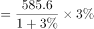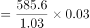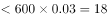万吨，不到20万吨，错误；

B项：定位图形材料，2013-2018年我国茶叶出口均价分别是3.8千美元/吨、4.2千美元/吨、4.3千美元/吨、4.5千美元/吨、4.5千美元/吨、4.9千美元/吨。则2014年-2018年出口均价的增长率分别是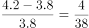，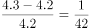，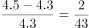，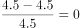，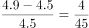，比较可得2014年增速最快，根据图形材料可知，2013年茶叶出口量是32.6万吨，2014年是30.1万吨，故2014年出口量为负增长，错误；

C项：定位图形材料，2016年和2017年的茶叶出口量分别是32.9万吨和35.5万吨，2016年和2017年的茶叶均价都是4.5千美元/吨，则2016年和2017年出口总额分别是（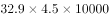）千美元和（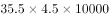）千美元，2017年中国茶叶出口总额的同比增长率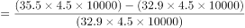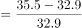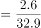，即增长率不到，正确；

D项：定位文字材料，2018年，中国茶叶国内销售量为191万吨，同比增长，国内销售总额为2661亿元，根据平均价格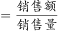，可得我国茶叶国内销售的平均价格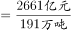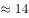万元/吨，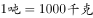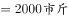，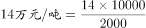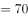元/市斤，则2018年国内销售的茶叶平均价格不到120元/市斤，错误。

故正确答案为C。

### 给定材料

        2018年全球茶叶产量585.6万吨，同比增长约，中国茶叶产量261.6万吨，同比增长0.7万吨。2018年，中国茶叶国内销售量为191万吨，同比增长，国内销售总额为2661亿元，出口量为36.5万吨，同比增长，出口总额为17.89亿美元（合人民币120亿元），同比增长（？）。

