# 综合分析判断题（两期比重比较+百分点差值还原基期比重+基期量计算）

考点：[[20-考点/资料分析/综合/综合分析判断题（两期比重比较+百分点差值还原基期比重+基期量计算）|综合 / 综合分析判断题（两期比重比较+百分点差值还原基期比重+基期量计算）]]
材料：[[15-材料/资料分析/270541 2016年全国女性就业与社会保险状况|270541 2016年全国女性就业与社会保险状况]]

**问法模型**：『能够从上述资料中推出的是』→综合分析四选一，各选项独立取数逐项验证：两期比重比较（部分增速a与整体增速b）、用'提高X个百分点'还原基期比重、基期=现期−增量后直除，证伪三项、留下正确项。

## 推理链
1. 第1步：A项取数：2016年工伤保险总人数2.2亿（22000万）、女性8129万人，'分别比2010年增加5728万人和2429万人'按前总后女对应，故2010年总数=22000−5728=16272万人、女性=8129−2429=5700万人。
2. 第2步：A项用两期比重比较结论'部分增长率a＞整体增长率b→比重上升'：女性a=2429÷5700≈43%，总数b=5728÷16272≈35%，a＞b说明2016年女性占比高于2010年，与A项'低于2010年水平'相反，A错误。
3. 第3步：B项计算：2016年城镇职工基本养老保险女性占比=1.8亿÷3.8亿≈47.4%，占比比2010年提高3个百分点，故2010年占比≈47.4%−3%=44.4%，并不低于选项图片所给的比例阈值，B错误。
4. 第4步：C项建立还原式：2010年女职工董事比重=2016年值−7.2个百分点、2010年女职工监事比重=2016年值−4.9个百分点（这两个2016年比重数值在给定文本中空缺，依原始完整材料数值），还原后董事比重低于监事比重，与C项'高于'相反，C错误。
5. 第5步：D项取数：2016年女性高级专业技术人员161万人、比2010年增加59.3万人、所占比重提高3个百分点，故2010年女性高级=161−59.3=101.7万人，2010年占比=2016年占比−3个百分点。
6. 第6步：D项代入：2010年高级专业技术人员总数=101.7万÷（2016年占比−3个百分点），总数减去女性101.7万人即为2010年男性高级专业技术人员，结果不到210万人，D成立。
7. 第7步：对照选项，A、B、C均被证伪，仅D能从资料中推出，锁定答案D。

**最快解法**：⚡ 考场最快解法：两期比重比较结论+截位直除，按'不依赖空缺数值的选项先做'排序。A项纯减法+直除：2429÷5700≈43%＞5728÷16272≈35%→比重上升→A错；B项一个直除：1.8÷3.8≈47.4%，减3个百分点得44.4%→B错；D项减法+直除：161−59.3=101.7万，101.7万÷（2016占比−3%）得2010年高级总数，再减101.7万即男性人数，判定不到210万→D对；C项需2016年董事/监事比重原值，依解析判定董事低于监事→C错。

## 易错点
- ⚠ '提高X个百分点'是比重（率）的差值，不能当增长率或比重本身使用：B、C、D三项都必须用'2016年比重−提高的百分点'还原2010年比重，把百分点当数值直接代入必错。
- ⚠ '分别比2010年增加5728万人和2429万人''分别提高7.2和4.9个百分点'均为前总后女、前董事后监事的顺序对应，交叉错配会把a、b算反，A项比重升降的判断随之反转。
- ⚠ A项方向陷阱：a（43%）＞b（35%）→2016年比重高于2010年，选项偏问'低于2010年水平'考方向感；另材料多处比重数值（含B项选项图片值）空缺，判定须以原始完整材料数值为准，不得凭空补数。

## 母题抽象
> 🧩 当题干出现'能够从上述资料中推出的是/一定正确的是'这类综合判断问法时，逐项套用'两期比重比较（a＞b→比重上升）''百分点差值还原基期比重''基期=现期−增量'等模型快速证伪，未被证伪的即为正确项。

**同类特征**：能够从上述资料中推出的是、综合分析四选一逐项判断、两期比重比较（部分增速a与整体增速b）、提高X个百分点还原基期比重、基期量=现期−增量、各选项分属不同段落、独立取数

## 相关题
- [[10-真题/资料分析/综合/19283943 综合分析判断题（倍数比较+求和判断+隐含平均每场座位数反推）|19283943]]（国考 2025，相关度1）
- [[10-真题/资料分析/综合/1796162 综合判断（月均计算、平均运输距离、比重对比、增长量比较逐项验证）|1796162]]（贵州 2016，相关度1）
- [[10-真题/资料分析/综合/2133504 综合判断题（现期比重+现期平均数多项验证，一对三错）|2133504]]（国考 2018，相关度1）
- [[10-真题/资料分析/综合/2444706 综合判断题（增长量+比重+倍数逐项验证）|2444706]]（四川 2019，相关度1）
- [[10-真题/资料分析/综合/2571728 综合分析逐项判断（等差递推求和＋单位换算＋比值估算）|2571728]]（山东 2020，相关度1）

---

### 题干
能够从上述资料中推出的是：

### 选项
- A. 
2016年全国参加工伤保险的人中，女性占比低于2010年水平

- B. 
2010年全国参加城镇职工基本养老保险的人中，女性占比低于

- C. 
2010年女职工董事占职工董事的比重高于女职工监事占职工监事的比重

- D. 
2010年公有制企业事业单位中男性高级专业技术人员不到210万人
　✅

### 官方解析

A项：定位文字材料最后一段可知，“2016年全国参加工伤保险人数2.2亿人，其中女性8129万人，分别比2010年增加······，增长约（b）和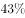（a）”。根据两期比重比较结论：若部分增长率（a）＞整体增长率（b），则比重上升。43%（a）＞35%（b），即2016年全国参加工伤保险的人中，女性占比高于2010年水平，错误；

B项：定位文字材料第五段可知，“2016年全国参加城镇职工基本养老保险人数3.8亿人，其中女性1.8亿人，占比比2010年提高3个百分点”。则2016年全国参加城镇职工基本养老保险的人中，女性占比为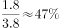，故2010年全国参加城镇职工基本养老保险的人中，女性占比为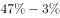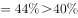，错误；

C项：定位文字材料第三段可知，“2016年企业董事会中女职工董事占职工董事的比重为，企业监事会中女职工监事占职工监事的比重为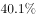，比2010年分别提高7.2和4.9个百分点”。则2010年女职工董事占职工董事的比重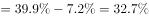；女职工监事占职工监事的比重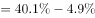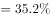。可以看出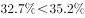，即2010年女职工董事占职工董事的比重低于女职工监事占职工监事的比重，错误；

D项：定位文字材料第二段可知，“2016年公有制企事业单位中女性专业技术人员1480万人，······其中女性高级专业技术人员161万人，比2010年增加59.3万人，所占比重，提高3个百分点”。由此可知2010年高级专业技术人员总人数为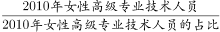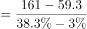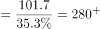万人，2010年男性高级专业技术人员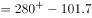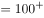万人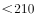万人，正确。

故正确答案为D。

### 给定材料

        2016年全国女性就业人员占全社会就业人员的比重为，其中城镇单位女性就业人员6518万人，比2010年增加1656万人。

        2016年公有制企事业单位中女性专业技术人员1480万人，比2010年增加211万人，所占比重达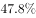，提高2.8个百分点；其中女性高级专业技术人员161万人，比2010年增加59.3万人，所占比重，提高3个百分点。

        2016年企业董事会中女职工董事占职工董事的比重为，企业监事会中女职工监事占职工监事的比重为，比2010年分别提高7.2和4.9个百分点；企业职工代表大会中女性代表比重为，略低于2010年0.3个百分点。

        2016年女性参加生育保险的人数达8020万人，比2010年增长。2016年，参加城镇职工基本医疗保险的女性1.4亿人，比2011年增长；参加城镇居民基本医疗保险的女性1.9亿人，比2011年增长了1.5倍。

        2016年全国参加城镇职工基本养老保险人数3.8亿人，其中女性1.8亿人，占比比2010年提高3个百分点；2016年，参加城乡居民基本养老保险人数5.1亿人，其中女性超过1.7亿人。

        2016年全国参加失业保险的人数超过1.8亿人，其中女性7551万人，分别比2010年增加4713万人和2402万人，增长约和；参加工伤保险人数2.2亿人，其中女性8129万人，分别比2010年增加5728万人和2429万人，增长约和。

> [!warning] 疑点（官方解析可能有误，待人工复核）
> 给定材料原文将判定所必需的多个百分数值留空（2016年女职工董事/监事比重、女性高级专业技术人员占比、B项选项比例为图片、职工医保增长率等），官方解析对应位置亦为空格（如'2010年高级专业技术人员总人数为 万人'），故B、C、D无法仅凭给定文本完整复算，需依原始完整材料数值（材料导读亦提示'以原始完整材料数值为准，不得凭空补数'）；本笔记按官方结论记录A、B、C错误、D正确，未改动答案。

<!-- CODEX-ANSWER-REVIEW:BEGIN -->
### 本次独立复核

**复核状态：** `resolved`（答案与解析已核定）

**计分答案：** D（可计分）

**复核解析：**

恢复公式图后逐项验证。A：女职工工伤保险人数增长率=2429÷(8129−2429)=42.6%，总人数增长率=5728÷(22000−5728)=35.2%；部分增速更高，女性占比应上升，与A称低于2010年相反。B：2016女性占比=1.8÷3.8≈47.4%，2010为47.4%−3%=44.4%，不低于图中40%阈值。C：2016女职工董事占比39.9%、监事40.1%，还原2010分别为32.7%和35.2%，董事比重并不高于监事。D：2010女性高级技术人员=161−59.3=101.7万人；女性比重=38.3%−3%=35.3%，总人数=101.7÷35.3%≈288.1万人，男性约288.1−101.7=186.4万人，不到210万。故选D。

**相关信息：**

资料分析—两期比重比较、百分点回推及基期总量；增速比较判断比重升降，女性占比降低百分点时用减法回推，部分量除以基期比重得整体。

**题源依据：** [固定版本原题](https://github.com/Mentat-Uran/kaogongzhentizhengliu/blob/84ab93d4b64b61d897bece8a1c0a5bab06b4feb2/10-%E7%9C%9F%E9%A2%98/%E8%B5%84%E6%96%99%E5%88%86%E6%9E%90/%E7%BB%BC%E5%90%88/2742322%20%E7%BB%BC%E5%90%88%E5%88%86%E6%9E%90%E5%88%A4%E6%96%AD%E9%A2%98%EF%BC%88%E4%B8%A4%E6%9C%9F%E6%AF%94%E9%87%8D%E6%AF%94%E8%BE%83%2B%E7%99%BE%E5%88%86%E7%82%B9%E5%B7%AE%E5%80%BC%E8%BF%98%E5%8E%9F%E5%9F%BA%E6%9C%9F%E6%AF%94%E9%87%8D%2B%E5%9F%BA%E6%9C%9F%E9%87%8F%E8%AE%A1%E7%AE%97%EF%BC%89.md)；固定内容 commit `84ab93d4b64b61d897bece8a1c0a5bab06b4feb2`，Markdown blob `184b37de5d714e615ec6e7604ea291f6d791db9e`。
<!-- CODEX-ANSWER-REVIEW:END -->
