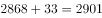
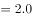
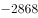

# 跨数据点拼接计算（累计值−当月值−环比反推上月值）

考点：[[20-考点/资料分析/综合/跨数据点拼接计算（累计值−当月值−环比反推上月值）|综合 / 跨数据点拼接计算（累计值−当月值−环比反推上月值）]]
材料：[[15-材料/资料分析/272114 某年8月份（含1—8月累计）我国能源|272114 某年8月份（含1—8月累计）我国能源]]

**问法模型**：题干问'上半年（1—6月）'某量约为多少 → 材料只给1—8月累计与8月当月，需用'累计−8月−7月（7月由环比增减量反推）'的拼接模型

## 推理链
1. 第1步：从材料第一部分第三段提取：8月煤炭进口2868万吨，比上月略降33万吨；1—8月煤炭进口2.0亿吨
2. 第2步：单位换算：2.0亿吨=20000万吨（1亿吨=10000万吨）
3. 第3步：由'比上月略降33万吨'反推7月进口量=2868+33=2901万吨
4. 第4步：上半年（1—6月）进口量=1—8月累计−8月−7月=20000−2868−2901
5. 第5步：代入计算：20000−2868=17132，17132−2901=14231万吨
6. 第6步：与选项对照：尾数各不相同，14231尾数为1，对应B项，锁定答案B

**最快解法**：⚡ 尾数法+环比反推：先反推7月=2868+33=2901万吨，再算尾数：20000−2868−2901的尾数为1（0−8−1需借位后尾数为1），直接锁定尾数为1的B项14231，无需完整计算

## 易错点
- ⚠ 单位陷阱：1—8月给的是'2.0亿吨'，与万吨级当月数据混算必须先换算为20000万吨，否则量级全错
- ⚠ 方向陷阱：'比上月略降33万吨'意为8月比7月降33万吨，反推7月应做加法（2868+33=2901），做减法得14165即错
- ⚠ 时间口径陷阱：'上半年'=1—6月，须同时减去8月和7月两个月，只减8月得17132（1—7月）即口径错误
- ⚠ 阅读陷阱：同比增速全部留空，本题完全不涉及同比，切勿找增长率

## 母题抽象
> 🧩 当题干出现'上半年/前N月某量约为多少'而材料只有累计值与当月值、并附'比上月增/减N'的环比差时，用'累计−当月−（当月±环比差）'拼接，再用尾数法锁定选项

**同类特征**：上半年（1—6月）、约为多少万吨、煤炭进口量、1—8月累计2.0亿吨、8月2868万吨比上月略降33万吨、选项尾数各不相同

## 相关题
- [[10-真题/资料分析/增长/18508080 增长量计算与环比增长率（季度汇总比较，含合并期拆分）|18508080]]（山东 2025，相关度1）
- [[10-真题/资料分析/增长/18508046 环比增长率计算与比较|18508046]]（山东 2025，相关度1）

---

### 题干
本年度上半年，煤炭进口量约为多少万吨？

### 选项
- A. 14198
- B. 14231　✅
- C. 14264
- D. 14297

### 官方解析

定位文字材料第一部分第三段可知：8月份，煤炭进口2868万吨，比上月略降33万吨，但仍保持较高水平，同比增长。1—8月份，煤炭进口2.0亿吨，同比增长。本年度7月份，煤炭进口量为万吨。则本年度上半年，即1—6月份，煤炭进口量（1—8月份煤炭进口量）8月份煤炭进口量7月份煤炭进口量亿吨万吨万吨万吨。

（注意：选项尾数各不相同，可用尾数法快速锁定答案。）

故正确答案为B。

### 给定材料

8月份，规模以上工业原煤生产增速回升，煤炭进口保持较高水平；原油生产增速由负转正，进口继续增加；天然气生产保持较快增长，进口持续高速增长；电力生产加快。

一、原煤生产增速回升，煤炭进口保持较高水平，市场价格小幅波动

8月份，原煤产量3.0亿吨，同比增长，上月为下降；日均产量957万吨，环比增加49万吨。1—8月份，原煤产量22.8亿吨，同比增长。

8月份，煤炭主产区生产均开始回升。其中，内蒙古同比增长，上月为下降；山西同比下降，降幅较上月收窄2.2个百分点；陕西同比增长，增速较上月加快7.6个百分点；新疆同比增长，上月为下降。

8月份，煤炭进口2868万吨，比上月略降33万吨，但仍保持较高水平，同比增长。1—8月份，煤炭进口2.0亿吨，同比增长。

8月底，秦皇岛5500大卡煤炭综合交易价格为573元/吨，比7月底下降3元；5000大卡煤炭价格为510元/吨，比7月底下降17元；4500大卡煤炭价格为456元/吨，比7月底下降12元。

二、原油生产增速由负转正，进口持续增加

8月份，原油生产1600万吨，同比增长，上月为下降，为2015年11月以来首次正增长；日均产量51.6万吨，环比增加0.5万吨。1—8月份，原油产量12595万吨，同比下降。

原油进口持续增加，8月份进口原油3838万吨，比上月增加236万吨，同比增长。1—8月份，进口原油29919万吨，同比增长。

国际原油价格震荡上行，截至8月底，布伦特原油现货离岸价格为76.94美元/桶，比7月底上涨2.78美元/桶。

三、原油加工量增速有所放缓

8月份，原油加工量5031万吨，同比增长，增速比上月回落6.0个百分点；日均加工162.3万吨，环比减少1.4万吨。1—8月，原油加工量40041万吨，同比增长。

四、天然气生产保持较快增长，进口持续高速增长

8月份，天然气产量129亿立方米，同比增长，增速比上月回落0.8个百分点；日均生产4.2亿立方米，与上月基本持平。1—8月份，天然气产量1040亿立方米，同比增长。

天然气进口持续高速增长。8月份，进口天然气777万吨（1吨约为1380立方米），比上月增加39万吨，同比增长。1—8月份，进口天然气5718万吨，同比增长。

五、电力生产加快

8月份，发电量6404.9亿千瓦时，同比增长，增速比上月加快1.6个百分点；日均发电206.6亿千瓦时，再创新高。1—8月份，发电量同比增长，比去年同期加快1.2个百分点。

8月份，除风电外，其他品种电力生产同比增速较7月份均有所加快。其中火电同比增长，比上月加快1.7个百分点；水电增长，加快5.5个百分点；核电增长，加快2.7个百分点；太阳能发电增长，加快1.3个百分点。

因台风、降雨等气候因素影响，8月份风电大幅减少，增速比上月回落24.1个百分点，同比增长。

