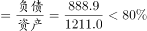

# 综合判断题（资产负债率计算+倍数区间判定+最值对应+比重区间验证）

考点：[[20-考点/资料分析/综合/综合判断题（资产负债率计算+倍数区间判定+最值对应+比重区间验证）|综合 / 综合判断题（资产负债率计算+倍数区间判定+最值对应+比重区间验证）]]
材料：[[15-材料/资料分析/272113 2015年S省“四上”企业（6个一级|272113 2015年S省“四上”企业（6个一级]]

**问法模型**：'能够从上述材料中推出的是'→将四个选项分别翻译为比值/倍数/比重计算模型，用表中2015年存量数据逐一验证真伪，选出唯一可推出项

## 推理链
1. 第1步：由表下注释知资产负债率=负债/资产；A项：限额以上住宿和餐饮业负债888.9亿元、资产1211.0亿元，888.9/1211.0≈73.4%，官方判定'并非超过'选项所给阈值，排除A
2. 第2步：B项：房地产开发企业负债35200.6亿元，资质等级建筑业企业负债9846.8亿元，用乘法夹逼：9846.8×3=29540.4＜35200.6＜9846.8×4=39387.2，故倍数≈3.57，介于3~4倍即'3倍多'，B成立
3. 第3步：C项：服务业10个子行业中资产最少的是居民服务、修理和其他服务业（132.6亿元），其负债87.2亿元＞教育的负债68.4亿元，即负债最少的是教育而非该行业，排除C
4. 第4步：D项：租赁和商务服务业资产27332.3亿元÷规模以上服务业资产总计46939.4亿元，截位直除273/469≈58.2%，不到七成（70%），排除D
5. 第5步：仅B项可由材料推出，与官方答案B一致

**最快解法**：⚡ 乘法夹逼优先锁定B：9846.8×3=29540.4＜35200.6＜9846.8×4=39387.2，一步心算判定'3倍多'成立；其余三项各用一次截位直除（888.9/1211.0≈73.4%、27332.3/46939.4≈58.2%）加负债列最值扫描即可全部排除，全题无需精算除法

## 易错点
- ⚠ '注释定义式'材料：资产负债率、所有者权益表中均未直接给出，必须按表下注释公式自行计算，跳过注释则A项无从下手
- ⚠ C项惯性误判'资产最少的行业负债也最少'：须逐项扫负债列，负债最少的是教育（68.4亿元），居民服务业为87.2亿元，资产最少≠负债最少
- ⚠ 名称相近口径混淆：房地产开发企业（一级分类，负债35200.6亿元）≠房地产服务业（服务业子行业，负债358.3亿元），B项若误用子行业数值必错；同时注意区间词口径——'3倍多'指介于3~4倍，'七成以上'指＞70%

## 母题抽象
> 🧩 当综合判断题出现'比率超阈值、是几倍多、最值对应、占比超七成'四类表述时，优先挑能用'阈值×基数'乘法夹逼直接验证的选项（如验证是否介于3~4倍），其余选项用截位直除估出比值与阈值比较排除

**同类特征**：能够从上述材料中推出的是、资产负债率超过（阈值）、负债是……的3倍多、资产最少的行业其负债也最少、资产占……的七成以上、注释公式：资产负债率=负债/资产、所有者权益=资产−负债；单一现期存量数据，单位亿元

## 相关题
- [[10-真题/资料分析/综合/4652204 综合判断题（核心验证点：两期比重升降判定；辅助：增长率比较、逐年数据核对、消费总量加总）|4652204]]（北京 2022，相关度1）
- [[10-真题/资料分析/综合/2033372 综合分析：增长量比较（大大则大）＋基期比重回推＋比重升降定性判断|2033372]]（河南 2016，相关度1）
- [[10-真题/资料分析/综合/2033414 综合判断题（倍数验证+增长率大小比较）|2033414]]（河南 2016，相关度1）
- [[10-真题/资料分析/综合/2049612 综合判断题（倍数比较＋当月比重与分数门槛比较＋比重变化方向＋增长率比较）|2049612]]（山东 2017，相关度1）
- [[10-真题/资料分析/综合/2049744 综合分析-逐项验证（核心为平均数之累计拆分求月均，兼查倍数、增长量、均价降幅比较）|2049744]]（山东 2017，相关度1）

---

### 题干
关于2015年S省“四上”企业的资产及负债状况，能够从上述材料中推出的是：

### 选项
- A. 
限额以上住宿和餐饮业企业资产负债率超过

- B. 
房地产开发企业负债是资质等级建筑业企业的3倍多
　✅
- C. 
规模以上服务业企业中，资产最少的行业其负债也最少

- D. 
租赁和商务服务业资产占规模以上服务业企业的七成以上

### 官方解析

A项：定位表格材料可得：限额以上住宿和餐饮业企业资产总计1211.0亿元，负债总计888.9亿元。根据注释可得，所求资产负债率，并非超过，不能推出，排除；

B项：定位表格材料可得：房地产开发企业负债总计35200.6亿元；资质等级建筑业企业负债总计9846.8亿元。则前者是后者的倍数，可以推出，当选；

C项：定位表格材料可得：规模以上服务业企业中，资产最少的行业是居民服务、修理和其他服务业（132.6亿元），其负债（87.2亿元）教育负债（68.4亿元），并非最少，不能推出，排除；

D项：定位表格材料可得：租赁和商务服务业资产总计27332.3亿元；规模以上服务业企业资产总计46939.4亿元。则前者占后者的比重，不到七成，不能推出，排除。

故正确答案为B。

### 给定材料

