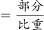
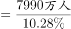
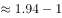

# 综合分析·逐项判断（比重判断-整体推算-倍数辨析-构成占比加和）

考点：[[20-考点/资料分析/综合/综合分析·逐项判断（比重判断-整体推算-倍数辨析-构成占比加和）|综合 / 综合分析·逐项判断（比重判断/整体推算/倍数辨析/构成占比加和）]]
材料：[[15-材料/资料分析/272115 2017年我国旅游业统计公报式材料：|272115 2017年我国旅游业统计公报式材料：]]

**问法模型**：问法为'以下说法正确的是'的混考点综合分析题→逐项匹配对应模型：比重=部分÷整体（B）、整体=部分÷比重（A）、多几倍=差÷基数（C）、分档占比加和（D），优先验证分子分母均为正文现成数的选项

## 推理链
1. 第1步：B项取数——第三部分现成两数：国际旅游收入1234亿美元、外国人在华花费695亿美元，套用比重=部分÷整体
2. 第2步：B项计算——695÷1234≈56.3%＞50%，'五成以上由外国人在华花费实现'成立，B正确
3. 第3步：C项核对——香港同胞在内地花费301亿美元、台湾同胞在大陆花费155亿美元，多出146亿美元，146÷155≈0.94倍＜1倍，即'多不到一倍'，C错误
4. 第4步：A项核对——首段'旅游直接和间接就业7990万人，占全国就业总人口的□%'，该占比数值正文缺失；按官方解析以整体=部分÷比重代入原卷占比数值，得全国就业总人口不足8亿人，A错误
5. 第5步：D项核对——第四部分按年龄分'14岁以下占□%、15—24岁占□%、25—44岁占□%'各档占比正文均缺失，44岁以下占比=三档之和，按官方解析其和未达到选项阈值，D错误
6. 第6步：结论——四项中仅B项可由正文数据直接验证且成立，故正确答案为B

**最快解法**：⚡ 综合分析'先易后难'秒杀：优先验证只用正文现成数的B项——695/1234，截位直除≈0.563＞0.5，'五成以上'成立直接锁定B；顺带排除C：301/155≈1.94倍，即多约94%＜100%（多不到一倍）；A、D依赖正文缺失的占比数值，按官方结论均不成立

## 易错点
- ⚠ '是…的几倍'≠'多几倍'：301÷155≈1.94倍，但'多'的部分146/155≈0.94倍（不到一倍），C选项最易被误判为正确
- ⚠ A项整体=部分÷比重且跨量级单位：7990万人与8亿人（=80000万）比较须统一量级，且该占比数值正文缺失，依赖原卷图示数据，不可臆造
- ⚠ D项'44岁以下'须把14岁以下、15—24岁、25—44岁三档占比相加，漏加或只取单档即错；正文各档占比数值缺失，严禁凭感觉补数

## 母题抽象
> 🧩 当题干出现'以下说法正确/错误的是'且各选项考点分散时，先用正文现成两数直接算比重或倍数验证最简选项（部分÷整体与50%比大小），再用'差÷基数'核'多几倍'类表述，涉及缺失占比的选项按整体=部分÷比重或官方结论排除

**同类特征**：以下说法正确的是、综合分析逐项判断、五成以上（50%临界判断）、多一倍以上（倍数与倍差辨析）、整体=部分÷比重、44岁以下占比分档加和

## 相关题
- [[10-真题/资料分析/综合/2172123 综合分析（当期值加总比较+负增长判基期高低+当月值序列判趋势+基期还原超阈值判断）|2172123]]（广州市考 2018，相关度2）
- [[10-真题/资料分析/综合/2393970 综合分析-逐项判断（基期量计算-增速方向比较-混合增长率-两数差值）|2393970]]（青海 2019，相关度2）
- [[10-真题/资料分析/综合/10204448 综合分析-逐项判断（历史极值确认、两期比重比较、多期累计求和、基期比重）|10204448]]（广东 2024，相关度1）
- [[10-真题/资料分析/综合/10204453 综合分析判断（读数比较+增长量比较+年均增长率比较+区间增速比较）|10204453]]（广东 2024，相关度1）
- [[10-真题/资料分析/比重/10204601 比重反推整体（整体=部分÷比重）后两期总量作差|10204601]]（黑龙江 2024，相关度1）

---

### 题干
根据上述材料，以下说法正确的是：

### 选项
- A. 
2017年，全国就业总人口超过8亿人

- B. 
2017年，国际旅游收入五成以上由外国人在华花费实现
　✅
- C. 
2017年，香港同胞在内地花费比台湾同胞在大陆花费多一倍以上

- D. 
2017年，入境外国游客中，44岁以下年龄段游客人数占以上

### 官方解析

A项：定位文字材料第一段：2017年，······旅游直接和间接就业7990万人，占全国就业总人口的。根据公式：整体，可得全国就业总人口万人亿人8亿人，错误；

B项：定位文字材料第三部分第一段：2017年，国际旅游收入1234亿美元······其中，外国人在华花费695亿美元。根据公式：比重，可知外国人在华花费占比，超过五成，正确；

C项：定位文字材料第三部分第一段：2017年，国际旅游收入1234亿美元······其中，香港同胞在内地花费301亿美元······台湾同胞在大陆花费155亿美元。故，即多不到一倍，错误；

D项：定位文字材料第四部分第一段：2017年，······按照年龄分，14岁以下人数占，15—24岁占，25—44岁占。可得：44岁以下年龄段游客人数占比，错误。

故正确答案为B。

### 给定材料

2017年，国内旅游市场高速增长，入出境市场平稳发展，供给侧结构性改革成效明显。国内旅游人数50.01亿人次，比上年同期增长；入出境旅游总人数2.7亿人次，增长；全年实现旅游总收入5.40万亿元，增长；全年全国旅游业对GDP的综合贡献为9.13万亿元，占GDP总量的；旅游直接就业2825万人，旅游直接和间接就业7990万人，占全国就业总人口的。

一、全年国内旅游收入增长

2017年，国内旅游人数50.01亿人次，比上年同期增长。其中，城镇居民36.77亿人次，增长；农村居民13.24亿人次，增长。国内旅游收入4.57万亿元，增长。其中，城镇居民花费3.77万亿元，增长；农村居民花费0.80万亿元，增长。

二、全年入境过夜旅游人数增长

2017年，入境旅游人数13948万人次，比上年同期增长。其中，外国人2917万人次，增长；香港同胞7980万人次，下降；澳门同胞2465万人次，增长；台湾同胞587万人次，增长。入境旅游人数按照入境方式分，船舶占，飞机占，火车占，汽车占，其他占。

2017年，入境过夜旅游人数6074万人次，比上年同期增长。其中，外国人2248万人次，增长；香港同胞2775万人次，增长；澳门同胞522万人次，增长；台湾同胞529万人次，增长。

三、全年国际旅游收入达1234亿美元

2017年，国际旅游收入1234亿美元，比上年同期增长。其中，外国人在华花费695亿美元，增长；香港同胞在内地花费301亿美元，下降；澳门同胞在内地花费83亿美元，增长；台湾同胞在大陆花费155亿美元，增长。

四、全年入境外国游客亚洲占，以观光休闲为目的游客占

2017年，入境外国游客人数4294万人次，亚洲占，美洲占，欧洲占，大洋洲占，非洲占。其中，按照年龄分，14岁以下人数占，15—24岁占，25—44岁占，45—64岁占，65岁以上占；按性别分，男占，女占；按目的分，会议/商务占，观光休闲占，探亲访友占，服务员工占，其他占。

2017年，按入境旅游人数排序，我国主要客源市场前17位国家如下：缅甸、越南、韩国、日本、俄罗斯、美国、蒙古、马来西亚、菲律宾、新加坡、印度、加拿大、泰国、澳大利亚、印度尼西亚、德国、英国。

五、全年中国公民出境旅游人数达13051万人次

2017年，中国公民出境旅游人数13051万人次，比上年同期增长。

> [!warning] 疑点（官方解析可能有误，待人工复核）
> 材料正文中所有占比/增速数值（含A项'占全国就业总人口的□%'与D项各年龄段占比）因原文图片未识别而缺失，A、D两项无法用正文数据独立复算，官方解析系按原卷图示数值判定错误，其解析文字中公式亦呈乱码（如'全国就业总人口万人亿人8亿人'）；但官方结论（仅B正确）与正文可验证数据（695/1234≈56.3%＞50%）一致，无碍答案
