# 综合判断·选非题（百分点做差推增速+基期量求和+基期平均数+利润率比较）

考点：[[20-考点/资料分析/综合/综合判断·选非题（百分点做差推增速+基期量求和+基期平均数+利润率比较）|综合 / 综合判断·选非题（百分点做差推增速+基期量求和+基期平均数+利润率比较）]]
材料：[[15-材料/资料分析/277849 2020年前三季度G省智能机器人产业|277849 2020年前三季度G省智能机器人产业]]

**问法模型**：『下列说法不正确的是』→选非题，逐项套用对应基本模型（百分点做差判方向、基期量=现期÷(1+r)、利润率=利润总额÷营业收入）验证A–D，锁定错误项

## 推理链
1. 第1步：A项对应文字段『智能机器人产业总产值同比增长（数值在原文为公式形式），增速高于全部规模以上工业产值32.8个百分点』——百分点关系须做减法
2. 第2步：A项验证：全部规上工业产值增速=智能机器人产业增速−32.8个百分点，按官方口径该差值为负，即全部规上工业产值同比下降；而A项表述为『同比增长（正值）』，方向相反，A不正确
3. 第3步：B项验证：用表2营业收入求2019年基期并加总：48.62÷1.275≈38.1、1.07÷2.184≈0.5、233.07÷1.46≈159.6、43.86÷1.403≈31.3，合计≈229.5亿元＞200亿元，B正确
4. 第4步：C项验证：由文字段平均用工3.12万人及所给同比增速，代入基期公式3.12÷(1+r)≈2.87万人，与选项一致，C正确
5. 第5步：D项验证：利润率=利润总额÷营业收入（带符号）：工业机器人−8.61÷48.62≈−17.7%、特殊作业0.22÷1.07≈20.6%、无人飞行器40.74÷233.07≈17.5%、服务消费−0.9÷43.86≈−2.1%，最高为特殊作业工业机器人制造业，D正确
6. 第6步：本题为选非题，不正确的表述为A项，与官方答案一致

**最快解法**：⚡ 综合判断题按『先易后难、先方向后计算』：A项秒杀——『增速高于32.8个百分点』做差后按官方口径为负（同比下降），与A项『同比增长』直接矛盾；再用两步口算复核：D项0.22÷1.07≈20.6%＞40.74÷233.07≈17.5%，特殊作业利润率确实最高；B项只抓大头233.07÷1.46≈160，加上其余三项必超200。三项均正确，锁定A

## 易错点
- ⚠ 百分点≠百分率：A项须用产业增速减去32.8个百分点，结果为负（同比下降）；误把百分点差当正的百分率或忽略结果符号，会把A误判为正确
- ⚠ 利润总额有负值：D项比较利润率时−8.61、−0.9必须带符号计算，丢掉负号会错排利润率高低、误判D
- ⚠ 选非题＋跨表取数：B、D必须用表2（营业收入、利润总额），严禁混用表1总产值（如无人飞行器201.07 vs 233.07）；B项四个行业基期量须全部加总，漏掉特殊作业（≈0.5）或服务消费（≈31.3）可能误判『超200亿元』

## 母题抽象
> 🧩 当综合判断题出现『下列说法不正确/正确的是』且四个选项分属不同模型时，逐项套用基本公式（百分点做差、基期量=现期÷(1+r)、比率=分子÷分母），优先验证只需判断方向/大小的选项，全程盯紧负值符号与『同比增长/下降』的方向词

**同类特征**：选非题（说法不正确的是）、增速高于…32.8个百分点（百分点做差）、2019年前三季度基期量求和、平均用工人数基期、利润率=利润总额÷营业收入、综合判断逐项验证、跨表取数

## 相关题
- [[10-真题/资料分析/比重/2443079 现期比重比较与排名判断（选非题）|2443079]]（辽宁 2019，相关度1）
- [[10-真题/资料分析/综合/12881985 综合判断题（选非题）—文字材料逐项定位与时间口径比对|12881985]]（广东 2025，相关度1）
- [[10-真题/资料分析/综合/2604301 综合分析判断题（选非题）：基期定性判断+增速比较+量级估算+图形读数|2604301]]（广东 2020，相关度1）
- [[10-真题/判断推理/科学推理/5701836 环境科学-大气污染物组成与雾霾成因（可吸入颗粒物的来源辨析）|5701836]]（上海 2016，相关度1）

---

### 题干
根据所给资料，下列说法不正确的是（    ）。

### 选项
- A. 
2020年前三季度，G省全部规模以上工业产值同比增长
　✅
- B. 
2019年前三季度，G省智能机器人产业营业收入超200亿元

- C. 
2019年前三季度，G省智能机器人产业平均用工人数为2.87万人

- D. 
2020年前三季度，G省智能机器人产业中利润率最高的行业是特殊作业工业机器人制造业

### 官方解析

A项：定位文字材料第一段“2020年前三季度，G省智能机器人······完成总产值306.90亿元，占全部规模以上工业产值的，同比增长，增速高于全部规模以上工业产值32.8个百分点”。2020年前三季度，G省全部规模以上工业产值同比增长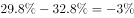，即同比下降，错误；

B项：定位表2，由基期量可得，2019年前三季度，工业机器人制造业营业收入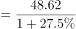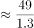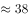亿元；特殊作业工业机器人制造业营业收入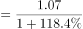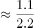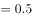亿元；智能无人飞行器制造业营业收入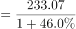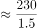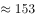亿元；服务消费机器人制造业营业收入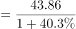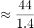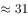亿元。则2019年前三季度，G省智能机器人产业营业收入2019年前三季度四大行业营业收入之和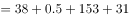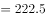亿元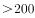亿元，正确；

C项：定位文字材料第一段“2020年前三季度，G省智能机器人产业······前三季度平均用工人数3.12万人，同比增长”。由基期量可得，2019年前三季度，G省智能机器人产业平均用工人数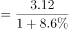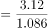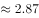万人，正确；

D项：定位表2可得，2020年前三季度，G省工业机器人制造业利润率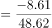；特殊作业工业机器人制造业利润率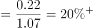；智能无人飞行器制造业利润率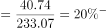；服务消费机器人制造业利润率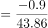。则利润率最高的行业是特殊作业工业机器人制造业，正确。

本题为选非题，故正确答案为A。

### 给定材料

        智能机器人产业是G省战略性新兴产业之一。2020年前三季度，G省智能机器人产业纳入规模以上工业统计的法人单位共140家，完成总产值306.90亿元，占全部规模以上工业产值的，同比增长，增速高于全部规模以上工业产值32.8个百分点；前三季度平均用工人数3.12万人，同比增长。

        2020年前三季度，G省智能机器人产业实现营业收入326.62亿元，同比增长超，四大行业营业收入均实现正增长，经济效益好于全部规模以上工业企业。

