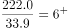
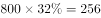
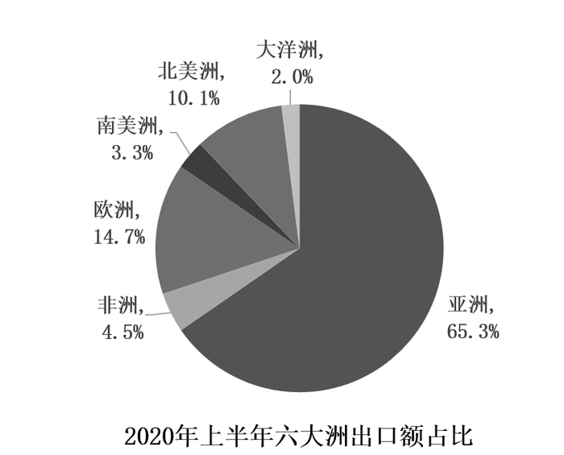

# 综合分析选非题（倍数比较+饼图占比换算金额+部分占整体比重核对）

考点：[[20-考点/资料分析/综合/综合分析选非题（倍数比较+饼图占比换算金额+部分占整体比重核对）|综合 / 综合分析选非题（倍数比较+饼图占比换算金额+部分占整体比重核对）]]
材料：[[15-材料/资料分析/277851 2020年上半年我国农产品进出口情况|277851 2020年上半年我国农产品进出口情况]]

**问法模型**：“关于2020年上半年农产品进出口情况，下列说法错误的是”→选非模型：对A倍数、B进出口额比较、C金额门槛、D比重四个陈述逐项独立取数验算，挑出与材料计算结果不符的一项

## 推理链
1. 第1步：A项从表格提取畜类产品进口额222.0亿美元、谷物进口额33.9亿美元
2. 第2步：A项代入倍数模型222.0÷33.9≈6.5倍＞6倍，A说法正确
3. 第3步：B项从文字提取对亚洲出口额229.7亿美元，从饼图1提取亚洲进口占比18.9%，对应整体为进口总额807.5亿美元
4. 第4步：B项换算亚洲进口额=807.5×18.9%≈152.6亿美元＜229.7亿美元，出口高于进口，B说法正确
5. 第5步：C项南美洲进口占比最大31.5%→807.5×31.5%≈254.4亿美元＞160；第二名亚洲18.9%≈152.6、第三名欧洲18.8%≈151.8均＜160，故六大洲仅南美洲超160亿美元，C说法正确
6. 第6步：D项将表格8类出口额加总：5.5+44.9+11.7+12.4+48.7+10.1+22.9+20.4=176.6亿美元（其中食用蔬菜44.9+水海产品48.7=93.6，即文字所述93.6亿美元）
7. 第7步：D项计算表格出口合计占全国出口额比重=176.6÷351.5≈50.2%（其中93.6占26.6%、其余6类83.0约占23.6%），与选项所给比重明显不符，D说法错误
8. 第8步：本题为选非题，故选D

**最快解法**：⚡ 估算法+截位直除：A项口算222/34≈6.5＞6；B、C项饼图占比×807.5截位（800×18.9%≈152、800×31.5%≈252）与229.7、160两个门槛直接比较；D项表格出口加总176.6后除以351.5得约一半（≈50.2%），对照选项所给比重不符即锁定D

## 易错点
- ⚠ 进出口口径混用：B、C项问的是进口额，必须用进口总额807.5×进口饼图占比，误用1159.0或351.5即掉坑；进口饼图（南美洲31.5%最大）与出口饼图（亚洲65.3%主导）结构完全不同
- ⚠ 表格是‘部分类别’而非全量：8类出口合计176.6远小于全国出口额351.5，D项分母必须用351.5，不能拿类别和当总额；且食用蔬菜44.9与水海产品48.7分处表格不同行，加总勿漏项
- ⚠ 选非题惯性陷阱：A、B、C均为正确表述，易顺手选成‘正确’项；C项中亚洲152.6、欧洲151.8都逼近160门槛，截位不能太粗，需确认第二、三名均未超过

## 母题抽象
> 🧩 当题干出现‘下列说法错误的是’且选项跨文字、饼图、表格取数时，逐项套用‘部分=占比×对应口径整体（进口807.5/出口351.5）’及简单倍数、加总验算，唯一与计算结果不符者即答案

**同类特征**：说法错误的是（选非）、畜类进口额为谷物的6倍以上、对亚洲出口额vs其进口额、进口额超过160亿美元、表格类别合计占全国出口比重、饼图占比×总额换算金额

## 相关题
- [[10-真题/判断推理/科学推理/1805102 物理-电磁感应与能量转换效率（无线充电原理）|1805102]]（上海 2016，相关度1）

---

### 题干
根据以上材料，关于我国2020年上半年农产品进出口情况，下列说法错误的是：

### 选项
- A. 
畜类产品进口额为谷物进口额的6倍以上

- B. 
对亚洲国家或地区的出口额高于其农产品进口额

- C. 
六大洲中只有南美洲国家或地区的进口额超过160亿美元

- D. 
表格给出的农产品出口额合计约占我国农产品出口额的
　✅

### 官方解析

A项：定位表格材料可得：2020年上半年畜类产品进口额为222.0亿美元，谷物进口额为33.9亿美元。，则畜类产品进口额为谷物进口额的6倍以上，正确；

B项：定位文字材料第一、二段可得：我国农产品进口额为807.5亿美元，农产品出口中，对亚洲国家或地区的出口额最高，达229.7亿美元；定位饼状图材料可得：2020年上半年亚洲进口额占比为。根据部分整体比重，则2020年上半年亚洲进口额约为亿美元＜出口额229.7亿美元，正确；

C项：定位文字材料第一段可得：农产品进口额为807.5亿美元；定位饼状图材料可得：2020年上半年六大洲进口额占比，其中南美洲进口额占比最大，为；亚洲进口额占比排名第二，为。根据部分整体比重，由于整体量相同，仅需确定占比第一、第二的大洲与160亿美元的关系即可。则南美洲进口额约为亿美元；根据B项解析可知，亚洲进口额约为亿美元，所以六大洲中只有南美洲国家或地区的进口额超过160亿美元，正确；

D项：定位文字材料第三段可得：我国农产品出口最多的两大类别分别是食用蔬菜和水、海产品，合计出口额达93.6亿美元，占农产品出口总额的；定位表格材料可得：2020年上半年表中各类别农产品的出口额。除食用蔬菜和水、海产品外，其余各类别农产品的出口额合计为5.5+11.7+12.4+10.1+22.9+20.46+12+12+10+23+20=83亿美元＞亿美元，则其占我国农产品出口额的比重，故表中各类别农产品的出口额合计占我国农产品出口额的比重＞26.6%+13.3%=39.9%，错误。

本题为选非题，故正确答案为D。

### 给定材料

        2020年上半年，我国农产品进出口总额达1159.0亿美元。农产品进口额为807.5亿美元，同比增长。受新冠肺炎疫情影响，我国农产品出口额同比下降，为351.5亿美元。

        在我国的农产品进口中，除大洋洲农产品进口额同比下降1.9个百分点外，其余各大洲的农产品进口额均有所增加；欧洲国家或地区农产品进口额增幅最大，达。农产品出口中，对亚洲国家或地区的出口额最高，达229.7亿美元，较2019年同期下降了3.7个百分点。

随着我国居民饮食结构的调整，居民对肉类食品的需求量逐年增加。2020年上半年畜类产品进口额同比增长，对农产品进口额的增长贡献超7成。我国农产品出口最多的两大类别分别是食用蔬菜和水、海产品，合计出口额达93.6亿美元，占农产品出口总额的。 

> [!warning] 疑点（官方解析可能有误，待人工复核）
> 官方解析D项文字存在公式图片缺省导致的乱码与数字跳跃（'83亿美元＞□亿美元'处缺数），且'＞26.6%+13.3%=39.9%'中的13.3%并非83/351.5的精确值（实为23.6%），而是按选项所给比重（约40%）减去26.6%反推的阈值；精确计算表格8类出口合计176.6/351.5≈50.2%，与选项所给约40%不符，D判'错误'的结论方向与官方一致，正确答案D维持不变
