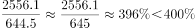

# 综合分析选非题——比重与倍数比值的逐项验证

考点：[[20-考点/资料分析/综合/综合分析选非题——比重与倍数比值的逐项验证|综合 / 综合分析选非题——比重与倍数比值的逐项验证]]
材料：[[15-材料/资料分析/280093 截至2019年12月31日中国共产党|280093 截至2019年12月31日中国共产党]]

**问法模型**：题干问'不能从上述资料中推出的是'（选非）→ 逐项用'部分÷整体'或'分子÷分母'算出实际比值，与选项给定的临界分数/倍数比较，找出说法错误的一项

## 推理链
1. 第1步：提取数据——2019年发展党员234.4万名其中学生84.4万名；党员总数9191.6万名；新中国成立前入党17.4万名；图1中56至60岁745.1万名、61岁及以上2657.7万名；职业存量中农牧渔民2556.1万名、工人（含工勤技能人员）644.5万名
2. 第2步：A项比重模型：84.4÷234.4≈36.0%＞1/3（33.3%），'学生占比超过1/3'成立，排除
3. 第3步：B项跨段拼数：55岁以上=745.1+2657.7=3402.8万名，55岁及以下占比=（9191.6-3402.8）÷9191.6=5788.8÷9191.6≈63.0%≤2/3（66.7%），'不超过2/3'成立，排除
4. 第4步：C项隐含推断：截至2019年底新中国成立前入党者均已满61岁，其占61岁及以上党员（2657.7万名）比重=17.4÷2657.7≈0.65%≤1%，'不超过1%'成立，排除
5. 第5步：D项倍数模型：农牧渔民÷工人=2556.1÷644.5，因644.5×4=2578＞2556.1，故比值≈3.97＜4，'之比超过4'不成立，说法错误
6. 第6步：本题为选非题，四个选项中仅D项不能推出，故正确答案为D

**最快解法**：⚡ 选非题优先验算可'乘法放缩一步定案'的D项：比较2556.1与644.5×4=2578，分子小于放缩值，比值必小于4，'超过4'直接判假即得答案；再口算复核其余三项——84.4/234.4截位直除≈36%＞1/3、(9191.6-3402.8)/9191.6≈63%＜2/3、17.4/2657.7≈0.65%＜1%，均成立，锁定D

## 易错点
- ⚠ 选非题方向陷阱：题干问'不能推出'，要选说法错误的D项，勿惯性选表述正确的项
- ⚠ 流量与存量口径混用：A项分母必须是2019年发展党员234.4万（年度流量），误用存量9191.6万会得出约0.9%的错误占比；'大专及以上学历''学生'等同名指标在两段中口径不同
- ⚠ 跨区间拼数与隐含推断：B项'55岁以上'须合并56—60岁与61岁及以上两段（745.1+2657.7），勿按图1条形长短串行读数；C项需自行推断'新中国成立前入党者至2019年底均满61岁'，材料未直接给出交集数据
- ⚠ 临界值附近误判：D项实际比值3.97与4极接近，粗估'约等于4倍'易误判为'超过'，必须用644.5×4=2578与2556.1比大小精判

## 母题抽象
> 🧩 当题干出现'不能从资料中推出'且各选项为'某比值超过/不超过某分数或倍数'时，逐项用部分÷整体（注意流量、存量分母区分）算出实际比值与临界值比较，优先处理可用'分母×临界值再与分子比大小'的乘法放缩项，一步锁定说法错误项即为答案

**同类特征**：不能推出（选非题）、各选项均为比值与给定分数/倍数的比较、流量占比（发展党员）与存量占比（党员总数）混合考查、需跨年龄段加总拼数（56—60岁+61岁及以上）、需隐含时间关系推断（新中国成立前入党者均已满61岁）、比值贴近临界值需放缩精判（3.97 vs 4）

## 相关题
- [[10-真题/资料分析/综合/2255788 综合分析—选非题（不能推出），混合定性增速判断、基期值估算、率差与'占比×城市数'部分量验证|2255788]]（江西 2016，相关度1）
- [[10-真题/资料分析/综合/2022292 综合判断题（选非）——混合平均数缺少权重不可推|2022292]]（吉林 2016，相关度1）
- [[10-真题/判断推理/逻辑判断/13504380 翻译推理-逆否规则与连锁递推（直言命题推出）|13504380]]（云南 2025，相关度1）

---

### 题干
不能从上述资料中推出的是：

### 选项
- A. 
2019年发展的党员人数中，学生党员占比超过

- B. 
截至2019年12月31日，55岁以下党员占党员总数的比不超过

- C. 
截至2019年12月31日，61岁及以上的党员人数中，新中国成立前入党的不超过

- D. 
截至2019年12月31日，从事农牧渔民职业的党员人数与工人（含工勤技能人员）党员人数之比超过
　✅

### 官方解析

A项：定位文字材料第二段：“2019年共发展党员234.4万名，……发展学生84.4万名”，则2019年发展的党员人数中，学生党员占比为，说法正确，排除；

B项：定位图1，截至2019年12月31日，55岁以上党员人数，则55岁及以下党员占党员总数的比55岁以上党员占党员总数的比，故55岁以下党员占党员总数的比不超过，说法正确，排除；

C项：定位文字材料第一段，新中国成立前入党的17.4万名；定位图1，截至2019年12月31日61岁以上党员人数为2657.7万名。而截至2019年12月31日，新中国成立前入党的人员都已满61岁。故61岁及以上的党员人数中，新中国成立前入党的人数占比为，说法正确，排除；

D项：定位文字材料第一段：“在党员的职业上，工人（含工勤技能人员）644.5万名，农牧渔民2556.1万名”，则从事农牧渔民职业的党员人数与工人（含工勤技能人员）党员人数之比为，说法错误，当选。

本题为选非题，故正确答案为D。

### 给定材料

        截至2019年12月31日，中国共产党党员总数为9191.6万名，同比增长。在党员的性别、民族和学历上，女党员2559.9万名，少数民族党员680.3万名，大专及以上学历党员4661.5万名。在党员的入党时间上，新中国成立前入党的17.4万名，新中国成立后至党的十一届三中全会前入党的1550.9万名，党的十一届三中全会后至党的十八大前入党的6127.7万名，党的十八大以来入党的1495.6万名。在党员的职业上，工人（含工勤技能人员）644.5万名，农牧渔民2556.1万名，企事业单位、社会组织专业技术人员1440.3万名，企事业单位、社会组织管理人员1010.4万名，党政机关工作人员767.8万名，学生196.0万名，其他职业人员710.4万名，离退休人员1866.1万名。

        2019年共发展党员234.4万名，比上年增长。其中，发展女党员99.4万名，占；发展少数民族党员23.6万名，占；发展35岁及以下党员188.3万名，占；发展具有大专及以上学历的党员106.8万名，占。发展党员的职业上，工人（含工勤技能人员）14.3万名，企事业单位、社会组织专业技术人员31.6万名，企事业单位、社会组织管理人员25.3万名，农牧渔民42.4万名，党政机关工作人员13.4万名，学生84.4万名，其他职业人员22.9万名。

