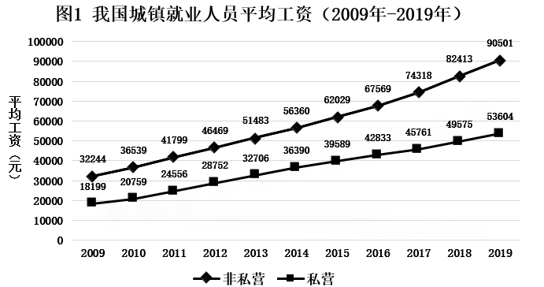
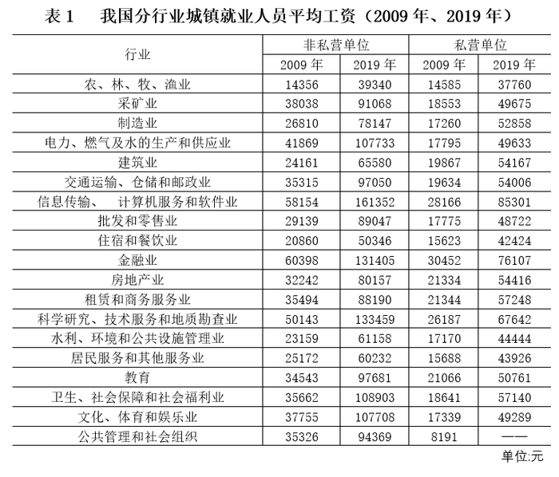

# 综合判断题（核心验证项为年均增长率大小比较，辅以数据可得性-口径判断）

考点：[[20-考点/资料分析/综合/综合判断题（核心验证项为年均增长率大小比较，辅以数据可得性-口径判断）|综合 / 综合判断题（核心验证项为年均增长率大小比较，辅以数据可得性/口径判断）]]
材料：[[15-材料/资料分析/280165 我国城镇就业人员平均工资：图1给出2|280165 我国城镇就业人员平均工资：图1给出2]]

**问法模型**：'下列选项说法正确的是'→逐项验证：A项用年均增长率比较模型（年份差n相同，只比现期/基期倍数），B/C/D项用'找反例+数据缺失/口径不符即可推出'的排除法处理

## 推理链
1. 第1步：A项从图1提取数据：非私营2009年32244元、2019年90501元；私营2009年18199元、2019年53604元；年份差2019-2009=10（n=10，两单位相同）
2. 第2步：年均增长率公式(1+r)^n=现期/基期，n相同时r大小只取决于现期/基期的倍数
3. 第3步：非私营倍数90501/32244≈2.81，私营倍数53604/18199≈2.95，2.95>2.81，故私营年均增长速度更快，A正确
4. 第4步：B项表1中2009年农林牧渔业私营14585元>非私营14356元，'各行业均高于'被反例推翻；且中间年份（2010-2018）分行业数据缺失，无法全面验证，B错误
5. 第5步：C项材料仅给'城镇就业人员平均工资'，未给'全社会平均工资'，且'最接近全社会平均→分配最公平'属无中生有，C错误
6. 第6步：D项表1公共管理和社会组织的私营单位2019年数据缺失（——），无法确定2019年私营行业最高/最低工资，'3.6倍'无从计算，D错误
7. 第7步：综上，只有A项正确，与官方答案一致

**最快解法**：⚡ 年均增长率倍数替代法：n相同则跳过开10次方，直接比现期/基期——私营53604/18199≈2.95>非私营90501/32244≈2.81，锁定A；B找农林牧渔业2009年私营14585>非私营14356的反例秒杀；C、D以'全社会口径未给'与'公共管理私营2019缺数'判'无法推出'直接排除

## 易错点
- ⚠ 年均增长率逐年开10次方硬算浪费时间——n相同时应约去，直接比较现期/基期倍数
- ⚠ '均高于'类全称判断须找反例：农林牧渔业2009年私营14585>非私营14356，打破'非私营全面高于私营'的直觉；同时注意中间年份分行业数据缺失，该选项双重不成立
- ⚠ 口径与数据缺失陷阱：图1是'城镇'平均工资≠'全社会'平均工资（C项）；公共管理和社会组织私营2019年为'——'，不能脑补数据算3.6倍（D项）；另注意两条折线数据标签密集易串行（本题A项只用首尾点，需核对非私营90501与私营53604不读错）

## 母题抽象
> 🧩 当综合判断题出现'年均增长速度比较'时，n相同只需比较现期/基期倍数即可定序；'各行业均高于/均低于'类选项用极端反例（如农林牧渔业私营反超非私营）证伪；涉及'全社会/全国全体'等材料未给口径、或表格缺数（——）的推断，一律判'无法推出'

**同类特征**：下列选项说法正确的是、2009年-2019年、年均增长速度快于、非私营vs私营双口径、现期/基期倍数比较、缺失数据无法推出

## 相关题
- [[10-真题/资料分析/其他/3522682 双序列逐年作差比较（差额最大年份判定）|3522682]]（广西 2021，相关度1）
- [[10-真题/资料分析/增长/3522690 年均增长率比较（现期-基期开n次方模型）|3522690]]（广西 2021，相关度1）
- [[10-真题/资料分析/综合/3523488 综合分析（逐项判断：利润率比较、销量趋势、利润总额变化、销售额比重最大）|3523488]]（新疆 2021，相关度1）

---

### 题干
下列选项说法正确的是：

### 选项
- A. 2009年-2019年，城镇私营单位平均工资年均增长速度快于非私营单位平均工资年均增长速度　✅
- B. 2009年-2019年，城镇非私营单位的各行业平均工资均高于私营单位相应行业的平均工资
- C. 2019年非私营采矿业的平均工资最接近全社会平均工资，所以该行业内部分配最公平
- D. 2019年城镇私营单位行业之间薪资差额最大的有3.6倍

### 官方解析
A项：定位折线图可知，城镇非私营单位平均工资2009年为32244元，2019年为90501元；城镇私营单位平均工资2009年为18199元，2019年为53604元。根据年均增长率公式：可得，n（年份差：2009年-2019年）相同，只需比较即可，即越大，年均增长率越大。则非私营单位：；私营单位：，故2009年-2019年，城镇私营单位平均工资年均增长速度快于非私营单位，正确；
B项：定位统计表可知，2009年农、林、牧、渔业私营单位平均工资为14585元，非私营单位为14356元，非私营平均工资并非均高于私营，且题干要求的是2009年-2019年，但材料只给了2009年和2019年的数据，中间年份的平均工资无法得知，错误；
C项：材料中没有说明全社会的平均工资，且没有提及行业内部分配问题，故无法推出，错误；
D项：材料未给出2019年公共管理和社会组织的城镇私营单位平均工资，故不能确定2019年城镇私营单位行业的最高薪资和最低薪资，故无法推出，错误。
故正确答案为A。

### 给定材料

