# 综合分析（逐项判断：利润率比较、销量趋势、利润总额变化、销售额比重最大）

考点：[[20-考点/资料分析/综合/综合分析（逐项判断：利润率比较、销量趋势、利润总额变化、销售额比重最大）|综合 / 综合分析（逐项判断：利润率比较、销量趋势、利润总额变化、销售额比重最大）]]
材料：[[15-材料/资料分析/280251 某公司某年度四个季度甲、乙、丙、丁四|280251 某公司某年度四个季度甲、乙、丙、丁四]]

**问法模型**：“下列选项说法正确的是”→综合分析题，逐项验证：先排只需直接读表比较的选项（趋势、大小），再对需乘法/减法派生的选项用“整体相同比部分”或量级估算快速核验

## 推理链
1. 第1步：A项提取单价与成本：甲四季单价12/12/13/13元、成本10/10/11/10元，单件利润2/2/2/3元；丙四季单价4.5/4.5/5.0/4.6元、成本2.5/2.5/3.0/2.6元，单件利润恒为2元
2. 第2步：A项利润率=利润÷成本：甲各季约20%/20%/18.2%/30%，丙各季约80%/80%/66.7%/76.9%，丙的利润率区间整体高于甲，甲并非最高，A错误
3. 第3步：B项直接读乙产品销量行：12260→13130→13280→13550件，四个季度连续上升，“有升有降”不成立，B错误
4. 第4步：C项丙单件利润=单价−成本=2元虽四季不变，但利润总额=单件利润×销量，销量46350/48980/45610/45820件逐季在变（如第1季度利润92700元≠第2季度97960元），C错误
5. 第5步：D项全年销售总额=Σ(各季销量×单价)：甲=244200+264120+235040+251160=994520元，乙=(12260+13130+13280+13550)×15=52220×15=783300元，丙=208575+220410+228050+210772=867807元，丁=566800+631764+504320+578816=2281700元
6. 第6步：D项整体（全年全公司销售总额）为同一定值，比重最大化等价于部分（各产品销售总额）最大化，丁的2281700元为四者最大，故丁占比最大，D正确

**最快解法**：⚡ 综合分析“先易后难”+量级估算：B项读乙销量行约10秒排除（四季递增）；C项由丙单件利润恒2元但销量逐季变排除；A项口算利润率：丙单件利润2元÷成本2.5~3.0元超60%，远超甲约2~3元÷10~11元的20%左右，排除；D项量级估算：丁≈130元×约1.7万件≈220万元，甲≈12元×约8万件≈96万元，乙=15元×5.2万件≈78万元，丙≈4.7元×约18.7万件≈87万元，丁最大，无需精算即可锁定

## 易错点
- ⚠ 混淆“单件利润”与“利润率”：甲单件利润2~3元绝对值不低，但利润率=利润÷成本（或÷单价），丙成本基数仅2.5~3.0元，利润率远高于甲，只比单件利润绝对值会误判A正确
- ⚠ C项“单件利润不变”≠“利润总额不变”：利润总额=单件利润×销量，丙销量逐季变动（46350→48980等），误把单件指标当作总量指标会错选C
- ⚠ D项被丁产品“销量四季最低（每季仅约4000件）”的表象误导：丁单价为百元级（128~138元），比丙单价高约两个数量级，销售额=销量×单价必须乘出量级再比较，只看销量会漏掉D

## 母题抽象
> 🧩 当综合分析题问“下列说法正确的是”且选项涉及利润率、利润总额、比重等派生指标时，先用读表类选项（趋势、升降）快速排除，再对乘法派生类选项用“整体相同比部分”和量级估算锁定答案

**同类特征**：下列选项说法正确的是、四种产品四个季度复合表、利润率最高、销量有升有降、单件利润不变与利润总额、销售总额占比重最大

## 相关题
- [[10-真题/资料分析/比重/14993607 现期利润率（利润总额÷互联网业务收入）逐省计算比较+与基准作百分点差|14993607]]（选调 2024，相关度1）
- [[10-真题/资料分析/综合/3522692 综合判断题（核心验证项为年均增长率大小比较，辅以数据可得性-口径判断）|3522692]]（广西 2021，相关度1）

---

### 题干
根据资料，下列选项说法正确的是：

### 选项
- A. 在四种产品中，甲产品的利润率最高
- B. 乙产品的销量在四个季度有升有降
- C. 由于丙产品每季度单位产品利润没有变化，所以每个季度的利润总额也没有发生变化
- D. 在四种产品中，销售总额占全年全公司销售总额比重最大的是丁产品　✅

### 官方解析

A项：定位表格材料，甲产品四个季度的单位成本依次为10元、10元、11元、10元，销售单价依次为12元、12元、13元、13元，丙产品四个季度的单位成本依次为2.5元、2.5元、3.0元、2.6元，销售单价依次为4.5元、4.5元、5.0元、4.6元。由利润率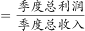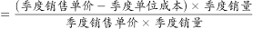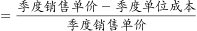得，甲产品四个季度的利润率分别为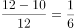、、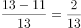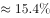、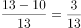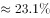，甲产品全年的利润率可以看成四个季度利润率的混合，根据总体混合居中，甲产品全年的利润率应介于~之间。同理，丙产品四个季度的利润率分别为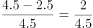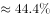、、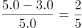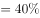、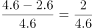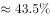，则丙产品的利润率应介于~之间，则丙产品的利润率大于甲产品的利润率，甲产品的利润率并非最高，错误；

B项：定位表格材料，乙产品四个季度的销量分比为12660件、13130件、13280件、13550件，可知乙产品的销量在四个季度中均为上升，错误；

C项：定位表格材料，丙产品第1季度、第2季度的销量分别为46350件、48980件，单位成本分别为2.5元、2.5元，销售单价分别为4.5元、4.5元，根据利润总额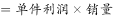，虽然单位利润不变，但销量变化，所以第1季度、第2季度的利润总额是不一样的，错误；

D项：根据比重，整体（全年全公司销售总额）相同，只需比较部分（各产品销售总额）即可，再根据销售总额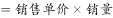，定位表格材料，可知甲产品的销售总额为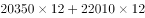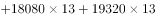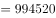元，乙产品的销售总额为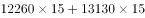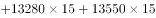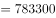元，丙产品的销售总额为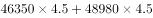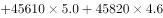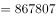元，丁产品的销售总额为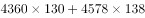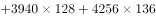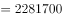元，则丁产品的销售总额最大，故占比也最高，正确。

故正确答案为D。

### 给定材料

某公司全年销售甲、乙、丙、丁四种产品的销量，单位成本和销售单价如下：

> [!warning] 疑点（官方解析可能有误，待人工复核）
> 官方解析B项将乙产品第1季度销量误写为“12660件”（表中实为12260件），属笔误，不影响“四季持续上升”的结论；另A、D项解析中利润率与各产品销售总额的具体算式数值缺失（空白），经按表核验结论一致，不影响正确答案D

<!-- CODEX-ANSWER-REVIEW:BEGIN -->
### 本次独立复核

**复核状态：** `confirmed`（独立复算确认答案）

**计分答案：** D（可计分）

**复核解析：**

按季度表逐项累加四种产品销售额，丁产品全年合计最高，因此其销售额占公司全年总销售额比重最大，D成立。甲利润率并非最高；乙销量各季均增加；丙单位利润固定但销量变化，利润总额仍变化。

**相关信息：**

独立复核：按题干定义逐项检验，关键基数、比值、增速与图表读数写明以便复算。

**题源依据：** [固定版本原题](https://github.com/Mentat-Uran/kaogongzhentizhengliu/blob/84ab93d4b64b61d897bece8a1c0a5bab06b4feb2/10-%E7%9C%9F%E9%A2%98/%E8%B5%84%E6%96%99%E5%88%86%E6%9E%90/%E7%BB%BC%E5%90%88/3523488%20%E7%BB%BC%E5%90%88%E5%88%86%E6%9E%90%EF%BC%88%E9%80%90%E9%A1%B9%E5%88%A4%E6%96%AD%EF%BC%9A%E5%88%A9%E6%B6%A6%E7%8E%87%E6%AF%94%E8%BE%83%E3%80%81%E9%94%80%E9%87%8F%E8%B6%8B%E5%8A%BF%E3%80%81%E5%88%A9%E6%B6%A6%E6%80%BB%E9%A2%9D%E5%8F%98%E5%8C%96%E3%80%81%E9%94%80%E5%94%AE%E9%A2%9D%E6%AF%94%E9%87%8D%E6%9C%80%E5%A4%A7%EF%BC%89.md)；固定内容 commit `84ab93d4b64b61d897bece8a1c0a5bab06b4feb2`，Markdown blob `0bbde922249dba9c1d1591523ef1f71b1f5fcb4f`。
<!-- CODEX-ANSWER-REVIEW:END -->
