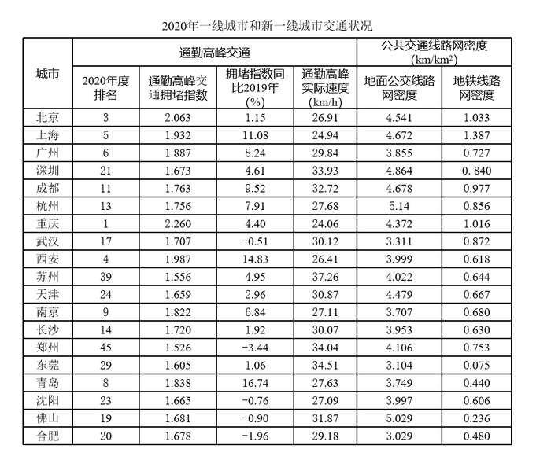

# 综合分析选非题（比重计算＋极值比较＋定性推断）

考点：[[20-考点/资料分析/综合/综合分析选非题（比重计算＋极值比较＋定性推断）|综合 / 综合分析选非题（比重计算＋极值比较＋定性推断）]]
材料：[[15-材料/资料分析/280256 2020年一线城市和新一线城市的通勤|280256 2020年一线城市和新一线城市的通勤]]

**问法模型**：『下列选项说法错误的是』为选非题 → 逐项用表中数据验证：A算前10名中新一线占比的比重，B比拥堵指数最小值，C/D按'指数+速度+密度'做合理推断，锁定与材料矛盾的一项

## 推理链
1. 第1步：A项——表中2020年度排名≤10的城市共7个：重庆(第1)、北京(第3)、西安(第4)、上海(第5)、广州(第6)、青岛(第8)、南京(第9)
2. 第2步：A项——剔除一线城市北上广深，其中新一线为重庆、西安、青岛、南京共4个，占比=4/7≈57.1%，与A项所给比例不符 → A错误
3. 第3步：B项——15个新一线城市中拥堵指数最低的是郑州(1.526，全国第45名)，'只考虑拥堵则最宜居'说法成立 → B正确
4. 第4步：C项——佛山2020年排名第19，拥堵指数同比-0.90%（指数下降），且地面公交线网密度5.029居表中第二高（仅次于杭州5.14），'增加地面公交投入'的推断合理 → C正确
5. 第5步：D项——重庆拥堵指数2.260为表中最高（全国第1）、通勤高峰实际速度24.06km/h为表中最低，'高峰限行私家车可缓解拥堵'推断合理 → D正确
6. 第6步：本题选'错误'项，故正确答案为A，与官方答案一致

**最快解法**：⚡ 选非题优先验证含具体数字的选项A——数数法+分数口算：表中排名≤10的有7城，去掉北上广深剩4个新一线，4/7≈57%（口算：4/7≈0.57），与A项给出的比例比对不一致即锁错，无需精算B/C/D的定性推断项

## 易错点
- ⚠ 排名≠指数大小：排名数字小只代表名次靠前（第1名重庆指数2.260最大），比较拥堵程度必须用'拥堵指数'列而非'排名'列——B项郑州排名45最靠后但指数1.526最低
- ⚠ 一线/新一线口径：北上广深不属于新一线城市，算'前10位中新一线占比'时必须把北京(第3)、上海(第5)、广州(第6)从分子分母中剔除，否则子集与分母同时算错
- ⚠ 表中只覆盖一线和新一线城市，全国第2、7、10名的城市不在表内，'全国前10中新一线占比'严格口径下无法精确确定，只能按表中7城计算4/7≈57.1%——官方已备注题干表述不明确、按优中选优处理，但A项必错

## 母题抽象
> 🧩 当综合分析选非题出现'某群体中占比达到X'的选项时，先数清子集个数与分母个数（注意剔除题干指定的口径如'北上广深'），用常见分数口算（4/7≈57%）直接比对判错；其余定性选项只需找表中极值（最大/最小的指数、速度、密度）验证方向即可

**同类特征**：下列选项说法错误的是（选非题）、排名全国前10位、新一线城市占比、一线城市=北上广深、最宜居/拥堵指数最低、定量计算+定性推断混合选项

## 相关题
（暂无）

---

### 题干
根据资料，下列选项说法错误的是：

### 选项
- A. 
2020年，在通勤高峰交通拥堵指数排名全国前10位的城市中，新一线城市占比达到
　✅
- B. 
如果只考虑交通拥堵情况，新一线城市中最宜居的是郑州

- C. 
假设2020年佛山的拥堵排名比上年下降4位，极有可能是该市增加了地面公交投入

- D. 
如果重庆要在2021年缓解交通拥堵，一个有效的办法是在通勤的高峰限制私家车出行

### 官方解析
A项：定位表格材料，2020年通勤高峰交通拥堵指数排名全国前10位的新一线城市分别是重庆、西安、青岛、南京4个，占比为，不是。错误；
B项：定位表格材料，新一线城市中，通勤高峰交通拥堵指数最低的是郑州。正确；
C项：定位表格材料，佛山的拥堵排名比上年下降，且观察数据可得，佛山地面公交线路网密度的数据全国表现突出，由此推断极有可能是该市增加了地面公交投入。正确；
D项：定位表格材料，重庆通勤高峰实际速度较慢，由此可以推断应是高峰期私家车辆过多导致的，故高峰期限制私家车出行可能会缓解交通拥堵。正确。
本题为选非题，故正确答案为A。
备注：
1、北京、上海、广州、深圳不属于新一线城市。
2、本道题目题干表述不明确，采取优中选优的方式选择，A项必错，在考场上其余选项不确定是否必错的情况下可做跳过处理。

### 给定材料

> [!warning] 疑点（官方解析可能有误，待人工复核）
> A项选项中的占比分数与官方解析中'占比为___，不是___'两处均为图片公式、未能读取具体数值，仅能依据官方判定确认'实际占比4/7≈57.1%与A项所给数值不符、A项必错'；另全国排名前10中第2、7、10名城市不在表内，该占比严格口径下无法唯一确定，官方备注已自认题干表述不明确并按优中选优处理，此口径瑕疵不影响答案A
