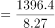
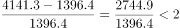
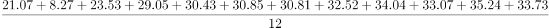
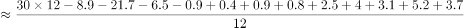
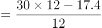

# 综合分析-逐项验证（平均运输距离-日均货运量换算-同比增长率-月均加总，多考点混合判断）

考点：[[20-考点/资料分析/综合/综合分析-逐项验证（平均运输距离-日均货运量换算-同比增长率-月均加总，多考点混合判断）|综合 / 综合分析-逐项验证（平均运输距离/日均货运量换算/同比增长率/月均加总，多考点混合判断）]]
材料：[[15-材料/资料分析/280257 2020年1-12月全国公路货物运输|280257 2020年1-12月全国公路货物运输]]

**问法模型**：'可以推出的是'综合判断题 → 对A/B/C/D四个选项分别套用对应模型逐项验证：A用平均距离=周转量÷货运量，B用日均=月货运量÷当月天数，C用增长率=(现期-基期)÷基期，D用月均=全年加总÷12

## 推理链
1. 第1步：A项：从图中取2月货物周转量1396.4亿吨公里、货运量8.27亿吨，按注释公式平均距离=1396.4÷8.27≈168.9公里，不在170-175公里区间，A错误
2. 第2步：B项：日均货运量多于1亿吨⇔当月货运量（亿吨数）大于当月天数，1-12月天数分别为31、29、31、30、31、30、31、31、30、31、30、31天
3. 第3步：逐月比大小：6月30.85>30、8月32.52>31、9月34.04>30、10月33.07>31、11月35.24>30、12月33.73>31共6个月满足；5月30.43<31、7月30.81<31不满足，B正确
4. 第4步：C项：3月周转量4141.3比2月1396.4多2744.9，增长率=2744.9÷1396.4≈196.6%，不到2倍（200%），C错误
5. 第5步：D项：全年货运量加总=21.07+8.27+23.53+29.05+30.43+30.85+30.81+32.52+34.04+33.07+35.24+33.73=342.61亿吨，月均=342.61÷12≈28.6亿吨<30亿吨，D错误
6. 第6步：四个选项中仅B可推出，与官方答案一致，选B

**最快解法**：⚡ 等价转化+估算排除法：B项将'日均>1亿吨'等价转化为'月货运量亿吨数>当月天数'，免做除法直接比大小（30.85>30、30.81<31等），秒数出6月/8月/9月/10月/11月/12月共6个；A项1396.4÷8.27≈169公里（8.27×170=1405.9>1396.4即不足170）排除；C项2744.9÷1396.4≈1.97<2排除；D项全年总和≈342.6÷12≈28.6<30排除

## 易错点
- ⚠ B项判定阈值是'日均>1亿吨'而非'月量>30亿吨'，必须与当月实际天数比：2020年闰年2月29天，7月30.81>30但30.81<31不满足，5月30.43<31不满足，凭目测或统一按30天会误判
- ⚠ C项'比2月份多…以上'是增长率口径(4141.3-1396.4)÷1396.4≈196.6%，易与'是2月的几倍'(4141.3÷1396.4≈2.97倍)混淆导致误判
- ⚠ D项2月断崖低谷8.27亿吨拉低全年均值（月均≈28.6亿吨），下半年多数月份超30亿吨易凭直观误判'月均超过30亿吨'；12个月须逐月加总不能漏2月
- ⚠ 双轴图陷阱：柱（亿吨）与线（亿吨公里）刻度、单位均不同，A项平均距离是复合比率，须用当月周转量÷当月货运量，不能读图目测

## 母题抽象
> 🧩 当综合分析题出现'日均/月均超过某值'特征时，将日均阈值乘以天数（或月量与天数直接比大小）转化为免除法的比大小；'比…多百分之几'用(现-基)÷基计算并与'是几倍'口径区分；'月均超过X'先粗算全年总和÷12再与X比较，逐项验证排除

**同类特征**：可以推出的是（综合分析逐项判断）、货运平均运输距离=周转量/货运量、日均货运量多于1亿吨、3月份比2月份多…以上（增长率）、全年月均货运量、月度当月值双轴组合图

## 相关题
（暂无）

---

### 题干
关于2020年全国公路货物运输情况的描述，可以推出的是：

### 选项
- A. 
2月份货运平均运输距离在170-175公里

- B. 
全年日均货运量多于1亿吨的月份有6个
　✅
- C. 
3月份货物周转量比2月份多以上

- D. 
全年月均货运量超过30亿吨

### 官方解析

A项：定位统计图材料可得，2020年2月份公路货物周转量1396.4亿吨公里，货运量为8.27亿吨，货物平均运输距离公里，不在170-175公里范围内，错误；

B项：定位统计图材料可得，2020年1-12月货运量分别为21.07、8.27、23.53、29.05、30.43、30.85、30.81、32.52、34.04、33.07、35.24、33.73亿吨，2020年1-12月所对应的天数分别为31、29、31、30、31、30、31、31、30、31、30、31天，则日均货运量多于1亿吨的有6月、8月、9月、10月、11月、12月，共计6个月份，正确；

C项：定位统计图材料可得，2020年2月份公路货物周转量1396.4亿吨公里，3月份为4141.3亿吨公里，3月份货物周转量比2月份多，即不到，错误；

D项：定位统计图材料可得，2020年月均货运量为亿吨，错误。

故正确答案为B。

### 给定材料

