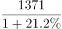
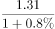
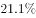

# 综合判断（选非题）——数据可得性核对＋基期值-基期比重推算

考点：[[20-考点/资料分析/综合/综合判断（选非题）——数据可得性核对＋基期值-基期比重推算|综合 / 综合判断（选非题）——数据可得性核对＋基期值/基期比重推算]]
材料：[[15-材料/资料分析/280258 2019年我国电信业务收入规模、增速|280258 2019年我国电信业务收入规模、增速]]

**问法模型**：题干出现'不能从上述材料中推出的是'（选非）→ 逐项列出该选项所需的量（现期值、对应增速、相邻年份值），能用'基期=现期/(1+增速)'或'基期比重=部分现期/(1+部分增速)÷[整体现期/(1+整体增速)]'补齐的为可推出，缺相邻两期数据的增长率判定为不可推出

## 推理链
1. 第1步：选非题，先盘点材料数据：2019年电信总收入1.31万亿元=13100亿元，图中折线给出2019年增速0.8%及2014-2018年各年增速2.9%、6.6%、5.4%、-2%、-1.6%，文字给出固定增值业务收入1371亿元、其中IPTV 294亿元（各分项2019年增速按官方口径材料中可查）
2. 第2步：A项需2018年固定增值业务收入，套基期公式：2018年=1371/(1+2019年增速)，现期值与增速均齐备→可推出
3. 第3步：B项需2014-2018年总收入，先算2018年=13100/1.008≈13000亿元，再沿折线逐年反推：÷1.029得2017年、÷1.066得2016年、÷1.054得2015年、负增长的2014年÷0.98，五项相加即得→可推出
4. 第4步：C项需2018年物联网业务收入的同比增长率，增长率=(2018年值-2017年值)/2017年值，而材料中物联网业务只给出2019年增速、连金额都未给，更无2017、2018年任何数值，公式无法构造→不可推出
5. 第5步：D项需2018年IPTV占比，用基期比重公式：[294/(1+g_IPTV)]÷[13100/(1+0.8%)]=294/13100×(1+0.8%)/(1+g_IPTV)，四个量（294、13100、0.8%、g_IPTV）材料中均有→可推出
6. 第6步：只有C项所需数据无论如何拼不出，故选C

**最快解法**：⚡ 数据可得性快判＋基期公式验证：先扫数据最'裸'的物联网——材料仅给其2019年增速、未给金额，求2018年增速必须要有2018与2017两期值，必然无解，直接锁定C；再用基期公式快速验证A（1371/(1+增速)）、D（294/13100×(1+0.8%)/(1+g_IPTV)）、B（13100/1.008≈13000亿元后沿折线逐年反推）均可推出，放心选C

## 易错点
- ⚠ 选非题审题反了：把'不能推出'看成'能推出'，见A/B/D都会算反而误选
- ⚠ 跨期增长率陷阱：能由基期公式算出2018年的值≠能得2018年的增速，2018年增速还需要2017年值或2018年增速本身，物联网恰好两样都没有；另外'移动/固定通信业务收入占比'（图中结构比重）与'移动/固定数据及互联网业务收入'（文字分项）口径不同，不能拿占比冒充增速
- ⚠ 计算细节：万亿元↔亿元须统一（1.31万亿=13100亿）；沿折线反推时2015、2014年为负增长（-2%、-1.6%），应除以0.98、0.984而非1.02、1.016，方向易错

## 母题抽象
> 🧩 当题干出现'不能（能）从材料中推出'的选非判断时，用'数据可得性清单法'逐项核对：基期值需'现期+对应增速'，基期比重需四个量齐备，跨期增长率必须有两期值（或基期增速）——缺关键量者即为答案，其余项用基期公式快速验证排除

**同类特征**：不能从材料中推出（选非）、逐项判定数据可得性、基期值=现期/(1+增速)、基期比重公式、跨期同比增速需相邻两期数据、物联网业务收入未给金额

## 相关题
（暂无）

---

### 题干
不能从上述材料中推出的是：

### 选项
- A. 2018年固定增值业务收入
- B. 2014-2018年电信业务总收入
- C. 2018年物联网业务收入的同比增长率　✅
- D. 2018年IPTV业务收入在全年电信业务收入中的占比

### 官方解析

A项：定位文字材料可得：（2019年）固定增值业务收入1371亿元，比上年增长。根据公式：，则2018年固定增值业务收入为亿元，可以推出，正确；

B项：定位文字材料可得：2019年，我国电信业务收入完成1.31万亿元，比上年增长。根据公式：，则2018年我国电信业务收入为万亿元。定位图形材料可得：2014-2018年电信业务收入的同比增速，同理可推出2017年、2016年、2015年、2014年的电信业务收入，进而可推出2014-2018年电信业务总收入，正确；

C项：材料中仅给出2019年物联网业务收入的同比增速，无法推出2018年物联网业务收入的同比增长率，错误；

D项：基期比重公式为，定位文字材料可得：2019年，我国电信业务收入完成1.31万亿元（），比上年增长（）；IPTV（网络电视）业务收入294亿元（），比上年增长（）。因此基期比重公式里的、、、四个量均有数据，可以推出2018年IPTV业务收入在全年电信业务收入中的占比，正确。

本题为选非题，故正确答案为C。

### 给定材料

        2019年，我国电信业务收入完成1.31万亿元，比上年增长。其中：固定数据及互联网业务收入完成2175亿元，比上年增长；移动数据及互联网业务收入6082亿元，比上年增长；固定增值业务收入1371亿元，比上年增长，其中，IPTV（网络电视）业务收入294亿元，比上年增长；物联网业务收入比上年增长。

> [!warning] 疑点（官方解析可能有误，待人工复核）
> 所给文字材料中'比上年增长'后的增速数值全部为空格缺失（图折线仅提供总收入各年增速，2019年为0.8%），与官方解析'固定增值/IPTV/物联网2019年增速可查、D项四个量均有数据'的表述存在口径出入；若严格按空格版材料，A、D同样缺分项增速无法计算，但物联网连金额都未给、求2018年增速必须要有2017-2018两期数据，C'不能推出'的结论在任何口径下均成立，官方答案C无误
