# 综合判断（核心：两期比重比较，兼考月均、比重计算、增长率比较）

考点：[[20-考点/资料分析/综合/综合判断（核心：两期比重比较，兼考月均、比重计算、增长率比较）|综合 / 综合判断（核心：两期比重比较，兼考月均、比重计算、增长率比较）]]
材料：[[15-材料/资料分析/280259 2017年上海三个统计口径（上海口岸|280259 2017年上海三个统计口径（上海口岸]]

**问法模型**：“能够从上述资料中推出的是”的综合判断题 → 四个选项分涉不同模型逐一验算排除：月均=总额÷12、占比=部分÷整体、两期比重升降只比部分增速与整体增速、增速=(现期−基期)/基期

## 推理链
1. 第1步：A项——定位文字段，上海关区2017年货物进出口总额59690.24亿元，月均=59690.24÷12≈4974.19亿元＜5000亿元，A错误
2. 第2步：B项——定位表格，2017年上海市自欧盟进口4488.51亿元；定位文字段，上海市进口总额19117.51亿元，占比=4488.51÷19117.51≈23.5%（或19117.51×30%≈5735.25＞4488.51），不到三成，B错误
3. 第3步：C项——定位表格，自东盟进口2016年2069.86亿元→2017年2642.73亿元，部分增速=(2642.73−2069.86)÷2069.86≈27.7%；文字段给出上海市进口总额19117.51亿元及其整体增速（数值在所给文本中缺失，须回原卷读取）
4. 第4步：C项用两期比重比较口诀——部分增速＞整体增速时比重上升；东盟进口部分增速≈27.7%高于上海市进口整体增速，故2017年占比高于上年水平，C正确
5. 第5步：D项——自日本进口增速=(2224.75−1941.73)÷1941.73≈14.6%，对日本出口增速=(1308.98−1266.95)÷1266.95≈3.3%，进口增速快于出口增速，D“慢于”表述错误
6. 第6步：综上排除A、B、D，答案为C

**最快解法**：⚡ 综合题按“先简后繁”截位秒杀：A用截位直除59690÷12≈4974＜5000直接排除（若误用口岸79211÷12≈6601会误判，务必认准“关区”口径）；B用特值法19117×0.3≈5735＞4488秒排；C用两期比重口诀只需比增速——东盟进口增速572.87/2069.86≈27.7%＞整体进口增速，秒选；D用“增量÷基期”比较，进口增量283.02远大于出口增量42.03且基期同量级，进口增速明显更快，“慢于”排除

## 易错点
- ⚠ 三套口径张冠李戴：A必须用“上海关区”59690.24亿元，误用“上海口岸”79211.40或“上海市”32237.82会得出月均超5000的错误判断
- ⚠ B项分母须取上海市进口总额19117.51（文字段），误用进出口总额32237.82或表格8国合计（约14063.18，且只是部分数据）都会算错占比
- ⚠ C项所需整体增速在所给文本中缺失，须回原卷读取，不得默认为0或编造；D项比较方向易反——实际进口增速≈14.6%快于出口增速≈3.3%，“慢于”恰好说反

## 母题抽象
> 🧩 当综合判断题出现“月均超过某值/占比高于上年/增速快慢比较”混合问法时，按“月均=总额÷12、两期比重升降只看部分增速与整体增速的相对大小、增速比较用(现期−基期)/基期”逐项截位排除，先算最易的选项建立排除基础

**同类特征**：能够从上述资料中推出的是、月均贸易额超5000亿元、占比高于上年水平（两期比重）、三成（30%）占比表述、自……进口与对……出口增速比较、四选项分涉四个考点需逐一排除

## 相关题
- [[10-真题/资料分析/综合/19283943 综合分析判断题（倍数比较+求和判断+隐含平均每场座位数反推）|19283943]]（国考 2025，相关度1）
- [[10-真题/资料分析/综合/1796162 综合判断（月均计算、平均运输距离、比重对比、增长量比较逐项验证）|1796162]]（贵州 2016，相关度1）
- [[10-真题/资料分析/综合/2133504 综合判断题（现期比重+现期平均数多项验证，一对三错）|2133504]]（国考 2018，相关度1）
- [[10-真题/资料分析/综合/2444706 综合判断题（增长量+比重+倍数逐项验证）|2444706]]（四川 2019，相关度1）
- [[10-真题/资料分析/综合/2571728 综合分析逐项判断（等差递推求和＋单位换算＋比值估算）|2571728]]（山东 2020，相关度1）

---

### 题干
能够从上述资料中推出的是：

### 选项
- A. 2017年，上海关区月均货物进出口贸易额超过5000亿元
- B. 2017年，上海市自欧盟货物进口额占其进口总额的三成以上
- C. 2017年，上海市货物进口总额中自东盟进口额占比高于上年水平　✅
- D. 2017年，上海市自日本进口额同比增速慢于对日本出口额同比增速

### 官方解析

A项：定位文字材料第一段可知，全年上海关区货物进出口总额59690.24亿元。根据公式：月均货物进出口贸易额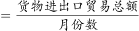可得，2017年上海关区月均货物进出口贸易额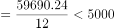亿元，错误；

B项：定位表格材料可知，2017年上海市自欧盟货物进口额为4488.51亿元；定位文字材料第二段可知，全年上海市货物进口19117.51亿元。则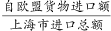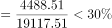，即上海市自欧盟货物进口额占其进口总额不到三成，错误；

C项：定位表格材料可知，上海市货物进口总额中自东盟进口额2016年为2069.86亿元，2017年为2642.73亿元；定位文字材料第二段可知，2017年全年上海市货物进口19117.51亿元，增长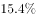。根据两期比重比较口诀：当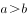时，比重上升，即高于上年水平。则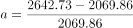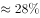，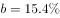，符合，正确；

D项：定位表格材料可知，上海市自日本进口额2016年为1941.73亿元，2017年为2224.75亿元；上海市对日本出口额2016年为1266.95亿元，2017年为1308.98亿元。根据公式：增长率可得，进口额的增长率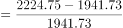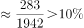，出口额的增长率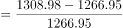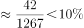，故2017年上海市自日本进口额同比增速快于对日本出口额同比增速，错误。

故正确答案为C。

### 给定材料

        2017年全年，上海口岸货物进出口总额79211.40亿元，比上年增长。其中，进口33445.10亿元，增长；出口45766.30亿元，增长。全年上海关区货物进出口总额59690.24亿元，比上年增长。其中，进口24684.20亿元，增长；出口35006.04亿元，增长。

        全年上海市货物进出口总额32237.82亿元，比上年增长。其中，进口19117.51亿元，增长；出口13120.31亿元，增长。

> [!warning] 疑点（官方解析可能有误，待人工复核）
> 官方解析C、D项中的算式数值在解析文本中呈现为空白，根源是材料文字段所有增速百分比在所给文本中缺失：C项的成立依赖原卷“上海市进口19117.51亿元，增长r%”中r＜27.7%（东盟进口部分增速），当前文本无法独立复现该步；D项则可直接用表格两年数据算出（进口≈14.6%＞出口≈3.3%）。此为材料/解析文本呈现缺漏，不改变官方答案C的判定
