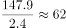
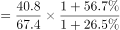
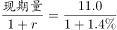

# 综合分析选非题（倍数计算、基期比重、基期量、增速计数逐项验证）

考点：[[20-考点/资料分析/综合/综合分析选非题（倍数计算、基期比重、基期量、增速计数逐项验证）|综合 / 综合分析选非题（倍数计算、基期比重、基期量、增速计数逐项验证）]]
材料：[[15-材料/资料分析/294539 2018年H市国民经济与社会统计公报|294539 2018年H市国民经济与社会统计公报]]

**问法模型**：题干为'下列不能从上述资料中推出的是'的选非综合判断题 → 对A~D逐项验证，三项为真、找唯一为假项；含具体数值的项优先用截位直除验量级

## 推理链
1. 第1步：本题选非，C项给出具体数值0.85亿元且涉及基期量计算，定位第三段'寿险业务保费赔付11.0亿元，增长1.4%'作为突破口
2. 第2步：用基期量公式：2017年寿险保费赔付=11.0÷(1+1.4%)=11.0÷1.014≈10.85亿元，与选项0.85亿元相差10倍量级，C项不能推出（0.85实为财产险赔付0.9÷1.057≈0.85亿元的张冠李戴）
3. 第3步：验证A项，定位第一段：秋粮147.9万吨÷夏粮2.4万吨≈61.6≈62倍，A可推出
4. 第4步：验证B项（基期比重）：2017年邮政=40.8÷1.265≈32.3亿元，2017年电信=67.4÷1.567≈43.0亿元，32.3÷43.0≈75%，B可推出
5. 第5步：验证D项，第三段保费收入各分项增速：寿险-5.1%、健康和意外险+21.6%、财产险+25.2%、车险+1.8%，高于10%的仅健康和意外险与财产险共2个，D可推出
6. 第6步：选非题中唯一为假的是C项，与官方答案C一致

**最快解法**：⚡ 选非题'先验具体数值项、后验计数项'：C项用截位直除11.0÷1.014≈10.9亿元，与0.85亿元量级明显不符（约10倍差距）秒判为不能推出项；再用147.9÷2.4≈62验A、(40.8/1.265)÷(67.4/1.567)≈75%验B、数保费收入增速>10%的项验D即可全部锁定

## 易错点
- ⚠ 张冠李戴：0.85亿元实为财产险赔付的2017年基期值（0.9÷1.057≈0.85），误与寿险赔付11.0亿元对应；且'寿险保费收入39.5亿元'与'寿险保费赔付11.0亿元'同段同名不同口径（收入段与赔付段两套并列指标），跨指标取数必错
- ⚠ D项计数口径：只能用'保费收入'各分项增速判定，若误把赔付段增速（如健康和意外险赔付+68.7%）计入会多算；寿险-5.1%为负、车险+1.8%均不满足>10%
- ⚠ B项不能直接用现期比40.8÷67.4≈60.5%代替基期比重，须先各自除以(1+增速)折算2017年基期量再相除；且按官方备注，邮政与电信为并列分项，'占比'表述本身不严谨

## 母题抽象
> 🧩 当题干出现'不能从资料中推出/无法推出'的选非判断时，用'逐项验证+量级排查'法：优先验算含具体数值的基期量、倍数项（截位直除看量级），量级明显不符者即答案，再对倍数、基期比重、增速计数项粗验印证

**同类特征**：不能从上述资料中推出、选非题、秋粮约是夏粮的62倍、基期比重约75%、基期量约0.85亿元、增速高于10%的业务类型有2个

## 相关题
- [[10-真题/资料分析/综合/14355349 综合分析-选非题（增长率计算比较+人均值计算）|14355349]]（浙江 2024，相关度2）
- [[10-真题/资料分析/综合/2719459 综合分析选非题（现期比重+现期平均数+单位换算混合验证）|2719459]]（国考 2021，相关度2）
- [[10-真题/资料分析/综合/19283743 综合分析-选非题（平均数增长率+增长量比较+比重临界值验证）|19283743]]（国考 2025，相关度2）
- [[10-真题/资料分析/综合/13504445 综合判断选非题（基期增长量计算+混合增长率比重比较+两期平均数比较+总量构成差）|13504445]]（河北 2025，相关度2）
- [[10-真题/资料分析/综合/16593091 综合判断选非题（基期值+两期平均数比较+比重计算+两期比重变化）|16593091]]（新疆 2024，相关度2）

---

### 题干
下列不能从上述资料中推出的是：

### 选项
- A. 2018年秋粮的产量约是夏粮的62倍
- B. 2017年邮政业务总量约占电信业务总量的75%
- C. 2017年寿险业务保费赔付金额约0.85亿元　✅
- D. 2018年全年保费收入同比增速高于10%的业务类型有2个

### 官方解析

A项：定位文字材料第一段可得：2018年······夏粮2.4万吨，秋粮147.9万吨。则所求倍数为倍，正确；

B项：定位文字材料第二段可得：2018年H市······邮政业务总量40.8亿元（），同比增长（）；电信业务总量67.4亿元（），同比增长（）。所求基期比重为，正确；

C项：定位文字材料第三段可得：2018年全年全市······寿险业务保费赔付11.0亿元，增长。则2017年寿险业务保费赔付金额为亿元，远高于0.85亿元，错误；

D项：定位文字材料第三段可得，全年保费收入同比增速高于的业务类型有健康和意外险（）、财产险（）2个，正确。

本题为选非题，故正确答案为C。

备注：B项不严谨。两者属于并列关系，不应考查比重概念。

### 给定材料

        2018年H市粮食种植面积235.7千公顷，油料种植面积3.0千公顷，棉花种植面积0.02千公顷。在粮食种植面积中，玉米种植面积199.3千公顷，小麦种植面积4.7千公顷。全年粮食产量150.2万吨。其中，夏粮2.4万吨，秋粮147.9万吨。

        2018年H市完成邮电业务总量108.2亿元。其中，邮政业务总量40.8亿元，同比增长26.5%；电信业务总量67.4亿元，同比增长56.7%。年末移动电话用户达到341万户，其中，3G移动电话用户达到25.7万户，4G移动电话用户达到241.4万户。全市互联网接入用户89.9万户，其中，新增互联网用户23.8万户。

        2018年全年全市保费收入65.4亿元，增长0.7%。其中，寿险业务保费收入39.5亿元，下降5.1%；健康和意外险业务保费收入9.1亿元，增长21.6%，增速同比增加5个百分点；财产险业务保费收入3.4亿元，增长25.2%；车险业务保费收入13.3亿元，增长1.8%。全年支付各类赔款及给付21.2亿元，增长5.3%。其中，寿险业务保费赔付11.0亿元，增长1.4%；健康和意外险业务保费赔付3.0亿元，增长68.7%；财产险业务保费赔付0.9亿元，增长5.7%；车险业务保费赔付6.4亿元，下降5.0%。

> [!warning] 疑点（官方解析可能有误，待人工复核）
> 官方解析备注B项不严谨：邮政与电信业务总量为并列分项，严格口径下不应使用'比重'表述，但不影响C为唯一错误项、答案无误

<!-- CODEX-ANSWER-REVIEW:BEGIN -->
### 本次独立复核

**复核状态：** `confirmed`（独立复算确认答案）

**计分答案：** C（可计分）

**复核解析：**

2017寿险业务保费赔付额由2018年11.0亿元、同比增长1.4%反推为11.0/1.014≈10.85亿元，不是0.85亿元，故不能推出项C。A秋粮/夏粮147.9/2.4≈61.6；B邮政占比(40.8/1.265)/(67.4/1.567)≈75%；D增速超过10%的险种共2类。

**相关信息：**

独立复核：按题干定义逐项检验，关键基数、比值、增速与图表读数写明以便复算。

**题源依据：** [固定版本原题](https://github.com/Mentat-Uran/kaogongzhentizhengliu/blob/84ab93d4b64b61d897bece8a1c0a5bab06b4feb2/10-%E7%9C%9F%E9%A2%98/%E8%B5%84%E6%96%99%E5%88%86%E6%9E%90/%E7%BB%BC%E5%90%88/4004839%20%E7%BB%BC%E5%90%88%E5%88%86%E6%9E%90%E9%80%89%E9%9D%9E%E9%A2%98%EF%BC%88%E5%80%8D%E6%95%B0%E8%AE%A1%E7%AE%97%E3%80%81%E5%9F%BA%E6%9C%9F%E6%AF%94%E9%87%8D%E3%80%81%E5%9F%BA%E6%9C%9F%E9%87%8F%E3%80%81%E5%A2%9E%E9%80%9F%E8%AE%A1%E6%95%B0%E9%80%90%E9%A1%B9%E9%AA%8C%E8%AF%81%EF%BC%89.md)；固定内容 commit `84ab93d4b64b61d897bece8a1c0a5bab06b4feb2`，Markdown blob `bbe35d66670f2e7a03a5d35718adf63cc13f4b0f`。
<!-- CODEX-ANSWER-REVIEW:END -->
