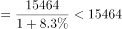
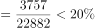
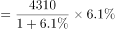
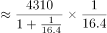
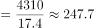
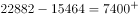

# 综合判断题（基期量、比重、增长量、差值四考点逐项验证）

考点：[[20-考点/资料分析/综合/综合判断题（基期量、比重、增长量、差值四考点逐项验证）|综合 / 综合判断题（基期量、比重、增长量、差值四考点逐项验证）]]
材料：[[15-材料/资料分析/294540 2019年前三季度全国居民人均可支配|294540 2019年前三季度全国居民人均可支配]]

**问法模型**：题干为'根据以上资料，可以推出的是'的四选一综合判断 → 对A/B/C/D分别套用基期量=现期/(1+r)、比重=部分/整体、增长量=现期×r/(1+r)、差值=现期相减逐一证伪或证实

## 推理链
1. 第1步：C项先验：段5给出食品烟酒消费支出现期4310元、同比名义增长6.1%，选项给出精确增长量247.79元
2. 第2步：用增长量公式：增长量=现期×r/(1+r)=4310×6.1%/106.1%
3. 第3步：代入计算：4310×0.061÷1.061≈247.8元（4310-4310/1.061≈4310-4062.2≈247.8），与247.79元吻合，C项成立
4. 第4步：A项排除：段4现期消费支出15464元、增速8.3%，基期量=15464/1.083≈14277元，远低于2万元
5. 第5步：B项排除：段3经营净收入3757元、段1可支配收入22882元，比重=3757/22882≈16.4%<20%
6. 第6步：D项排除：22882-15464=7418元，虽接近但不足7500元，'以上'不成立
7. 第7步：仅C项可推出，对照选项确认答案为C

**最快解法**：⚡ C项百化分速算：6.1%≈1/16.4，增长量=4310×6.1/106.1≈4310×0.0575≈248元，与247.79元吻合即锁定；其余三项用截位直除快速证伪：A项15464/1.083≈14200+（远小于20000），B项3757/22882首位商1（约16%），D项22882-15464=7418<7500

## 易错点
- ⚠ C项增长量须用'现期×r/(1+r)'，若误用现期×r=4310×6.1%≈263元，会误判C项错误
- ⚠ B项比重分母是人均可支配收入22882元（收入体系），勿误用消费支出15464元（消费体系）做分母，材料并列两套体系口径不同
- ⚠ D项'7500元以上'为临界陷阱：差值7418元很接近7500但不足，粗心估算易误判；A项需先换算基期（除以1.083）再与2万比较，不能拿现期15464直接比较

## 母题抽象
> 🧩 当题干出现'可以推出的是/能够从上述资料中推出的是'且选项涉及多个不同公式时，优先验算给出精确数值的选项（通常为正确项设计），用对应公式（基期=现期/(1+r)、比重=部分/整体、增长量=现期×r/(1+r)、差值=直接相减）逐项证伪其余三项

**同类特征**：可以推出的是、四选一综合判断、基期量与2万元比较、占比20%以上、增长量约为247.79元、收入比消费支出多7500元以上

## 相关题
- [[10-真题/资料分析/综合/20701 综合分析判断（波动幅度比较＋增长快慢＋逐月增长验证＋比重计算）|20701]]（湖北 2010，相关度1）
- [[10-真题/资料分析/综合/1797644 综合判断——各选项数据可得性（分子-分母-基期齐备性）验证|1797644]]（山东 2016，相关度1）
- [[10-真题/资料分析/综合/2050552 综合分析（基期计算＋增速趋势判断＋口径辨析）|2050552]]（吉林 2017，相关度1）
- [[10-真题/资料分析/综合/1746812 综合判断题（逐项验证：比重计算、双指标排序比较、同比方向判断）|1746812]]（国考 2016，相关度1）
- [[10-真题/资料分析/综合/2049348 综合判断题（单产比较为主，兼含面积占比、产销读图、趋势外推多重验证）|2049348]]（河南 2017，相关度1）

---

### 题干
根据以上资料，可以推出的是∶

### 选项
- A. 2018年前三季度，全国居民人均消费支出高达2万元
- B. 2019年前三季度，全国居民人均经营净收入占全国居民人均可支配收入的20%以上
- C. 2019年前三季度，全国居民人均食品烟酒消费支出的增长量约为247.79元　✅
- D. 2019年前三季度，全国居民人均可支配收入比全国居民人均消费支出多7500元以上

### 官方解析

A项：定位材料第四段，2019年前三季度，全国居民人均消费支出15464元，比上年同期名义增长。根据公式：基期量，可得2018年前三季度，全国居民人均消费支出元，错误；

B项：定位材料第一段，2019年前三季度，全国居民人均可支配收入22882元；定位材料第三段，按收入来源分，前三季度······人均经营净收入3757元。根据公式：比重，可得2019年前三季度，全国居民人均经营净收入占全国居民人均可支配收入的比重，错误；

C项：定位材料第五段，（2019年）前三季度，全国居民人均食品烟酒消费支出4310元，增长。根据公式：增长量，可得2019年前三季度，全国居民人均食品烟酒消费支出的增长量元，与选项数字接近，正确；

D项：定位材料第一段，2019年前三季度，全国居民人均可支配收入22882元；定位材料第四段，2019年前三季度，全国居民人均消费支出15464元。则2019年前三季度，全国居民人均可支配收入比全国居民人均消费支出多元元，错误。

故正确答案为C。

### 给定材料

        2019年前三季度，全国居民人均可支配收入22882元，比上年同期名义增长8.8%。其中，城镇居民人均可支配收入31939元，增长（以下如无特别说明，均为同比名义增长）7.9%；农村居民人均可支配收入11622元，增长9.2%。

        前三季度，全国居民人均可支配收入中位数19882元，增长9.0%，中位数是平均数的86.9%。其中，城镇居民人均可支配收入中位数29304元，增长7.6%，是平均数的91.8%；农村居民人均可支配收入中位数10172元，增长10.0%，是平均数的87.5%。

        按收入来源分，前三季度，全国居民人均工资性收入13020元，增长8.6%；人均经营净收入3757元，增长9.3%；人均财产净收入1949元，增长12.3%；人均转移净收入4157元，增长7.2%。

        2019年前三季度，全国居民人均消费支出15464元，比上年同期名义增长8.3%。其中，城镇居民人均消费支出20379元，增长7.2%；农村居民人均消费支出9353元，增长9.5%。

        前三季度，全国居民人均食品烟酒消费支出4310元，增长6.1%；人均衣着消费支出962元，增长3.8%；人均居住消费支出3607元，增长10.3%；人均生活用品及服务消费支出926元，增长3.2%；人均交通通信消费支出2078元，增长7.6%；人均教育文化娱乐消费支出1766元，增长13.5%；人均医疗保健消费支出1414元，增长10.9%；人均其他用品及服务消费支出401元，增长11.1%。

