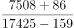
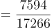
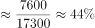

# 综合分析选非题（基期比重还原+现期差值+基期比重计算逐项验证）

考点：[[20-考点/资料分析/综合/综合分析选非题（基期比重还原+现期差值+基期比重计算逐项验证）|综合 / 综合分析选非题（基期比重还原+现期差值+基期比重计算逐项验证）]]
材料：[[15-材料/资料分析/294542 2015-2019年我国农民工总量规|294542 2015-2019年我国农民工总量规]]

**问法模型**：题干问'不能够从材料中推出的是'→选非题，逐项验算四个表述，找出唯一与材料数据矛盾的一项

## 推理链
1. 第1步：A项用表+文字联动：表中2019年东北省内流动占外出70.2%，文字段说东北占比比上年下降3.4个百分点，倒推2018年=70.2%+3.4个百分点=73.6%，A可推出
2. 第2步：B项用文字段：2019年本地11652万人、外出17425万人，17425-11652=5773万人，B可推出
3. 第3步：C项用表格绝对数：2019年西部外出5555万人、东部4792万人，5555-4792=763万人，即西部比东部多763万人，而非少763万人，C方向颠倒、不可推出
4. 第4步：D项基期换算：2018年跨省=7508+86=7594万人（减少的加回），2018年外出=17425-159=17266万人（增加的减去）
5. 第5步：代入比重=7594/17266≈44.0%，D可推出
6. 第6步：本题为选非题，唯一不可推出的是C，与官方答案一致

**最快解法**：⚡ 综合分析先挑纯加减项秒验：C项只差一步减法加方向判断，5555（西）−4792（东）=763万人且西部更大，说明是'西比东多763'，与选项'少763万'直接矛盾，立即锁定C，无需再验A/B/D

## 易错点
- ⚠ 方向词陷阱：差值算出763万人后必须核对大小方向，西部5555>东部4792，正确表述是'多763万'，选项偷换成'少'——综合分析中最常见的'数值对、方向错'陷阱
- ⚠ 百分点升降还原方向：A项东北占比'下降3.4个百分点'，倒推基期应加回（70.2%+3.4%=73.6%），若按'下降就减'误算成66.8%会误判A错误
- ⚠ D项基期双向换算：分子跨省（减少86，加回7594）与分母外出（增加159，减去17266）都要倒推到2018年，且增用减、减用加；只换算分子得7594/17425≈43.6%，会错判D

## 母题抽象
> 🧩 当题干出现'不能够推出/以下说法错误'特征时，逐项验证并优先验算只含一步加减的差值类选项，重点核对'差值大小+方向词（多/少、高/低）'是否与数据大小关系一致，方向颠倒即锁定答案

**同类特征**：选非题（不能够推出）、综合分析逐项验证、基期占比倒推（2018年占比）、个百分点升降方向还原、两地区人数差值与方向词、基期比重双换算

## 相关题
（暂无）

---

### 题干
下列选项不能够从上述材料中推出的是：

### 选项
- A. 2018年，东北地区省内流动农民工数量约占外出农民工总量的73.6%
- B. 2019年，本地农民工比外出农民工少5773万人
- C. 2019年，西部地区外出农民工工人数量比东部地区少763万人　✅
- D. 2018年，跨省流动农民工数量约占外出农民工总量的44%

### 官方解析

A项：定位文字材料第二段可得，2019年东北地区省内流动农民工占外出农民工的比重比上年下降3.4个百分点；定位表格材料可得，2019年东北地区省内流动农民工占外出农民工的比重为。故2018年东北地区省内流动农民工数量约占外出农民工总量的，正确；

B项：定位文字材料第一段可得，2019年本地农民工11652万人，外出农民工17425万人。故2019年本地农民工比外出农民工少万人，正确；

C项：定位表格材料可得，2019年西部地区外出农民工为5555万人，东部地区外出农民工为4792万人。故2019年西部地区外出农民工工人数量比东部地区多万人，并非少763万人，错误；

D项：定位文字材料第一段可得，2019年外出农民工17425万人，比上年增加159万人；定位文字材料第二段可得，2019年跨省流动农民工7508万人，比上年减少86万人。根据公式：比重，可知2018年跨省流动农民工数量约占外出农民工总量的，正确。

本题为选非题，故正确答案为C。

### 给定材料

        2019年农民工总量达到29077万人，比上年增加241万人，增长0.8%。其中，本地农民工11652万人，比上年增加82万人，增长0.7%；外出农民工17425万人，比上年增加159万人，增长0.9%。在外出农民工中，年末在城镇居住的进城农民工13500万人，与上年基本持平。

        在外出农民工中，在省内流动的农民工9917万人，比上年增加245万人，增长2.5%；跨省流动农民工7508万人，比上年减少86万人，下降1.1%。省内流动农民工占外出农民工的56.9%，所占比重比上年提高0.9个百分点。分地区看，除东北地区省内流动农民工占外出农民工的比重比上年下降3.4个百分点以外，东部、中部和西部地区省内流动农民工占比分别比上年提高0.1、1.4和1.2个百分点。

