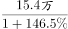
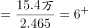
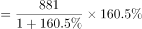
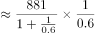
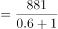
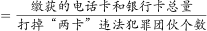
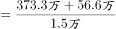
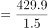

# 综合判断题（基期量计算+同比增长量计算+平均数计算的组合验证）

考点：[[20-考点/资料分析/综合/综合判断题（基期量计算+同比增长量计算+平均数计算的组合验证）|综合 / 综合判断题（基期量计算+同比增长量计算+平均数计算的组合验证）]]
材料：[[15-材料/资料分析/307043 2021年1-5月全国打击治理电信网|307043 2021年1-5月全国打击治理电信网]]

**问法模型**：题干出现'能够从上述资料中推出的有几项'→对①②③逐项独立定位数据、套用基期量/增长量/平均数公式，与各陈述内置门槛值（10万名、500件、300张）比较后数出成立项数

## 推理链
1. 第1步：①定位第一段：2021年1-5月抓获犯罪嫌疑人15.4万名，同比上升146.5%
2. 第2步：①用基期量=现期/(1+增长率)=15.4/(1+146.5%)=15.4/2.465≈6.2万名，未超过10万名，①错误
3. 第3步：②定位第四段：2021年1-5月破获被骗百万元以上案件881起，同比上升160.5%
4. 第4步：②用增长量=现期×r/(1+r)=881×1.605/2.605≈543起（百化分160.5%≈8/5，即881×8/13≈542），超过500件，②正确
5. 第5步：③定位第五段（2020年10月-2021年5月）：打掉'两卡'团伙1.5万个，缴获电话卡373.3万张、银行卡56.6万张，合计373.3+56.6=429.9万张
6. 第6步：③平均每团伙缴获=429.9万张/1.5万个≈286.6张/个，不足300张，③错误
7. 第7步：仅②成立，共1项，对照选项选B

**最快解法**：⚡ 逐项速算+门槛反推：①反向验证——若基期≥10万名，现期应≥10×2.465=24.65万>15.4万，故①错；②百化分——160.5%≈8/5，增长量=881×8/13≈542起>500件，②对；③反向验证——300张/个×1.5万个=450万张>429.9万张，故③错；三项中仅②成立，选B

## 易错点
- ⚠ ①基期公式漏加1：误算成15.4/1.465≈10.5万或15.4×146.5%，正确须除以(1+146.5%)=2.465，得约6.2万
- ⚠ ②增长量误用'现期×增长率'=881×160.5%≈1414起（漏除1+r），正确为现期×r/(1+r)≈543起；本题两者虽都>500不影响结论，但属高频公式陷阱
- ⚠ ③取数口径与合并：须用2020年10月-2021年5月段落数据（与前文1-5月区间不同），且电话卡373.3万张与银行卡56.6万张须相加后再除以1.5万个，漏项或口径混用易误判

## 母题抽象
> 🧩 当题干出现'以下信息能推出有几项'（①②③编号式综合判断）时，逐项独立定位→套基期量=现期/(1+r)、增长量=现期×r/(1+r)、平均数=总量/份数三公式→与题干门槛值比较→计数选选项

**同类特征**：能够从上述资料中推出、有几项、①②③逐项独立判断、10万名以上（基期量门槛）、500件以上（同比增长量门槛）、300张以上（平均数门槛）

## 相关题
- [[10-真题/资料分析/综合/5893779 综合判断——可推出项数判定（基期倍数还原＋比重百分点还原）|5893779]]（国考 2024，相关度2）
- [[10-真题/资料分析/综合/19526221 综合判断题—信息可推性判断（多指标能否从资料推出）|19526221]]（国考 2026，相关度2）
- [[10-真题/资料分析/比重/1796336 两期比重升降判断（比较部分增速a与整体增速b）|1796336]]（黑龙江 2016，相关度1）
- [[10-真题/资料分析/其他/1797634 现期两主体逐项作差比较（差值数数题）|1797634]]（山东 2016，相关度1）
- [[10-真题/资料分析/增长/5514960 增长量比较（超过固定门槛的项数计数）|5514960]]（广东 2023，相关度1）

---

### 题干
以下信息中，能够从上述资料中推出的有几项？
①2020年1-5月，全国抓获电信网络诈骗犯罪嫌疑人10万名以上
②2021年1-5月，全国公安机关破获被骗百万元以上案件比去年同期多500件以上
③2020年10月-2021年5月，每打掉1个“两卡”违法犯罪团伙，平均缴获的电话卡和银行卡总量就在300张以上

### 选项
- A. 0项
- B. 1项　✅
- C. 2项
- D. 3项

### 官方解析

①：定位文字材料第一段可得：2021年1-5月，全国共破获电信网络诈骗案件······抓获犯罪嫌疑人15.4万名，同比分别上升······146.5%。根据公式：基期量，则2020年1-5月，全国抓获电信网络诈骗犯罪嫌疑人 万名万名，错误；

②：定位文字材料第四段可得：2021年1-5月，全国公安机关共破获被骗百万元以上案件881起，同比上升160.5%。根据公式：增长量，则2021年1-5月，全国公安机关破获被骗百万元以上案件同比增长量起，正确；

③：定位文字材料第五段可得：2020年10月至2021年5月，全国公安机关会同检察、法院、通讯、金融等部门，共打掉“两卡”违法犯罪团伙1.5万个，缴获涉诈电话卡373.3万张，银行卡56.6万张。则题目所求平均数张，错误。

综上所述，只有②正确，共1项。

故正确答案为B。

### 给定材料

        2021年1-5月，全国共破获电信网络诈骗案件11.4万起，打掉犯罪团伙1.4万个，抓获犯罪嫌疑人15.4万名，同比分别上升60.4%、80.6%和146.5%。2021年5月，全国共立电信网络诈骗案件8.46万起，与4月相比下降14.3%。

        2021年1-5月，全国拦截诈骗电话6.1亿次，拦截诈骗短信9.1亿条，封堵诈骗网址82.1万个。1-5月公安部日均下发预警指令5.2万条。

        2021年1-5月，全国共成功劝阻771万名群众免于受骗，紧急止付涉案资金2654亿元，为群众挽回经济损失991亿元。

        2021年1-5月，全国公安机关捣毁境内诈骗窝点6500余个，共破获被骗百万元以上案件881起，同比上升160.5%，先后组织20余次集中收网行动，抓获犯罪嫌疑人2421名，打掉技术开发平台、网络引流推广、虚拟货币洗钱等团伙380余个。

        2020年10月至2021年5月，全国公安机关会同检察、法院、通讯、金融等部门，共打掉“两卡”违法犯罪团伙1.5万个，缴获涉诈电话卡373.3万张，银行卡56.6万张，惩戒“两卡”失信人员17.3万名，整治违规行业网点，机构1.8万家。

