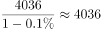
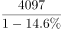
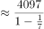
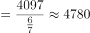
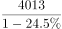
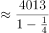
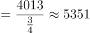
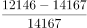
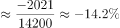

# 综合判断题（核心为环比增减验证：累计差值＋日均×天数折算月产量，辅以基期换算与平均差距排除）

考点：[[20-考点/资料分析/综合/综合判断题（核心为环比增减验证：累计差值＋日均×天数折算月产量，辅以基期换算与平均差距排除）|综合 / 综合判断题（核心为环比增减验证：累计差值＋日均×天数折算月产量，辅以基期换算与平均差距排除）]]
材料：[[15-材料/资料分析/307972 2020年7月—2021年7月我国原|307972 2020年7月—2021年7月我国原]]

**问法模型**：'能够从上述资料中推出的是'（四选一综合判断）→ 逐项验证：优先做能用'累计−当月差值'和'日均×天数'直接算通的选项，其余选项用口径陷阱（合并项不可拆分、基期换算、除以月数）排除

## 推理链
1. 第1步：从文字提取混排数据：2021年1-7月原油产量11561万吨、7月当月1686万吨；1-7月进口30193万吨、7月当月4124万吨
2. 第2步：C项需比较2021年上半年与2020年下半年（上一统计期）产量：上半年产量=11561-1686=9875万吨
3. 第3步：由统计表取2020年7-12月日均产量53.1、53.7、53.7、52.9、53.2、52.5万吨/日，分别乘以各月天数31/31/30/31/30/31，得2020年下半年产量=9785.2万吨
4. 第4步：比较9875>9785.2，2021年上半年产量高于2020年下半年，环比增加，C项可直接推出
5. 第5步：排除A：表中1-2月日均产量54.4万吨为合并值，无法拆出1月、2月单月产量，无法确认7月（1686万吨）为最多（事实上3月55.1×31=1708.1万吨已超过1686万吨，A必错）
6. 第6步：排除B：2021年二季度进口=4036+4097+4013=12146万吨，2020年二季度≈4036/0.999+4097/0.854+4013/0.755≈14153万吨，同比≈-14.2%，并非下降13.1%
7. 第7步：排除D：7月差距=4124-1686=2438万吨；上半年产量9875、进口26069，差距16194万吨，月平均差距=16194/6≈2699万吨，2438<2699为缩小而非扩大

**最快解法**：⚡ 综合判断先验最直接项C：①累计−当月：11561−1686=9875万吨；②2020下半年用'日均和×30＋大月修正'速算：六项日均和=53.1+53.7+53.7+52.9+53.2+52.5=319.1，319.1×30=9573，再加7、8、10、12月各多1天的53.1+53.7+52.9+52.5=212.2，合计9785.2<9875，环比增加，锁定C；A、B、D只需快速确认排除（A合并项不可拆、B截位直除基期约14153、D除以6个月）

## 易错点
- ⚠ 日均≠月总量：C项必须将日均产量逐月乘以实际天数（31/31/30/31/30/31），全部按30天或忽略大小月会算错2020年下半年产量
- ⚠ 环比基准搞错：'上半年环比'的上一统计期是2020年下半年，不是2020年上半年（同比），也不是与某单月比较
- ⚠ 1-2月合并口径：A项54.4万吨/日为两月合并日均无法拆分单月；B项图表中2021年1-2月8957万吨为合并柱，做季度计算时勿当单月误用（本题二季度只取4/5/6月）
- ⚠ D项月平均差距须除以6个月，且差距方向易看反：2438<2699是缩小，若只比单边数字易误判为扩大

## 母题抽象
> 🧩 当综合判断题出现'日均产量×天数''累计值与当月值混排''合并月份'特征时，先用'累计−当月'差值与'日均和×30＋大月修正'直接验证一个可算通的选项，其余选项用'合并项不可拆分''基期量=现期/(1+r)''平均差距=总差距÷月数'逐一排除

**同类特征**：能够从上述资料中推出的是（综合判断型问法）、上半年环比增减（与2020年下半年比较）、日均产量×天数折算月产量、累计值−当月值求上半年量、月平均差距=总差距÷6个月、1-2月合并数据不可拆分

## 相关题
（暂无）

---

### 题干
能够从上述资料中推出的是：

### 选项
- A. 2021年1-7月，我国原油月产量最多的是7月
- B. 2021年二季度，我国原油进口量同比下降13.1%
- C. 2021年上半年，我国原油生产量环比有所增加　✅
- D. 2021年7月，我国原油生产量与进口量的差距较上半年的月平均差距有所扩大

### 官方解析

A项：定位统计表可知，2021年1-2月我国原油日均产量为54.4万吨。但无法推出1月和2月每个月各自的日均产量是多少，也就无法推出1月和2月的月产量，故无法推出2021年1-7月，我国原油月产量最多的是7月。错误；

B项：定位柱状图可知，2021年4月我国原油进口量为4036万吨，同比增长-0.1%；5月进口量为4097万吨，同比增长-14.6%；6月进口量为4013万吨，同比增长-24.5%。则2021年二季度我国原油进口量为4036+4097+4013=12146万吨。根据基期量，则2020年4月我国原油进口量为万吨；5月进口量为万吨；6月进口量为万吨。则2020年二季度我国原油进口量为4036+4780+5351=14167万吨。根据增长率，则2021年二季度，我国原油进口量同比增速为，下降率不是13.1%。错误；

C项：定位文字材料可知，2021年1-7月，我国原油产量11561万吨；其中，7月我国原油产量1686万吨。则2021年上半年我国原油产量为：11561-1686=9875万吨；定位统计表可知，2020年7月至2020年12月我国原油的日均产量，则2020年下半年我国原油产量为：53.1×31+53.7×31+53.7×30+52.9×31+53.2×30+52.5×31=（53.1+53.7+53.7+52.9+53.2+52.5）×30+53.1+53.7+52.9+52.5=9573+212.2=9785.2万吨。因为9875&gt;9785.2，所以2021年上半年，我国原油生产量环比有所增加。正确；

D项：定位文字材料可知，2021年1-7月，我国原油产量11561万吨。其中，7月我国原油产量1686万吨。1-7月我国进口原油30193万吨。其中，7月进口原油4124万吨，则2021年7月，我国原油生产量与进口量的差距为4124-1686=2438万吨；2021年上半年，我国原油产量为11561-1686=9875万吨，进口原油30193-4124=26069万吨，则2021年上半年，我国原油生产量与进口量的月平均差距为万吨。因此2021年7月，我国原油生产量与进口量的差距（2438万吨）较上半年的月平均差距（2699万吨）有所缩小。错误。

故正确答案为C。

### 给定材料

        2021年1-7月，我国原油产量11561万吨，同比增长2.4%，比2019年同期增长3.9%。其中，7月我国原油产量1686万吨，增长2.5%，比2019年同期增长3.1%。1-7月我国进口原油30193万吨，下降5.6%。其中，7月进口原油4124万吨，下降19.6%。

> [!warning] 疑点（官方解析可能有误，待人工复核）
> 官方解析B项中间基期值4780、5351与精确计算（4097/0.854≈4798、4013/0.755≈5315）略有出入，但同比约-14%而非13.1%的结论不受影响，不影响正确答案C；另A项除官方'1-2月不可拆分'的理由外，尚可用3月产量55.1×31=1708.1>1686直接否定，结论一致。
