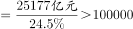

# 综合判断（比重反推总量＋混合增长率居中＋两期比重判增速＋平均增速可行性）

考点：[[20-考点/资料分析/综合/综合判断（比重反推总量＋混合增长率居中＋两期比重判增速＋平均增速可行性）|综合 / 综合判断（比重反推总量＋混合增长率居中＋两期比重判增速＋平均增速可行性）]]
材料：[[15-材料/资料分析/307971 2020年江苏省'三新'经济发展情况|307971 2020年江苏省'三新'经济发展情况]]

**问法模型**：题干为'能够从上述资料中推出的是'的多考点综判问法 → 对四项逐一验证：整体=部分÷比重、混合增速'居中且偏向基数大的一方'、比重升降反推部分与整体增速关系、平均增速须有权重数据

## 推理链
1. 第1步：A项条件——2020年'三新'经济增加值25177亿元，占全省GDP比重24.5%
2. 第2步：A项公式——整体=部分÷比重，GDP=25177÷24.5%
3. 第3步：代入速算——25177÷24.5%≈102763亿元≈10.28万亿元>10万亿元，A项'超过10万亿元'成立
4. 第4步：B项——网上零售额（整体）增长10.0%，其中实物商品（部分）增长13.9%，由混合增长率'居中'可知非实物增速<整体10.0%<13.9%，'高于13.9%'错误
5. 第5步：C项——高技术服务业增速14.1%，占规上服务业比重37.9%且提高2.4个百分点，比重上升→部分增速>整体增速，即14.1%>规上服务业增速，'慢于'错误
6. 第6步：D项——材料只给新能源汽车42.0%、集成电路22.3%、太阳能电池16.5%三个产量增速，未给各品产量作权重，无法求平均增长速度，错误
7. 第7步：综上仅A项可推出，与官方答案一致

**最快解法**：⚡ 选项分层速判：A用'部分÷比重'一步估算——24.5%<25%（1/4），故GDP=25177÷24.5%>25177×4=100708亿元>10万亿，秒锁正确；B用混合增速居中定性排除（整体10.0%<实物13.9%→非实物<10.0%）；C用'比重上升（+2.4个百分点）→部分14.1%>整体'反向排除；D看到'平均增长速度'但材料缺产量权重直接排除，无需计算

## 易错点
- ⚠ D项26.9%恰是三个增速的算术平均（(42.0%+22.3%+16.5%)÷3≈26.9%）设下的陷阱：平均增长速度必须以各品产量（现期/基期量）为权重加权，仅有增速不能直接对增速取平均
- ⚠ C项'提高2.4个百分点'是两期比重之差而非增速，误当增速会误判；百分点只能加减，两期比重升降规则为'部分增速>整体增速→比重上升'
- ⚠ B项混合增长率方向：整体10.0%居中介于实物13.9%与非实物之间，实物高于整体则非实物必低于10.0%，不能拿13.9%与非实物直接乱比；另A项分母是'占GDP比重24.5%'，勿与材料中其他占比（如高技术制造业占规上工业23.5%）跨口径混用

## 母题抽象
> 🧩 当题干出现'能够从上述资料中推出的是'且选项混编'部分÷比重求总量、增速高于/慢于、平均增长速度'时，先用'部分÷比重'凑整估算总量锁定正解，再用混合增速居中、两期比重升降两条定性规则及'平均数需权重'排除其余

**同类特征**：能够从上述资料中推出的是、占…比重24.5%（部分÷比重反推整体）、增速高于13.9%（混合增长率居中）、比重提高2.4个百分点（两期比重判增速）、平均增长速度是26.9%（增速算术平均陷阱）、四选项跨多考点混编

## 相关题
- [[10-真题/资料分析/综合/19283943 综合分析判断题（倍数比较+求和判断+隐含平均每场座位数反推）|19283943]]（国考 2025，相关度1）
- [[10-真题/资料分析/综合/1796162 综合判断（月均计算、平均运输距离、比重对比、增长量比较逐项验证）|1796162]]（贵州 2016，相关度1）
- [[10-真题/资料分析/综合/2133504 综合判断题（现期比重+现期平均数多项验证，一对三错）|2133504]]（国考 2018，相关度1）
- [[10-真题/资料分析/综合/2444706 综合判断题（增长量+比重+倍数逐项验证）|2444706]]（四川 2019，相关度1）
- [[10-真题/资料分析/综合/2571728 综合分析逐项判断（等差递推求和＋单位换算＋比值估算）|2571728]]（山东 2020，相关度1）

---

### 题干
能够从上述资料中推出的是：

### 选项
- A. 2020年江苏省地区生产总值超过10万亿元　✅
- B. 2020年江苏非实物商品网上零售额增速高于13.9%
- C. 2020年江苏高技术服务业营业收入增长速度慢于规模以上服务业
- D. 2020年江苏新能源汽车、集成电路和太阳能电池产量的平均增长速度是26.9%

### 官方解析

A项：定位文字材料可知：2020年江苏省实现以新产业、新业态、新模式为主要内容的“三新”经济增加值25177亿元，占全省地区生产总值的比重为24.5%。根据公式：，可得2020年江苏省地区生产总值亿元，即2020年江苏省地区生产总值超过10万亿元，正确；

B项：定位文字材料可知：2020年全省网上零售额增长10.0%。其中，实物商品网上零售额增长13.9%。根据混合增长率口诀“混合后居中”可得，2020年江苏非实物商品网上零售额增速小于全省网上零售额增速，即小于10.0%，错误；

C项：定位文字材料可知：2020年高技术服务业营业收入增长14.1%，占规模以上服务业的比重为37.9%，提高2.4个百分点。根据两期比重比较结论，部分增长率＞整体增长率时，比重上升。2020年高技术服务业营业收入占规模以上服务业的比重高于上年，则2020年高技术服务业营业收入增长速度快于规模以上服务业，错误；

D项：定位材料查找可知，材料只给出2020年江苏新能源汽车、集成电路和太阳能电池的增速，并未给出三者的产量，故无法计算平均增长速度，错误。

故正确答案为A。

### 给定材料

        2020年江苏省实现以新产业、新业态、新模式为主要内容的“三新”经济增加值25177亿元，比上年增长5.6%，比全省地区生产总值的增速快1.5个百分点，占全省地区生产总值的比重为24.5%。全省战略性新兴产业产值增长11.0%，快于规模以上工业5.5个百分点。其中新能源汽车、数字创意、新能源和高端装备制造业的产值增速分别为21.0%、19.8%、15.6%和15.5%。高技术制造业增加值增长10.3%，占规模以上工业的比重为23.5%，提高1.7个百分点。高技术服务业营业收入增长14.1%，占规模以上服务业的比重为37.9%，提高2.4个百分点。全省碳纤维增强复合材料、新能源汽车、城市轨道车辆、集成电路、太阳能电池等新产品的产量分别增长48.9%、42.0%、24.5%、22.3%和16.5%。全省现代设施农业占地面积100.5万公顷，其中属于战略性新兴产业的中药材种植业种植面积1.8万公顷，实现产值32亿元，产值增长138.1%。全省网上零售额10602亿元，增长10.0%。其中，实物商品网上零售额增长13.9%，增速比上年快5.2个百分点，占社会消费品零售总额37086亿元的比重为24.9%，提高2.7个百分点。

