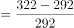
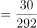
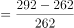
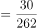
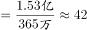

# 综合判断（增长量计算+增长率比较+平均数换算逐项验证）

考点：[[20-考点/资料分析/综合/综合判断（增长量计算+增长率比较+平均数换算逐项验证）|综合 / 综合判断（增长量计算+增长率比较+平均数换算逐项验证）]]
材料：[[15-材料/资料分析/307973 2015—2020年我国住房公积金的|307973 2015—2020年我国住房公积金的]]

**问法模型**：'能够从上述资料中推出的是'→综合判断题，对A-D逐项用表/图数据代入验证，只需找到唯一正确项；其中'年增量均超过2000亿元'须逐年计算增长量=当年值-上年值并统一换算成亿元比较

## 推理链
1. 第1步：A项直接查表：2020年实缴余额7.30万亿元 > 2019年6.54万亿元，A项'小于'错误，排除
2. 第2步：B项查图：单位数2017-2019年为262、292、322万个，两年增量均为30万个，但2018年基期262小于2019年基期292，故2018年增速(30/262≈11.5%)大于2019年增速(30/292≈10.3%)，B项错误，排除
3. 第3步：C项查图：2020年实缴职工1.53亿人=15300万人，实缴单位365万个，平均每个单位人数=15300万÷365万≈41.9人，超过40人，C项'不足40人'错误，排除
4. 第4步：D项查表：实缴额2015-2020年为1.45、1.66、1.87、2.11、2.37、2.62万亿元，年增量=当年实缴额-上年实缴额，利用1万亿元=10000亿元换算
5. 第5步：逐年计算：2016年1.66-1.45=0.21万亿元=2100亿元、2017年1.87-1.66=0.21万亿元=2100亿元、2018年2.11-1.87=0.24万亿元=2400亿元、2019年2.37-2.11=0.26万亿元=2600亿元、2020年2.62-2.37=0.25万亿元=2500亿元
6. 第6步：五个年增量均大于2000亿元，D项'均超过2000亿元'成立，故正确答案为D

**最快解法**：⚡ 排除法+单位换算口算：A直接读表排除；B抓住'增量同为30万个、基期262<292'判定2018增速更大，排除；C口算15300万÷365万≈41.9人排除；D将'0.2X万亿元'直接读作'2X00亿元'（1万亿=10000亿）口算，五个增量2100/2100/2400/2600/2500均>2000亿，锁定D

## 易错点
- ⚠ 单位换算陷阱：D项0.21万亿元=2100亿元而非210亿或21亿，万亿→亿需×10000；C项1.53亿人÷365万个须化为15300万人÷365万个，'万'相互约掉后约为41.9人，量级弄错即选错
- ⚠ C项口径陷阱：'实缴单位的平均人数'=职工人数÷单位数（人/个），切勿误用实缴额÷单位数，也不能用职工人数（亿）直接除以单位数（万）而漏换算
- ⚠ B项基期混淆：2018年增速基期是2017年262、2019年增速基期是2018年292，比较增速时增量相近则基期小者增速大，精算时勿代错基期；A项勿把'实缴余额'（存量）误读为'实缴额'（流量）

## 母题抽象
> 🧩 当题干出现'能够从上述资料中推出的是'且选项混合'小于/增速大于/平均人数不足/年增量均超过阈值'时，先用直接读数排除最简单项，再用比值与增量逐年验证，全程统一单位（万亿元↔亿元、亿人↔万人）再比较

**同类特征**：能够从上述资料中推出的是、年增量均超过2000亿元、平均人数不足40人、增速大于2018年、实缴余额小于2019年、万亿/亿/万单位换算

## 相关题
- [[10-真题/资料分析/综合/19283943 综合分析判断题（倍数比较+求和判断+隐含平均每场座位数反推）|19283943]]（国考 2025，相关度1）
- [[10-真题/资料分析/综合/1796162 综合判断（月均计算、平均运输距离、比重对比、增长量比较逐项验证）|1796162]]（贵州 2016，相关度1）
- [[10-真题/资料分析/综合/2133504 综合判断题（现期比重+现期平均数多项验证，一对三错）|2133504]]（国考 2018，相关度1）
- [[10-真题/资料分析/综合/2444706 综合判断题（增长量+比重+倍数逐项验证）|2444706]]（四川 2019，相关度1）
- [[10-真题/资料分析/综合/2571728 综合分析逐项判断（等差递推求和＋单位换算＋比值估算）|2571728]]（山东 2020，相关度1）

---

### 题干
能够从上述资料中推出的是：

### 选项
- A. 2020年我国住房公积金实缴余额小于2019年
- B. 2019年我国住房公积金实缴单位数增速大于2018年
- C. 2020年我国住房公积金实缴单位的平均人数不足40人
- D. 2016-2020年我国住房公积金实缴额年增量均超过2000亿元　✅

### 官方解析

A项：定位统计表可得，2020年我国住房公积金实缴余额为7.30万亿元；2019年我国住房公积金实缴余额为6.54万亿元，2020年&gt;2019年，错误；

B项：定位统计图可得，2017-2019年，我国住房公积金实缴单位数分别为262万个、292万个、322万个，根据增长率可得：2019年我国住房公积金实缴单位数增长率，2018年我国住房公积金实缴单位数增长率，2019年&lt;2018年，错误；

C项：定位统计图可得，2020年我国住房公积金实缴单位数为365万个，实缴职工人数为1.53亿人，则2020年我国住房公积金实缴单位的平均人数人人，错误；

D项：定位统计表可得，2015-2020年我国住房公积金实缴额分别为1.45万亿元、1.66万亿元、1.87万亿元、2.11万亿元、2.37万亿元、2.62万亿元，根据公式：增长量=现期量-基期量，则2016-2020年我国住房公积金实缴额年增量分别为：2016年=1.66-1.45=0.21万亿元&gt;2000亿元、2017年=1.87-1.66=0.21万亿元&gt;2000亿元、2018年=2.11-1.87=0.24万亿元&gt;2000亿元、2019年=2.37-2.11=0.26万亿元&gt;2000亿元、2020年=2.62-2.37=0.25万亿元&gt;2000亿元，均超过2000亿元，正确。

故正确答案为D。

### 给定材料

