# 综合分析选非题（增长率比较＋逐年差值比较＋五年平均数计算＋增长率比较）

考点：[[20-考点/资料分析/综合/综合分析选非题（增长率比较＋逐年差值比较＋五年平均数计算＋增长率比较）|综合 / 综合分析选非题（增长率比较＋逐年差值比较＋五年平均数计算＋增长率比较）]]
材料：[[15-材料/资料分析/307974 2016—2020年（十三五期）全球|307974 2016—2020年（十三五期）全球]]

**问法模型**：'不能从上述资料中推出的是'的选非综合分析问法 → 逐项独立回表验证：A/D项用增长率=(现期−基期)÷基期比较，B项逐年做差验证'差距逐年增大'，C项用总量做商（总数量÷总次数），唯一推不出的一项即答案

## 推理链
1. 第1步：A项取全球'数量(枚)'列：2016年209枚、2017年443枚、2018年461枚、2019年492枚、2020年1277枚
2. 第2步：A项逐年增速：2017年234/209≈112%、2018年18/443≈4.1%、2019年31/461≈6.7%、2020年785/492≈160%，最慢确为2018年，A可推出
3. 第3步：B项取俄美'数量(枚)'列逐年做差：2016年72−27=45枚，2017年152−116=36枚，36<45即2017年差距小于2016年，'逐年增大'被推翻（2018年191枚→2019年175枚亦缩小），B推不出
4. 第4步：C项中国五年加总：总次数22+18+39+34+39=152次，总数量40+34+95+81+77=327枚，平均327÷152≈2.15枚>2枚，C可推出
5. 第5步：D项2019年较2018年增速：中国(81−95)/95≈−14.7%、美国40/212≈18.9%、俄罗斯56/21≈266.7%、欧洲1/9≈11.1%，俄罗斯最快，D可推出
6. 第6步：本题为选非题，仅B项推不出，故正确答案为B

**最快解法**：⚡ 选非题优先验证最易找反例的B项：俄美相邻年份直接做差，2016年差45枚>2017年差36枚，一处反例即否定，无需算满四年；A项增速用'增长量÷基期'截位直除（18/443≈4%为最小即2018年）；C项327/152≈2.15直除；D项俄罗斯56/21≈267%远超其他主体，直接锁定最快

## 易错点
- ⚠ 次数列与数量列口径混用：A/B/C/D四项全部使用'数量(枚)'列，误用相邻的'次数(次)'列（俄罗斯22/21/20/25/17次）会得出完全不同的差距与增速序列
- ⚠ '逐年增大'只需一个相邻年份反例即可推翻：2017年差36枚<2016年差45枚，勿被2020年1076枚的极端值（一箭多星效应）误导为'总体在增大'而误判B成立
- ⚠ 选非题漏看'不能推出'三字：A/C/D三项均正确，按常规'选正确项'习惯会错选；D项中中国2019年为负增长（−14.7%）仍须参与比较，俄罗斯因2018年基数仅21枚而增速畸高（≈267%），勿凭绝对量大小判断增速快慢

## 母题抽象
> 🧩 当题干出现'不能从资料中推出的是'且选项混合'增速最慢/最快年份''差距逐年增大''五年单次平均数量'时，逐项独立回表取数：增速=增长量÷基期截位直除、逐年做差找一个反例即可否定、平均=总数量÷总次数，唯一不成立的选项即答案

**同类特征**：不能从上述资料中推出的是（选非综合分析）、增速最慢的年份是、数量差距逐年增大、单次发射航天器的平均数量、增速最快的是、同一张表内次数列/数量列反复切换

## 相关题
- [[10-真题/资料分析/增长/19452642 同比增速比较（查找比较型+数据完整性判断）|19452642]]（上海 2026，相关度1）
- [[10-真题/资料分析/增长/19591658 增长率比较（同比增速排序取最大）|19591658]]（选调 2024，相关度1）
- [[10-真题/资料分析/增长/2676664 一般增长率比较（逐年增速比大小）|2676664]]（选调 2018，相关度1）

---

### 题干
不能从上述资料中推出的是：

### 选项
- A. 2017—2020年全球航天器发射数量增速最慢的年份是2018年
- B. 2017—2020年俄罗斯与美国发射航天器的数量差距逐年增大　✅
- C. 2016—2020年中国单次发射航天器的平均数量大于2枚
- D. 2019年全球主要国家或地区中发射航天器数量增速最快的是俄罗斯

### 官方解析

A项：定位统计表，可知2016—2020年全球航天器发射数量。根据公式：增长率，可得2017—2020年全球航天器发射数量的增速分别为：2017年，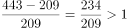；2018年，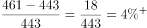；2019年，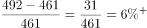；2020年，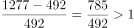。则增速最慢的是2018年，正确；

B项：定位统计表，可知2016—2020年俄罗斯与美国航天器发射数量。2016年两国航天器发射数量的差距为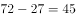枚，2017年为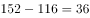枚，则2017年的差距小于2016年，故差距并非逐年增大，错误；

C项：定位统计表，可知2016—2020年中国航天发射次数和航天器发射数量。2016—2020年，中国航天发射总次数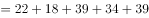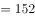次，航天器发射总数量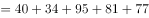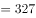枚，则2016—2020年中国单次发射航天器的平均数量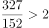枚，正确；

D项：定位统计表，可知2018年、2019年全球主要国家或地区发射航天器的数量。根据公式：增长率，可得2019年中国、美国、俄罗斯、欧洲发射航天器数量的增长率分别为：中国，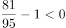；美国，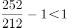；俄罗斯，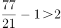；欧洲，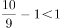。则2019年发射航天器数量增速最快的是俄罗斯，正确。

本题为选非题，故正确答案为B。

### 给定材料

