# 综合判断选非题：增速差单位辨析（百分点vs百分数）+两期比重升降判断+增长量计算与比较

考点：[[20-考点/资料分析/综合/综合判断选非题：增速差单位辨析（百分点vs百分数）+两期比重升降判断+增长量计算与比较|综合 / 综合判断选非题：增速差单位辨析（百分点vs百分数）+两期比重升降判断+增长量计算与比较]]
材料：[[15-材料/资料分析/307984 H市2019年统计公报节选：教育（各|307984 H市2019年统计公报节选：教育（各]]

**问法模型**：题干'关于…下列说法不正确的是'→对四个选项逐项验证（比重升降口诀、增速差单位、增长量公式），锁定表述错误的选项

## 推理链
1. 第1步：从第二段提取专利数据——全年专利申请26.15万件(+14.4%)、授权16.66万件(+18.8%)；其中发明申请8.29万件(+18.4%)、发明授权2.61万件(+22.3%)；PCT申请1.75万件(-3.4%)
2. 第2步：A项套用两期比重比较结论：部分增速a>整体增速b则比重上升——发明申请18.4%>全部申请14.4%，发明授权22.3%>全部授权18.8%
3. 第3步：故发明专利在申请量与授权量中的占比均同比上升，A正确
4. 第4步：B项计算增速差：18.4%-(-3.4%)=21.8个百分点，而选项表述为'高21.8%'，把'百分点'偷换成'%'，表述错误
5. 第5步：C项用增长量公式=q×r/(1+r)：申请量增量26.15×14.4%/(1+14.4%)≈3.3万件，授权量增量16.66×18.8%/(1+18.8%)≈2.6万件，3.3>2.6，C正确
6. 第6步：D项：PCT减少量=1.75×3.4%/(1-3.4%)≈0.06万件，与'约0.06万件'相符，D正确
7. 第7步：本题选不正确项，故答案为B

**最快解法**：⚡ 考场最快解法：口诀+百化分。A项比重升降口诀秒判（部分增速18.4%>14.4%、22.3%>18.8%均上升）；B项定性排雷——两个增速相减只能得'百分点'，见'高21.8%'直接锁定错误；C项百化分：14.4%≈1/7，增量≈26.15/8≈3.3万件，18.8%≈3/16，增量≈16.66×3/19≈2.6万件；D项：3.4%≈1/29，减少量≈1.75/28≈0.06万件

## 易错点
- ⚠ 增速差单位陷阱：18.4%-(-3.4%)=21.8个百分点而非21.8%，选项B正是用'%'冒充'个百分点'设置错误，这是本题唯一错误项
- ⚠ '分别增长'顺序错位：14.4%/18.8%依次对应申请量/授权量，18.4%/22.3%依次对应发明申请/发明授权，对应错位则A项判断全盘皆错
- ⚠ C项直觉陷阱：授权量增速18.8%>申请量增速14.4%，但申请量基数大（26.15>16.66），增量比较必须实际计算，不能'增速大则增量大'；D项负增长时分母应为(1-3.4%)=0.966而非1.034

## 母题抽象
> 🧩 当综合判断题出现'两个增速比较/相减'的表述时，先核单位——增速差只能用'百分点'表述，写成'%'即为错误项；比重升降用'部分增速vs整体增速'口诀秒判；增量比较用'现期×r/(1+r)'百化分估算，负增长时分母用(1-r)

**同类特征**：下列说法不正确的是（选非题）、专利申请量与授权量、占比均同比上升（两期比重比较）、增速高21.8%（百分点vs百分数）、同比增量大于、同比减少约0.06万件（负增长增量）

## 相关题
- [[10-真题/资料分析/综合/2042106 文字综合分析·选非题（年均增长量+两期比重差逆推增长率+结构倒减）|2042106]]（江苏 2017，相关度1）
- [[10-真题/资料分析/综合/2042812 综合判断（选非题）——比重、排序一致性、求和、平均数混合验证|2042812]]（江苏 2017，相关度1）

---

### 题干
关于H市2019年专利申请量与授权量，下列说法不正确的是（    ）。

### 选项
- A. 发明专利在全年专利申请量与授权量中的占比均同比上升
- B. 发明专利申请量同比增速较PCT国际专利申请量同比增速高21.8%　✅
- C. 全年专利申请量同比增量大于全年专利授权量同比增量
- D. PCT国际专利申请量同比减少约0.06万件

### 官方解析

A项：定位文字材料第二段，可知2019年全年专利申请量与授权量······分别增长14.4%（）和18.8%（）。其中，发明专利申请量与授权量······分别增长18.4%（）和22.3%（）。根据两期比重比较结论：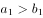，则发明专利在全年专利申请量中的占比同比上升；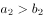，则发明专利在全年专利授权量中的占比同比上升。故发明专利在全年专利申请量与授权量中的占比均同比上升，正确；

B项：定位文字材料第二段，可知2019年全年发明专利申请量增长18.4%，PCT国际专利申请量减少3.4%，则发明专利申请量同比增速较PCT国际专利申请量同比增速高18.4%-（-3.4%）=21.8个百分点，而不是21.8%，错误；

C项：定位文字材料第二段，可知2019年全年专利申请量与授权量分别为26.15万件和16.66万件，分别增长14.4%和18.8%。根据公式：增长量，可得：全年专利申请量同比增量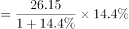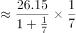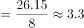万件，全年专利授权量同比增量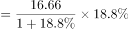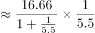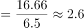万件，故全年专利申请量同比增量大于全年专利授权量同比增量，正确；

D项：定位文字材料第二段，可知PCT国际专利申请量1.75万件，减少3.4%。根据公式：增长量，可得：PCT国际专利申请量同比增量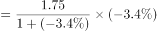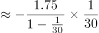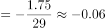万件，即减少约0.06万件，正确。

本题为选非题，故正确答案为B。

### 给定材料

        H市统计公报显示，2019年末全市各级各类学校总数达2642所，比上年增加91所；毕业生51.49万人，招生63.97万人，在校学生232.24万人，分别增长2.9%、0.5%和5.1%。年末全市有幼儿园1836所，增加65所；在园幼儿54.50万人，增长4.0%；有小学340所，减少4所；在校学生106.90万人，增长4.0%。普通中学417所，增加27所；在校学生47.74万人，增长6.6%。普通高等学校13所，与上年持平，在校学生数增长9.0%。全年全市普通高等学校本专科招生3.00万人，在校生9.22万人，毕业生2.13万人；普通高等学校研究生教育招生0.81万人，在校生2.10万人，毕业生0.47万人。

        2019年末，全市各类专业技术人员183.50万人，比上年增长10.1%，其中具有中级及以上技术职称的专业技术人员54.69万人，增长7.4%。年末全市各级创新载体2258个，其中，国家级重点实验室、工程实验室和技术中心等创新载体116个，部级创新载体604个，市级创新载体1537个。全年专利申请量与授权量分别为26.15万件和16.66万件，分别增长14.4%和18.8%。其中，发明专利申请量与授权量分别为8.29万件和2.61万件，分别增长18.4%和22.3%；PCT国际专利申请量1.75万件，减少3.4%。

