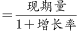
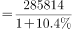
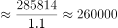
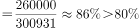
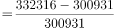
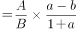
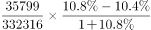
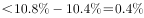

# 综合判断选非题（五年总量加总+单位换算为主，兼查基期比重、持平增速、两期比重差）

考点：[[20-考点/资料分析/综合/综合判断选非题（五年总量加总+单位换算为主，兼查基期比重、持平增速、两期比重差）|综合 / 综合判断选非题（五年总量加总+单位换算为主，兼查基期比重、持平增速、两期比重差）]]
材料：[[15-材料/资料分析/308285 2016年我国社会消费品零售总额的总|308285 2016年我国社会消费品零售总额的总]]

**问法模型**：题干为'不能从上述资料中推出的是'的选非综合题→逐项验证四个表述并锁定错误项；A项用'五年数据截位加总'再换算万亿与140万亿元比较，B/C/D分别用基期比重、'持平=0%'读数、两期比重差公式快速验证。

## 推理链
1. 第1步：A项需2012—2016年五年总量，从柱状图读取214433、242843、271896、300931、332316亿元；注意题干'140万亿元'须换算为1400000亿元再比较。
2. 第2步：A项截位加总（向上取整做上界）：215000+243000+272000+301000+333000=1364000亿元=136.4万亿元（精确值1362419亿元≈136.24万亿元），136.4万亿元<140万亿元，故'超过140万亿元'不成立，A是错误表述。
3. 第3步：B项从文字第1段取2016年城镇零售额285814亿元、增速10.4%，基期量=285814÷1.104≈258900亿元；除以图中2015年总额300931亿元得≈86%＞80%，B表述正确可推出。
4. 第4步：C项从文字第2段读得金银珠宝类'与上年持平'即增速0%，故限额以上13类中并非所有品类都增长，C表述正确可推出。
5. 第5步：D项用两期比重差公式=(35799/332316)×(10.8%−10.4%)/(1+10.8%)≈10.8%×0.36%≈0.04个百分点＜0.4个百分点，'上升不到0.4个百分点'成立，D表述正确可推出。
6. 第6步：本题为选非题，唯一错误表述为A项，与官方答案一致。

**最快解法**：⚡ 截位直除/凑整加总：A项五年数据向上凑整为21.5+24.3+27.2+30.1+33.3（万亿）=136.4万亿<140万亿，一步锁定答案A；B项285814÷1.104≈285814×0.906≈25.9万，25.9/30.1≈86%＞80%；D项比重差≈(a−b)×现期比重=0.4%×10.8%≈0.04个百分点，远小于0.4。

## 易错点
- ⚠ 单位量级陷阱：题干用'140万亿元'、图中数据为亿元，须换算140万亿元=1400000亿元比较，直接看数字量级会误判A正确。
- ⚠ 选非题陷阱：问的是'不能推出'，B、C、D均为正确表述，按常规'找正确项'习惯会误选。
- ⚠ '与上年持平'=增速0%的隐含读数：漏掉金银珠宝类持平会误判C'并非所有品类都增长'为错。
- ⚠ D项两期比重差易错直接用a−b=0.4个百分点下结论；实际须乘现期比重并除以(1+a)，真实上升约0.04个百分点。

## 母题抽象
> 🧩 当题干出现'不能从资料中推出'且选项含'若干年总量超过X万亿'特征时，用截位凑整加总（向上取整做上界）并统一万亿元/亿元口径一步判错；其余选项用基期比重、'持平=0%'、两期比重差(a−b)×A/B÷(1+a)快速排除。

**同类特征**：不能从上述资料中推出的是、2012-2016年、超过140万亿元、五年数据加总、万亿元与亿元换算、选非型综合判断

## 相关题
- [[10-真题/资料分析/综合/5893736 综合判断·选非题（环比增量比较＋峰谷倍数＋渠道比重比较＋跨层级加总）|5893736]]（国考 2024，相关度1）
- [[10-真题/资料分析/综合/2662230 综合判断·选非题（数据缺口判定＋同比增长量比较＋混合增长率＋累计总量加总比较）|2662230]]（新疆 2020，相关度1）
- [[10-真题/资料分析/综合/4769901 综合分析判断（选非题·不能从资料中推出）|4769901]]（四川 2017，相关度1）

---

### 题干
不能从上述资料中推出的是：

### 选项
- A. 2012-2016年，社会消费品零售总额超过140万亿元　✅
- B. 2015年，城镇消费品零售总额占当年社会消费品零售总额的80%以上
- C. 2016年，限额以上企业商品零售额中，并非所有品类都呈增长趋势
- D. 2016年，餐饮收入额占社会消费品零售总额的比重同比上升了不到0.4个百分点

### 官方解析

A项：定位统计图，可知2012-2016年社会消费品零售总额分别为214433亿元、242843亿元、271896亿元、300931亿元、332316亿元。则2012-2016年，社会消费品零售总额为214433＋242843＋271896＋300931＋332316＜215000+243000+272000+301000+333000=1364000亿元=136.4万亿元＜140万亿元，错误；

B项：定位文字材料第一段可得，2016年城镇消费品零售额285814亿元，增长10.4%；定位统计图可得，2015年社会消费品零售总额为300931亿元。根据公式：基期量，则2015年城镇消费品零售额亿元，则2015年城镇消费品零售总额占当年社会消费品零售总额比重，正确；

C项：定位文字材料第二段可得，2016年限额以上企业商品零售额中，金银珠宝类与上年持平。故2016年限额以上企业商品零售额中，并非所有品类都呈增长趋势，正确；

D项：定位文字材料第一段可得，2016年餐饮收入额35799亿元（A），增长10.8%（a）；定位统计图可得，2015年、2016年社会消费品零售总额分别为300931亿元、332316亿元（B）。根据公式：增长率，则2016年社会消费品零售总额同比增长率（b）；根据公式：两期比重差，则2016年餐饮收入额占社会消费品零售总额的比重同比上升，即上升不到0.4个百分点，正确。

本题为选非题，故正确答案为A。

### 给定材料

        2016年，我国全年社会消费品零售总额332316亿元。按经营地统计，城镇消费品零售额285814亿元，增长10.4%；乡村消费品零售额46503亿元，增长10.9%。按消费类型统计，商品零售额296518亿元，增长10.4%；餐饮收入额35799亿元，增长10.8%。

        在限额以上企业商品零售额中，粮油、食品、饮料、烟酒类零售额比上年增长10.5%，服装、鞋帽、针纺织品类增长7.0%，化妆品类增长8.3%，金银珠宝类与上年持平，日用品类增长11.4%，家用电器和音像器材类增长8.7%，中西药品类增长12.0%，文化办公用品类增长11.2%，家具类增长12.7%，通讯器材类增长11.9%，建筑及装潢材料类增长14.0%，汽车类增长10.1%，石油及制品类增长1.2%。

        全年网上零售额51556亿元，比上年增长26.2%。其中，网上商品零售额41944亿元，增长25.6%，占社会消费品零售总额的比重为12.6%。在网上商品零售额中，吃类商品增长28.5%，穿类商品增长18.1%，用类商品增长28.8%。

> [!warning] 疑点（官方解析可能有误，待人工复核）
> 官方解析A项用向上取整上界1364000亿元，精确加总为1362419亿元（≈136.24万亿元），结论同为<140万亿元，口径无冲突，不影响答案。

<!-- CODEX-ANSWER-REVIEW:BEGIN -->
### 本次独立复核

**复核状态：** `confirmed`（独立复算确认答案）

**计分答案：** A（可计分）

**复核解析：**

2012—2016年社会消费品零售总额合计=214433+242843+271896+300931+332316=1,362,419亿元，低于140万亿元，因此A所称超过140万亿元不能推出。其他三项分别可由2015城镇占比、2016品类中有下降项、餐饮收入份额变化计算。

**相关信息：**

独立复核：按题干定义逐项检验，关键基数、比值、增速与图表读数写明以便复算。

**题源依据：** [固定版本原题](https://github.com/Mentat-Uran/kaogongzhentizhengliu/blob/84ab93d4b64b61d897bece8a1c0a5bab06b4feb2/10-%E7%9C%9F%E9%A2%98/%E8%B5%84%E6%96%99%E5%88%86%E6%9E%90/%E7%BB%BC%E5%90%88/4658632%20%E7%BB%BC%E5%90%88%E5%88%A4%E6%96%AD%E9%80%89%E9%9D%9E%E9%A2%98%EF%BC%88%E4%BA%94%E5%B9%B4%E6%80%BB%E9%87%8F%E5%8A%A0%E6%80%BB%2B%E5%8D%95%E4%BD%8D%E6%8D%A2%E7%AE%97%E4%B8%BA%E4%B8%BB%EF%BC%8C%E5%85%BC%E6%9F%A5%E5%9F%BA%E6%9C%9F%E6%AF%94%E9%87%8D%E3%80%81%E6%8C%81%E5%B9%B3%E5%A2%9E%E9%80%9F%E3%80%81%E4%B8%A4%E6%9C%9F%E6%AF%94%E9%87%8D%E5%B7%AE%EF%BC%89.md)；固定内容 commit `84ab93d4b64b61d897bece8a1c0a5bab06b4feb2`，Markdown blob `115aef557e8d750258cf356a67381cf53255fb1b`。
<!-- CODEX-ANSWER-REVIEW:END -->
