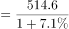
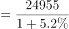
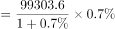
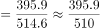

# 综合判断题（基期量计算+增长量计算+现期比重比较混合验证）

考点：[[20-考点/资料分析/综合/综合判断题（基期量计算+增长量计算+现期比重比较混合验证）|综合 / 综合判断题（基期量计算+增长量计算+现期比重比较混合验证）]]
材料：[[15-材料/资料分析/308416 2018年我国各种运输方式（铁路-公|308416 2018年我国各种运输方式（铁路-公]]

**问法模型**：题干问'能够从上述资料中推出的是'→四选项各用不同模型逐项验证：A基期量、B基期量、C同比增长量、D现期比重，算对一项即定答案

## 推理链
1. 第1步：A项定位表格，2018年货物运输总量514.6亿吨、同比+7.1%，基期量=514.6÷(1+7.1%)≈480.5亿吨<500亿吨，A错误
2. 第2步：B项定位文字段，2018年规模以上港口集装箱吞吐量24955万标准箱（≈2.4955亿标准箱）、同比+5.2%，验证24955÷1.052是否超过22000万标准箱
3. 第3步：因1.052×22000=23144万<24955万，故基期量24955÷1.052>22000万≈2.37亿标准箱>2.2亿标准箱，B正确
4. 第4步：C项定位表格，水运周转量99303.6亿吨公里、同比+0.7%，增长量=99303.6×0.7%÷1.007≈690亿吨公里<1000亿吨公里，C错误
5. 第5步：D项定位表格，公路货运量395.9亿吨占总量514.6亿吨，比重=395.9÷514.6≈76.9%<80%（八成），D错误
6. 第6步：只有B项成立，故正确答案为B

**最快解法**：⚡ 逐项速算+放缩验证：A项截位直除514.6÷1.071≈480<500秒杀；B项不放除法，用乘法放缩——1.052×2.2亿=2.3144亿<2.4955亿（24955万），故基期>2.2亿直接确认；C项百化分：0.7%≈1/143，增长量≈99303.6÷144≈690<1000；D项特殊分数比较：514.6×80%≈411.7>395.9，比重不足八成

## 易错点
- ⚠ 单位换算陷阱：集装箱24955万标准箱需换算成2.4955亿标准箱再与2.2亿比较，且表格中民航货运量738.5万吨是万吨（其他行是亿吨），本题D项虽未涉及民航，但读表时勿把万吨行当亿吨
- ⚠ C项增长量必须用现期×r/(1+r)，若直接用99303.6×0.7%≈695仍<1000结论不变，但对小增速大基期类题忽略÷(1+r)易出错；且增速仅0.7%远达不到增1000的量级，可先粗估排除
- ⚠ A项基期量514.6÷1.071≈480.5亿吨，不能拿现期514.6当2017年数，也不能误判'514.6÷(1-7.1%)'的方向；D项'货物运输量占货物运输总量'中分子取公路395.9亿吨，勿误用水运69.9或加总口径

## 母题抽象
> 🧩 当题干出现'能够从上述资料中推出的是/说法正确的是'且四个选项分属基期、增量、比重不同模型时，先挑数据最简单的一项用'基期量=现期÷(1+r)、增长量=现期×r/(1+r)、比重=部分÷整体'做乘法放缩或百化分验证，锁定唯一正确项即可停笔

**同类特征**：能够从上述资料中推出的是、四选项分别考基期/增量/比重、基期量超过某值、同比增长量超过某值、比重超过八成、现期值+同比增速为基本数据形态

## 相关题
- [[10-真题/资料分析/综合/5445866 综合判断题（混合增长率+两期比重比较+基期比重-基期量计算）|5445866]]（国考 2023，相关度2）
- [[10-真题/资料分析/综合/19283943 综合分析判断题（倍数比较+求和判断+隐含平均每场座位数反推）|19283943]]（国考 2025，相关度1）
- [[10-真题/资料分析/综合/1796162 综合判断（月均计算、平均运输距离、比重对比、增长量比较逐项验证）|1796162]]（贵州 2016，相关度1）
- [[10-真题/资料分析/综合/2133504 综合判断题（现期比重+现期平均数多项验证，一对三错）|2133504]]（国考 2018，相关度1）
- [[10-真题/资料分析/综合/2444706 综合判断题（增长量+比重+倍数逐项验证）|2444706]]（四川 2019，相关度1）

---

### 题干
能够从上述资料中推出的是：

### 选项
- A. 2017年我国全年货物运输总量大于500亿吨
- B. 2017年我国规模以上港口集装箱吞吐量超过2.2亿标准箱　✅
- C. 2018年我国水运货物运输周转量同比增长超过1000亿吨公里
- D. 2018年我国公路货物运输量占货物运输总量的比重超过八成

### 官方解析

A项：定位统计表可知：2018年我国全年货物运输总量为514.6亿吨，同比增长7.1%。根据公式：基期量，则2017年我国全年货物运输总量亿吨，错误；

B项：定位文字材料可知：（2018年我国）规模以上港口集装箱吞吐量24955万标准箱，同比增长5.2%。根据公式：基期量，则2017年我国规模以上港口集装箱吞吐量万标准箱亿标准箱&gt;2.2亿标准箱，正确；

C项：定位统计表可知：2018年我国水运货物运输周转量为99303.6亿吨公里，同比增长0.7%。根据公式：增长量，则2018年我国水运货物运输周转量的同比增长量亿吨公里&lt;1000亿吨公里，错误；

D项：定位统计表可知：2018年我国公路货物运输量为395.9亿吨，货物运输总量为514.6亿吨。根据公式：比重，则2018年我国公路货物运输量占货物运输总量的比重，即比重不到八成，错误。

故正确答案为B。 

### 给定材料

        2018年我国全年规模以上港口完成货物吞吐量133亿吨，同比增长2.7%，其中外贸货物吞吐量42亿吨，同比增长2.0%。规模以上港口集装箱吞吐量24955万标准箱，同比增长5.2%。

