# 综合分析选非题（环比增幅比较+趋势判断+年均增长量+平均数同比增幅混合验证）

考点：[[20-考点/资料分析/综合/综合分析选非题（环比增幅比较+趋势判断+年均增长量+平均数同比增幅混合验证）|综合 / 综合分析选非题（环比增幅比较+趋势判断+年均增长量+平均数同比增幅混合验证）]]
材料：[[15-材料/资料分析/308752 以'双碳'为背景介绍我国森林资源状况|308752 以'双碳'为背景介绍我国森林资源状况]]

**问法模型**：题干以'下列说法不准确的是'给出四个跨图表述（选非题）→ 对A/B/C/D逐项套用对应基础模型（增长率=（现-基）/基期、观察趋势、年均增长量=（末-初）/年份差、平均数两期相除比较），锁定错误项

## 推理链
1. 第1步：A项——由图1蓄积量序列86.56→90.28→91.41→101.37→101.37→124.56→137.21→151.37→175.60，逐次计算环比增幅
2. 第2步：第6次增幅=(124.56-101.37)/101.37≈22.9%，为历次最大（第9次24.23/151.37≈16.0%、第4次9.96/91.41≈10.9%均更小），A说法准确
3. 第3步：B项——图1中第5~9次森林面积23.84→26.24→29.32→31.15→33.07、蓄积量101.37→124.56→137.21→151.37→175.60均逐年递增，两指标趋势一致，B说法准确
4. 第4步：C项——由图2湿地数量2016年49个、2020年64个，年均增长量=(64-49)/(2020-2016)=15/4=3.75个>3个，C说法准确
5. 第5步：D项——平均每个湿地面积=湿地面积÷湿地数量；2017年、2019年数据与上年完全持平，同比增幅均为0，只需比较2018年和2020年
6. 第6步：2018年增幅=(104.24/57)÷(61.68/49)-1≈1.829/1.259-1≈45.3%；2020年增幅=(109.91/64)÷(104.24/57)-1≈1.717/1.829-1≈-6.1%
7. 第7步：2020年平均每个湿地面积同比不增反降，增幅最大的是2018年而非2020年，D说法不准确，选非题故选D

**最快解法**：⚡ 选非题逐项速验：A用'增长量÷基期'粗比——第6次增量23.19对基期101.37约23%，明显大于第9次增量24.23对基期151.37约16%，秒定A对；D不必精算增长率，直接比较两期平均数——2020年109.91/64≈1.72<2019年104.24/57≈1.83，平均每个湿地面积下降、同比增幅为负，即判D错

## 易错点
- ⚠ 选非题惯性：前三项均为'准确'表述，易在C处耗时后草率收尾漏验D，四个选项必须逐一验证
- ⚠ '平均每个湿地面积同比增幅'≠'湿地面积同比增幅'：2020年总面积109.91万亩仍在上升，但数量57→64增速（≈12.3%）快于面积增速（≈5.4%），平均每个由1.83降至1.72，只看柱形上升会误判2020年增幅最大
- ⚠ 图2中2017与2016、2019与2018数值完全相同（面积、数量同比均为0%），忽略这两个零增长年份会误以为逐年都在增长
- ⚠ C项年均增长量分母取年份差n=4（2020-2016）而非5年，若误除以5得3.0个，会误判'超过3个'不成立

## 母题抽象
> 🧩 当题干出现'下列说法不准确（正确）的是'的选非综合题时，逐项套基础模型验证，其中'平均每个X的同比增幅'类选项只需比较两期'总量÷份数'的大小即可判升降，无需精算增长率

**同类特征**：选非题·不准确的是、增幅最大（环比增长率比较）、变化趋势一致、平均每年增加（年均增长量）、平均每个…同比增幅、文字+图1+图2全材料覆盖

## 相关题
- [[10-真题/资料分析/综合/2730994 综合判断题（趋势一致性比对+逐年增长率比较+平均票房合成+五年年均值计数）|2730994]]（深圳市考 2020，相关度1）

---

### 题干
根据以上资料，下列说法不准确的是（    ）。

### 选项
- A. 我国森林蓄积量较前一次森林资源清查增幅最大的是第6次森林资源清查
- B. 第5次至第9次森林资源清查，我国森林面积和森林蓄积量的变化趋势一致
- C. 2016-2020年，我国平均每年增加国际重要湿地超过3个
- D. 2017-2020年，我国平均每个国际重要湿地面积同比增幅最大的年份是2020年　✅

### 官方解析

A项：定位统计图1，可知我国第1次至第9次森林资源清查中的森林蓄积量，根据公式：增长率=，第6次森林资源清查中我国森林蓄积量增幅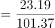；第2次：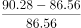；第3次：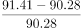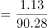；第4次：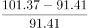；第5次：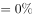；第7次：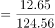；第8次：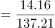；第9次：，故我国森林蓄积量较前一次森林资源清查增幅最大的是第6次森林资源清查，正确；

B项：定位统计图1，观察发现第5次至第9次森林资源清查，我国森林面积和森林蓄积量均保持增长，变化趋势一致，正确；

C项：定位统计图2，可知2016年和2020年我国国际重要湿地数量分别为49个和64个。根据公式：年均增长量，则2016-2020年我国平均每年增加国际重要湿地数量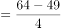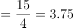个个，正确；

D项：定位统计图2，可知2016-2020年我国国际重要湿地面积分别为61.68万亩、61.68万亩、104.24万亩、104.24万亩、109.91万亩，2016-2020年我国国际重要湿地数量分别为49个、49个、57个、57个、64个。其中2017年和2019年较上年数据均未发生变化，同比增幅为0，只需比较2018年和2020年即可。根据公式：增长率，可得2018年我国平均每个国际重要湿地面积同比增幅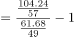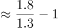，2020年同比增幅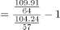，则2020年我国平均每个国际重要湿地面积同比增幅并非最大，错误。

本题为选非题，故正确答案为D。

### 给定材料

        增加森林面积、提高森林质量、提升生态系统碳汇增量，将为我国实现碳达峰、碳中和目标、维护全球生态安全做出巨大贡献。1973年，我国开展了第一次森林资源清查。目前已完成第9次森林资源清查，我国森林面积和森林蓄积量连续30年保持“双增长”。“十三五”时期，我国累计造林5.45亿亩，森林覆盖率达到23.04%，森林蓄积量为175.6亿立方米，森林面积达到2.2亿公顷（1公顷为15亩）。湿地保护率达到52%，治理沙化土地1.5亿亩。

> [!warning] 疑点（官方解析可能有误，待人工复核）
> 官方解析中增长率与年均增长量公式因排版显示不完整，但各项数值结论经复核均正确（A项第6次增幅≈22.9%最大、C项15/4=3.75个、D项2018年≈45.3%＞2020年≈-6.1%），不影响答案判定

<!-- CODEX-ANSWER-REVIEW:BEGIN -->
### 本次独立复核

**复核状态：** `resolved`（答案与解析已核定）

**计分答案：** D（可计分）

**复核解析：**

第6次森林蓄积量较上次增幅约22.9%，为各次最大；第5—9次面积与蓄积均持续增长；2016至2020国际重要湿地增加15个，4年年均3.75个，超过3。每个湿地面积：2018为104.24/57≈1.829万亩，较2017(61.68/49≈1.259)增约45.3%；2020为109.91/64≈1.717，较2019(104.24/57≈1.829)下降约6.1%。D错误，题为最不准确，选D。

**相关信息：**

跨次增长率=增量/前次；湿地均面积=总面积/数量。

**题源依据：** [固定版本原题](https://github.com/Mentat-Uran/kaogongzhentizhengliu/blob/84ab93d4b64b61d897bece8a1c0a5bab06b4feb2/10-%E7%9C%9F%E9%A2%98/%E8%B5%84%E6%96%99%E5%88%86%E6%9E%90/%E7%BB%BC%E5%90%88/4673164%20%E7%BB%BC%E5%90%88%E5%88%86%E6%9E%90%E9%80%89%E9%9D%9E%E9%A2%98%EF%BC%88%E7%8E%AF%E6%AF%94%E5%A2%9E%E5%B9%85%E6%AF%94%E8%BE%83%2B%E8%B6%8B%E5%8A%BF%E5%88%A4%E6%96%AD%2B%E5%B9%B4%E5%9D%87%E5%A2%9E%E9%95%BF%E9%87%8F%2B%E5%B9%B3%E5%9D%87%E6%95%B0%E5%90%8C%E6%AF%94%E5%A2%9E%E5%B9%85%E6%B7%B7%E5%90%88%E9%AA%8C%E8%AF%81%EF%BC%89.md)；固定内容 commit `84ab93d4b64b61d897bece8a1c0a5bab06b4feb2`，Markdown blob `b9770f9ed2478300a50f5f824f506cc93f18b701`。
<!-- CODEX-ANSWER-REVIEW:END -->
