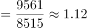
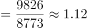
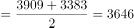
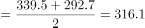
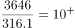
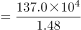
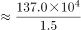
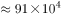
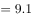

# 综合分析·选非题（强度指标反推总量＋平均数＋倍数逐项验证）

考点：[[20-考点/资料分析/综合/综合分析·选非题（强度指标反推总量＋平均数＋倍数逐项验证）|综合 / 综合分析·选非题（强度指标反推总量＋平均数＋倍数逐项验证）]]
材料：[[15-材料/资料分析/308753 2020年全国基层医疗卫生服务情况：|308753 2020年全国基层医疗卫生服务情况：]]

**问法模型**：题干为'下列说法最不准确的是'选非题 → 对A~D逐项定位数据验证，优先核算口径/量级存疑项，确认一项明显错误即可作答

## 推理链
1. 第1步：选非题须全项验证。A项：表1乡镇卫生院卫生技术人员123.2万→126.7万人，表2社区41.5万→44.4万人，2020年均比2019年增加，A准确
2. 第2步：B项：表2中2019年社区卫生服务中心9561个÷街道8515个≈1.12个/街道，2020年9826个÷8773个≈1.12个/街道，基本持平，B准确
3. 第3步：C项：乡镇卫生院2019、2020年入院3909、3383万人，年平均(3909+3383)÷2=3646万人；社区入院339.5、292.7万人，年平均316.1万人；3646÷316.1≈11.5倍＞10倍，C准确
4. 第4步：D项：2019年床位137.0万张、每千农村人口床位1.48张，农村人口=137.0万张÷1.48张/千人≈92.6万（千人），按'张÷(张/千人)=千人'还原单位：92.6万千人≈9.26亿人，并非约8亿，D明显不准确
5. 第5步：A、B、C均准确，仅D与实际量级不符，选非题故选D

**最快解法**：⚡ D项量级秒杀：137.0万÷1.48≈92.6（万千人）=9.26亿人，与'约8亿'偏差约16%且量级口径需过'千人→亿人'换算链，直接锁定；A、B、C口算过筛——A看两个增量均＞0，B两个比值均≈1.12，C用316.1×10=3161＜3646即知＞10倍

## 易错点
- ⚠ 强度指标反推总量的单位链：张÷(张/千人)=千人，92.6万千人=9.26亿人；漏做换算把92.6万当'万人'或直接当'亿'会得出0.93亿/92.6亿的荒谬量级，D项正是靠'每千农村人口床位'的换算设陷阱
- ⚠ 选非题惯性错误：考生习惯找'正确'选项，须看清'最不准确'，且四项都要过一遍，不能算完一项就交卷
- ⚠ C项口径：'2019-2020年平均入院人数'须先对两年求平均再作比；本题单年比值(3383/292.7≈11.6)也＞10倍所以结论不变，但若数值接近10倍，单年口径会误判；B项'基本持平'须两年比值对比而非只看增减方向

## 母题抽象
> 🧩 当综合分析选非题中出现'每千人口床位/人员'强度指标反推总量时，用'总量÷每千人指标→千人→再换亿人'的单位链模型，先验证量级差异最大的选项即可快速锁定答案

**同类特征**：说法最不准确（选非题）、逐项验证四个陈述、每千农村人口床位反推总人口、两年平均入院人数作倍数、平均每个街道机构数持平、跨表取数对比

## 相关题
（暂无）

---

### 题干
根据所给材料，下列说法最不准确的是：

### 选项
- A. 与2019年相比，2020年全国乡镇卫生院卫生技术人员和社区卫生服务中心卫生技术人员均有所增加
- B. 2020年，平均每个街道社区卫生服务中心数与2019年基本持平
- C. 2019-2020年，全国乡镇卫生院年平均入院人数是全国社区服务中心的十倍以上
- D. 2019年，全国农村人口约为8亿　✅

### 官方解析

A项：定位表1可得，2019年、2020年全国农村乡镇卫生院卫生技术人员分别为123.2、126.7万人；定位表2可得，2019年、2020年全国社区卫生服务中心卫生技术人员分别为41.5、44.4万人，2020年两者均比2019年有所增加，正确；

B项：定位表2可得，2019年、2020年街道数分别为8515、8773个，社区卫生服务中心数分别为9561、9826个，则2019年平均每个街道社区卫生服务中心数个，2020年平均每个街道社区卫生服务中心数个，两者基本持平，正确；

C项：定位表1可得，2019年、2020年全国农村乡镇卫生院入院人数分别为3909、3383万人；定位表2可得，2019年、2020年全国社区服务中心入院人数分别为339.5、292.7万人，则2019-2020年，全国乡镇卫生院年平均入院人数万人，全国社区服务中心年平均入院人数万人，前者是后者的倍，正确；

D项：定位表1可得，2019年全国农村乡镇卫生院床位数为137.0万张，每千农村人口乡镇卫生院床位为1.48张，则2019年农村人口数 千人亿人，错误。

本题为选非题，故正确答案为D。

### 给定材料

        近年来，全国基层卫生服务能力稳步提升，居民健康水平进一步提高。2020年，我国农村乡镇卫生院卫生人员数达148.1万人，比上年增加3.6万人，社区卫生人员数达52.1万人，比上年增加3.3万人。

> [!warning] 疑点（官方解析可能有误，待人工复核）
> 官方解析文本中C、D项算式数字有缺漏（'年平均入院人数＿万人''农村人口数＿千人＿亿人'），按材料复算C为3646/316.1≈11.5倍＞10倍、D为137.0万÷1.48≈92.6万千人≈9.26亿人≠8亿，结论与官方一致，不影响答案D
