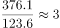
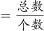
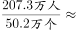
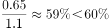
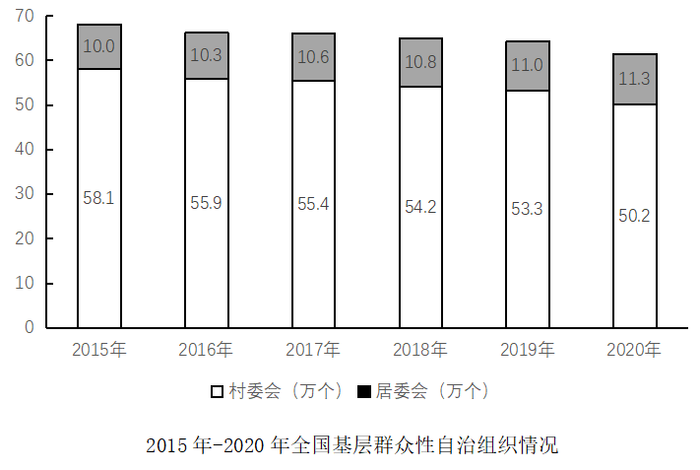

# 综合判断（逐项验证：倍数、平均数、比重、趋势比较）

考点：[[20-考点/资料分析/综合/综合判断（逐项验证：倍数、平均数、比重、趋势比较）|综合 / 综合判断（逐项验证：倍数、平均数、比重、趋势比较）]]
材料：[[15-材料/资料分析/308754 2015—2020年全国基层群众性自|308754 2015—2020年全国基层群众性自]]

**问法模型**：题干为'下列说法最准确的是'的综合判断题 → 对四个选项分别套用倍数=小组数之比、平均数=成员总数÷组织个数、比重=投票数÷选民数、趋势看逐年升降方向的模型逐项排除

## 推理链
1. 第1步：A项从文字取2020年底村民小组376.1万个、居民小组123.6万个，倍数=376.1÷123.6≈3.0倍，并非5倍，A错误
2. 第2步：B项从文字取村委会成员207.3万人、村委会50.2万个，平均数=207.3÷50.2≈4.1人＞4人，B正确
3. 第3步：C项从文字取参与投票0.65亿人、登记选民1.1亿人，比重=0.65÷1.1≈59.1%＜60%，C错误
4. 第4步：D项从图中取数：村委会58.1→55.9→55.4→54.2→53.3→50.2万个逐年下降，居委会10.0→10.3→10.6→10.8→11.0→11.3万个逐年上升，一降一升趋势不一致，D错误
5. 第5步：仅B项成立，与官方答案B一致

**最快解法**：⚡ 优先验B（纯直除）：207.3÷50.2，截位直除首商4，得约4.1人＞4人；再快速排除——A项376.1÷123.6≈3.0倍≠5倍；C项用0.6×1.1=0.66＞0.65速判不足60%；D项看图一柱降一柱升，四个方向判断即锁定B

## 易错点
- ⚠ 口径混淆：B项平均数必须用'村委会成员207.3万人'，勿误用'村民小组376.1万个'；A项须用村民小组÷居民小组（376.1÷123.6），勿拿成员数或村委会数混算
- ⚠ 量级与临界值陷阱：C项为'亿人'口径，0.65÷1.1≈59.1%，恰在60%临界之下，勿凭直觉判为超过60%
- ⚠ 趋势误判：D项中居委会逐年上升、村委会逐年下降，方向相反；勿因总量下降而误认为二者趋势一致，注意图中村委会标在柱内下部、居委会标在上部的堆叠读图方式

## 母题抽象
> 🧩 当综合判断题出现'下列说法最准确的是'且选项混排倍数、平均数、比重、趋势时，优先挑可一步直除的选项（平均数/比重）先验证，量级混排（万个/万人/亿人）先统一单位，趋势题只看升降方向不看幅度

**同类特征**：下列说法最准确的是、四选项分别考倍数、平均数、比重、变化趋势、时点存量口径（2020年底）、万个/万人/亿人三级单位混排、文字与统计图跨材料取数、60%、4人等整数临界值设错

## 相关题
（暂无）

---

### 题干
根据所给材料，下列说法最准确的是：

### 选项
- A. 2020年，村民小组数量是居民小组数量的5倍
- B. 2020年，平均每个村委会的成员数量超过4人　✅
- C. 2020年，超过60%的登记选民参与了投票
- D. 2015-2020年，村委会数量与居委会数量的变化趋势一致

### 官方解析

A项：定位文字材料可知：截止2020年底，共有村民小组376.1万个，居民小组123.6万个。则村民小组数量是居民小组数量的倍，错误；

B项：定位文字材料可知：截止2020年底，共有村委会50.2万个，村委会成员207.3万人。根据公式：平均数，可得2020年，平均每个村委会的成员数量为：4.1人＞4人，正确；

C项：定位文字材料可知：2020年村（居）委会登记选民数为1.1亿人，参与投票人数为0.65亿人。根据公式：比重，可得2020年参与投票人数占登记选民的比重为：，错误；

D项：定位图形材料可知，2015-2020年村委会数量呈整体下降趋势，居委会数量呈整体上升趋势，二者变化趋势并非一致，错误。

故正确答案为B。

### 给定材料

        基层群众性自治组织是我国在城市和农村按居民的居住地区建立起来的居民委员会或村民委员会，是城市居民或农村村民自我管理、自我教育、自我服务的组织。

        截止2020年底，全国基层群众性自治组织共计61.5万个，同比减少4.35%。其中，村委会50.2万个，占基层群众性自治组织的81.63%，村民小组376.1万个，村委会成员207.3万人；居委会11.3万个，占基层群众性自治组织的18.37%，居民小组123.6万个，居委会成员61.6万人。2016-2020年，我国村（居）委会完成选举数分别为9.7万个、18.2万个、27.6万个、8.8万个、6.1万个，其中，2020年村（居）委会登记选民数为1.1亿人，参与投票人数为0.65亿人。

> [!warning] 疑点（官方解析可能有误，待人工复核）
> 官方解析A项公式处数值有缺漏（'是居民小组数量的倍'），但按376.1÷123.6≈3.04倍≠5倍判断A错误无误；C项解析同样缺失代入数值，按0.65÷1.1≈59.1%＜60%判断C错误无误；均不影响正确答案B

<!-- CODEX-ANSWER-REVIEW:BEGIN -->
### 本次独立复核

**复核状态：** `resolved`（答案与解析已核定）

**计分答案：** B（可计分）

**复核解析：**

A村民小组/居民小组=376.1/123.6≈3.04倍，不是5倍；B村委会成员/村委会=207.3万人/50.2万个≈4.13人，超过4；C投票比例0.65/1.1≈59.1%，未超过60%；D村委会数总体下降而居委会数总体上升，趋势不一致。正确项B。

**相关信息：**

万人/万个=人/个；百分比判断保留足够精度。

**题源依据：** [固定版本原题](https://github.com/Mentat-Uran/kaogongzhentizhengliu/blob/84ab93d4b64b61d897bece8a1c0a5bab06b4feb2/10-%E7%9C%9F%E9%A2%98/%E8%B5%84%E6%96%99%E5%88%86%E6%9E%90/%E7%BB%BC%E5%90%88/4673214%20%E7%BB%BC%E5%90%88%E5%88%A4%E6%96%AD%EF%BC%88%E9%80%90%E9%A1%B9%E9%AA%8C%E8%AF%81%EF%BC%9A%E5%80%8D%E6%95%B0%E3%80%81%E5%B9%B3%E5%9D%87%E6%95%B0%E3%80%81%E6%AF%94%E9%87%8D%E3%80%81%E8%B6%8B%E5%8A%BF%E6%AF%94%E8%BE%83%EF%BC%89.md)；固定内容 commit `84ab93d4b64b61d897bece8a1c0a5bab06b4feb2`，Markdown blob `5dbf58775526e138cabbe3274b99baef99d12af6`。
<!-- CODEX-ANSWER-REVIEW:END -->
