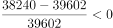
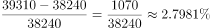
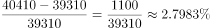
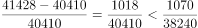
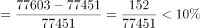

# 综合分析判断（全称判断反例排除+比重变化+增速精细比较+预测现期量）

考点：[[20-考点/资料分析/综合/综合分析判断（全称判断反例排除+比重变化+增速精细比较+预测现期量）|综合 / 综合分析判断（全称判断反例排除+比重变化+增速精细比较+预测现期量）]]
材料：[[15-材料/资料分析/309616 2012—2016年全国就业人员数量|309616 2012—2016年全国就业人员数量]]

**问法模型**：'以下对图中数据分析正确的是'→综合分析逐项验证：全称判断项找一个反例排除，趋势判断项找转折年排除，最高增速项用交叉相乘精细比较，预测项用现期量=基期量×(1+r)做量级核对

## 推理链
1. 第1步：提取数据——2012—2016年城镇为37102/38737/37943/37041/36175万人，乡村为39602/38240/39310/40410/41428万人；2013年是5年中唯一城镇(38737)>乡村(38240)的年份
2. 第2步：A项验证：2013年城镇38737万人>乡村38240万人，与'乡村均多于城镇'矛盾，A错误
3. 第3步：B项验证：2012年乡村39602>城镇37102，乡村占比超50%；2013年乡村38240<城镇38737，占比不到50%，比重先降后升，非逐年递增，B错误
4. 第4步：C项验证：乡村同比增速2013年为-1362/39602≈-3.4%（负增长），2014年为1070/38240≈2.80%，2015年为1100/39310≈2.80%，2016年为1018/40410≈2.52%
5. 第5步：精细比较2014与2015：交叉相乘1070×39310=42061700 < 1100×38240=42064000，故1100/39310>1070/38240，2015年增速在可计算年份中最高，C正确
6. 第6步：D项验证：2016年全国同比增速=(77603-77451)/77451=152/77451≈0.2%，2017年预测=77603×(1+0.2%)≈77603+152≈77755万人，远小于92813万人，D错误
7. 第7步：A、B、D均明显错误，C为正确答案

**最快解法**：⚡ 综合分析排除法+交叉相乘比较增速：A项直接看2013年（38737>38240）秒排；B项看2012→2013乡村占比由>50%跌破50%秒排；D项看全国增速仅152/77451≈0.2%的极小量级，77603×1.002≈77760<88000<92813秒排；C项为唯一幸存项，粗算2014≈1070/38240、2015≈1100/39310均约2.8%、2016≈2.5%，用交叉相乘1100×38240>1070×39310确认2015>2014，锁定C

## 易错点
- ⚠ 2013年是唯一城镇>乡村的年份：A项'均多于'、B项'比重递增'都靠这一年反转即可排除，漏看2013年方向相反会误判
- ⚠ 2014年与2015年乡村增速几乎同大（1070/38240与1100/39310均约2.80%），必须交叉相乘精细比较，粗看易误判2014年更高而认为C错
- ⚠ D项全国增速仅0.2%量级而乡村分项增速约2.8%量级，若错用乡村增速或五年累计增幅外推，会得出92813这类虚高预测值；2012年同比增速因图中无2011年基期无法计算，涉及'2012—2016年增速最高'的表述严格不可证，只能靠排除法择优

## 母题抽象
> 🧩 当题干出现'以下对图中数据分析正确的是'时，先用一行数据排除全称判断项和趋势项（优先找唯一反转的特殊年份），预测项用小增速×大基数量级核对，剩余唯一项只需与最接近的竞争者交叉相乘精比即可定答案；含'2012—2016年增速最高'类表述且图无首年基期时，按排除法择优处理

**同类特征**：综合分析判断（以下正确的是）、均多于/逐年递增等全称判断——找一个反例即可排除、同比增长率最高年份比较、假设增长率不变的预测现期量、极小增速（0.2%量级）与分项增速量级差异、图中无2011年基期数据

## 相关题
（暂无）

---

### 题干
以下对图中数据分析正确的是：

### 选项
- A. 2012—2016年，乡村就业人员数量均多于城镇就业人员数量
- B. 2012—2016年，乡村就业人员数量占全国就业人员数量比重呈逐年递增趋势
- C. 2012—2016年，乡村就业人员数量的同比增长率最高的一年是2015年　✅
- D. 假设2017年全国就业人员数量的同比增长率与2016年相同，则2017年全国就业人员数量约为92813万人

### 官方解析

A项：定位统计图可知：2013年城镇就业人员数量为38737万人，乡村就业人员数量为38240万人，乡村就业人员数量少于城镇就业人员数量，错误；

B项：定位统计图可知：2012年、2013年乡村就业人员数量分别为39602万人、38240万人。城镇就业人员数量分别为37102万人、38737万人。2012年乡村就业人员数量＞城镇就业人员数量，则2012年乡村就业人员数量占全国就业人员数量的比重超过50%；2013年乡村就业人员数量＜城镇就业人员数量，则2013年乡村就业人员数量占比不到50%，比重下降，错误；

C项：定位统计图可知：2012-2016年乡村就业人员数量分别为39602万人、38240万人、39310万人、40410万人、41428万人。根据公式：，则2013-2016年乡村就业人员数量同比增长率分别为、、、，比较可知，2015年乡村就业人员数量同比增长率最高，正确；

D项：由本篇材料第四题可知，2016年、2015年全国就业人员数量分别为77603万人、77451万人。根据公式：，则2016年全国就业人员数量同比增长率。根据公式：现期量=基期量×（1+r），则2017年全国就业人员数量＜77603×（1+10%）＜80000×（1+10%）=88000万人，错误。

故正确答案为C。

备注：对于本题C选项，根据材料数据无法计算2012年乡村就业人员数量同比增长率，因此无法比较2012年与其他年份增长率的大小关系。但结合其他选项的明显错误，粉笔择优选择C项为正确答案。

### 给定材料

> [!warning] 疑点（官方解析可能有误，待人工复核）
> C项存在口径瑕疵：图中无2011年数据，2012年乡村同比增速无法计算，严格上无法比较2012年与其他年份增速高低；官方备注已承认此点，并说明因A、B、D明显错误而择优选C。经计算2015年增速（约2.7983%）确为可计算年份中最高（略高于2014年约2.7981%），与官方答案C一致，无需更改，仅提示该题属'带瑕疵最优项'题型。
