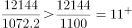
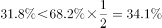

# 综合分析判断（比重互补+倍数+增长量混合验证）

考点：[[20-考点/资料分析/综合/综合分析判断（比重互补+倍数+增长量混合验证）|综合 / 综合分析判断（比重互补+倍数+增长量混合验证）]]
材料：[[15-材料/资料分析/309617 2016年我国研发（R&D）经费投入|309617 2016年我国研发（R&D）经费投入]]

**问法模型**：题干为'从上述资料中可以推出的是'四选一判断 → 逐项验证，优先做只涉比重的口算项（1-68.2%=31.8%与68.2%÷2=34.1%比较）先锁定答案，再排其余

## 推理链
1. 第1步：C项只需第三段两个数：东部占比68.2%，故中部+西部+东北合计占比=100%-68.2%=31.8%
2. 第2步：口算比较31.8%与东部一半68.2%÷2=34.1%，因31.8%<34.1%，三者累计研发经费不及东部一半，C可推出
3. 第3步：A项需链式计算：总量=822.9÷5.2%≈15825亿元，×应用研究占比10.3%≈1630亿元为2016年值，2015年约1546亿元，增长量=1546×5.4%≈83.5亿元<1600×6%=96亿元<100亿元，A错误
4. 第4步：B项直接截位直除：12144÷1072.2≈11.3倍，是'大于11倍'而非'是10倍'，B错误
5. 第5步：D项材料仅有2016年一年数据，无历年比重可比较，且四地区占比合计100%，逻辑上不可能全部逐年递增，D错误
6. 第6步：仅C项经得起验证，故选C

**最快解法**：⚡ 先攻C项秒杀：比重互补+对半比较——1-68.2%=31.8%与68.2%÷2=34.1%口算即出结论，无需先求全社会研发经费总量；再用截位直除排B（12144÷1072.2≈11.3倍≠10倍）、用放缩估算排A（1546×5.4%<1600×6%=96<100）、用'仅一年数据+占比合计100%'排D

## 易错点
- ⚠ C项勿硬算绝对额（2378.1+1944.3+664.9=4987.3再与10689.4÷2比较）绕远路，直接用占比互补替代绝对额即可；且注意第三段'分别增长'与'所占比重'对应顺序（中部、西部、东北），勿错位匹配
- ⚠ A项增长量=基期量×增长率（1546×5.4%≈83.5亿元），需先借基础研究822.9÷5.2%推总量再乘10.3%得现期，两步链式换算不能直接找数；'不足100亿'与选项'超过100亿'表述要分清
- ⚠ B项'是10倍'≠'超过10倍'：12144÷1072.2≈11.3倍，倍数表述必须精确；D项'逐年递增'需多年数据，材料仅给2016年且各占比合计100%，不可能全部递增

## 母题抽象
> 🧩 当题干出现'从资料中可以推出/无法推出'的综合判断特征时，先用比重互补与对半比较等纯口算项验证（部分合计占比=1-最大占比，再与最大占比一半比大小），再依次排除倍数表述不精确项（'是N倍'≠'超过N倍'）、链式增长量估算项、只有单年数据却断言多年趋势的选项

**同类特征**：从上述资料中可以推出的是、四选一综合判断、比重互补(1-68.2%=31.8%)、对半比较(68.2%÷2=34.1%)、倍数精确表述(是10倍)、逐年递增趋势判断

## 相关题
- [[10-真题/资料分析/综合/1797644 综合判断——各选项数据可得性（分子-分母-基期齐备性）验证|1797644]]（山东 2016，相关度1）
- [[10-真题/资料分析/综合/1746812 综合判断题（逐项验证：比重计算、双指标排序比较、同比方向判断）|1746812]]（国考 2016，相关度1）
- [[10-真题/资料分析/综合/2049348 综合判断题（单产比较为主，兼含面积占比、产销读图、趋势外推多重验证）|2049348]]（河南 2017，相关度1）
- [[10-真题/资料分析/综合/2444708 综合判断题（容斥交集下界+分数性质比较+比重最值+跨图表反推总户数）|2444708]]（四川 2019，相关度1）
- [[10-真题/资料分析/综合/10942304 综合判断（增长量计算+单位换算；两期比重比较；下降速度比较）|10942304]]（山东 2024，相关度1）

---

### 题干
从上述资料中可以推出的是（    ）。

### 选项
- A. 2016年我国应用研究经费比上年增长超过100亿元
- B. 2016年各类企业研发经费支出是高等学校科研经费支出的10倍
- C. 2016年中部、西部和东北地区累计研发经费还不及东部地区研发经费的一半　✅
- D. 各地区研发经费占全社会研发经费的比重是逐年递增的

### 官方解析

A项：根据本材料第一题可知，2015年我国应用研究经费约为1546亿元，定位文字材料第一段可得，2016年我国应用研究经费经费同比增速为5.4%。根据公式：增长量＝基期量×增长率，则2016年我国应用研究经费比上年增长：1546×5.4%＜1600×6%=96亿元，故增长不足100亿元。错误；

B项：定位文字材料第二段可得，2016年各类企业研发经费支出12144亿元，高等学校科研经费支出1072.2亿元，前者是后者的：倍，即大于11倍。错误；

C项：定位文字材料第三段可得，2016年我国东部地区研发经费占全社会研发经费的比重为68.2%，则中部、西部和东北地区占比应为1-68.2%=31.8%。。正确；

D项：全国各地区研发经费占全社会研发经费的比重必然是有增有减，不可能所有地区占比全部增加。错误。

故正确答案为C。

### 给定材料

        2016年我国基础研究经费为822.9亿元，比上年增长14.9%，明显高于应用研究经费（5.4%）和试验发展经费（11.1%）的增速。基础研究、应用研究和试验发展经费所占科技经费总投入比重分别为5.2%、10.3%和84.5%。

        2016年各类企业研发经费支出12144亿元，比上年增长11.6%；政府属研究机构经费支出2260.2亿元，比上年增长5.8%；高等学校科研经费支出1072.2亿元，比上年增长7.4%。企业研发、政府属研究机构、高等学校科研经费支出所占比重分别为77.5%，14.4%和6.8%。

        2016年我国东部地区研发经费为10689.4亿元，首次迈上万亿台阶，比上年增长11%，占全社会研发经费的比重为68.2%；中部、西部和东北地区研发经费分别为2378.1亿元、1944.3亿元和664.9亿元，分别比上年增长10.8%、12.3%和0.4%，所占全社会研发经费的比重分别为15.2%、12.4%和4.2%。

