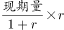
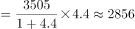
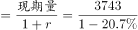
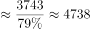

# 综合判断题（增长倍数表述+增长量计算+基期量反推+数据可推性核查）

考点：[[20-考点/资料分析/综合/综合判断题（增长倍数表述+增长量计算+基期量反推+数据可推性核查）|综合 / 综合判断题（增长倍数表述+增长量计算+基期量反推+数据可推性核查）]]
材料：[[15-材料/资料分析/309963 2015年全国环境与安全状况统计公报|309963 2015年全国环境与安全状况统计公报]]

**问法模型**：‘以下说法正确的是’综合判断问法 → 对四个选项分别套用‘全称判断找反例’‘增加X倍求增长量’‘基期=现期÷(1+增速)’‘材料外数据不可推’四个模型逐一复核

## 推理链
1. 第1步：从材料第4段提取核心数据：旱灾损失757亿元、下降31.2%；洪涝滑坡泥石流损失3505亿元、增加4.4倍；农作物受灾3743万公顷、减少20.7%；森林火灾7723起、下降12.8%（同比对象为2014年）
2. 第2步：A项‘均有所增加’是全称判断，只需找到一个下降分项即可否决——旱灾下降31.2%，A错
3. 第3步：B项‘增加4.4倍’即增长440%，基期=3505÷(1+4.4)=3505÷5.4≈649.1亿元，同比增加量=3505−649.1≈2855.9≈2856亿元，与选项一致
4. 第4步：C项按基期反推公式：2014年受灾面积=3743÷(1−20.7%)=3743÷0.793≈4718.8万公顷，≠4228.6万公顷，C错
5. 第5步：D项材料只给出2015年7723起、较2014年下降12.8%，全文无2010年数据，‘比2010年多12.8%’无从推出，D错
6. 第6步：仅B项成立，对照选项确定正确答案为B

**最快解法**：⚡ 综合判断题优先验证含‘倍数+具体增长量’的选项（B）：截位直除3505÷5.4≈650，再3505−650≈2855≈2856，直接锁定B；A项用旱灾‘下降31.2%’一票否决，D项见‘2010年’无数据直接排除，C项直除3743÷0.793≈4719≠4228.6排除

## 易错点
- ⚠ ‘增加4.4倍’≠‘是4.4倍’：基期须用3505÷(1+4.4)=3505÷5.4，若误按‘是4.4倍’处理得增长量3505−3505/4.4≈2708亿元，会错杀B项
- ⚠ C项‘减少20.7%’方向陷阱：2014年基期=现期÷(1−20.7%)≈4718.8万公顷，误用现期×(1+20.7%)或错算即落入4228.6这一命题人预设错值
- ⚠ D项时间口径陷阱：下降12.8%是2015年对2014年的同比，材料无2010年数据，不可将2014年数据偷换为2010年
- ⚠ A项‘均有所增加’类全称表述，只需一个下降分项（旱灾）即可否定，不必逐项核对所有灾种

## 母题抽象
> 🧩 当综合判断题出现‘均有所增加/减少’特征时，扫描各分项增速找一个反向者一票否决；当选项出现‘增加X倍+同比增加量’时，用增长量=现期−现期÷(1+X)验证；当选项引入材料未给的年份（如2010年）比较时，直接判‘无数据不可推’

**同类特征**：综合判断题‘以下说法正确的是’、‘均有所’全称判断找反例、‘增加X倍’表述陷阱、同比增加量=现期−现期÷(1+倍数)、基期量反推除以(1−降幅)、引入材料外年份不可推

## 相关题
（暂无）

---

### 题干
根据材料，以下说法正确的是（    ）。

### 选项
- A. 2015年全年各类自然灾害造成直接经济损失较上年度相比均有所增加
- B. 2015年全年因洪涝、滑坡和泥石流灾害造成经济损失3505亿元，同比增加了2856亿元　✅
- C. 2014年全年农作物受灾面积为4228.6万公顷
- D. 2014年全年发生森林火灾次数比2010年全年发生森林火灾次数多12.8％

### 官方解析

A项：定位文字材料第四段可知，（2015年）全年因旱灾造成直接经济损失757亿元，下降31.2％，并非各类自然灾害造成直接经济损失较上年度相比均有所增加，错误；

B项：定位文字材料第四段可知，（2015年）全年因洪涝、滑坡和泥石流灾害造成直接经济损失3505亿元，增加4.4倍。则同比增加了亿元，正确；

C项：定位文字材料第四段可知，（2015年）全年农作物受灾面积3743万公顷，减少20.7％。则2014年全年农作物受灾面积万公顷，错误；

D项：定位文字材料第四段可知，（2015年）全年共发生森林火灾7723起，下降12.8%。无2010年相关的数据，无法推出2014年全年发生森林火灾次数比2010年多12.8％，错误。

故正确答案为B。

### 给定材料

        近岸海域298个海水水质监测点，在2015年监测中，达到国家一、二类海水水质标准的监测点占62.8%，比上年下降10.1个百分点；三类海水占14.1％，上升8.1个百分点；四类、劣四类海水占23.1％，上升2.1个百分点。

        在监测的330个城市中，有273个城市空气质量达到二级以上(含二级)标准，占监测城市数的82.7％；有53个城市为三级，占16.1％；有4个城市为劣三级，占1.2％。在监测的331个城市中，城市区域声环境质量好的城市占6.3％，较好的占67.4％，轻度污染的占25%，中度污染的占0.9％。

        2015年年末城市污水处理厂日处理能力达10262万立方米，比上年末增长13.4％；城市污水处理率达到76.9％，提高1.6个百分点。集中供热面积39.1亿平方米，增长3.0％。建成区绿地率达到34.5％，提高0.3个百分点。

        2015年全年各类自然灾害造成直接经济损失5340亿元，比上年增加1.1倍，占国内生产总值的1.31％。全年农作物受灾面积3743万公顷，减少20.7％。其中，绝收486万公顷，减少1.1％。全年因洪涝、滑坡和泥石流灾害造成直接经济损失3505亿元，增加4.4倍；死亡3101人。全年因旱灾造成直接经济损失757亿元，下降31.2％。全年因低温冷冻和雪灾造成直接经济损失318亿元，死亡51人。全年因海洋灾害造成直接经济损失149.4亿元，增加49.1％。全年累计发生赤潮面积10892平方公里，减少22.8％。全年大陆地区共发生5级以上地震17次，成灾10次，造成直接经济损失235.7亿元，死亡2705人。全年共发生森林火灾7723起，下降12.8％。

        2015年全年各类生产安全事故共死亡79552人，比上年下降4.4％。亿元国内生产总值生产安全事故死亡人数为0.201人，下降19.0％；工矿商贸企业就业人员10万人生产安全事故死亡人数为2.13人，下降11.3％；道路交通万车死亡人数为3.2人，下降11.1％；煤矿百万吨死亡人数为0.749人，下降16.0％。

