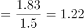

# 隔年基期连环回推（部分=整体×比重 + 基期量=现期量−增长量）

考点：[[20-考点/资料分析/综合/隔年基期连环回推（部分=整体×比重 + 基期量=现期量−增长量）|综合 / 隔年基期连环回推（部分=整体×比重 + 基期量=现期量−增长量）]]
材料：[[15-材料/资料分析/310781 2015年全国电话用户发展情况：电话|310781 2015年全国电话用户发展情况：电话]]

**问法模型**：题干问2013年（比材料现期2015年早两年）的2G用户规模 → 先用'整体×比重'锁定2015年2G现期量，再按两年净减数逐年加回的连环基期回推模型

## 推理链
1. 第1步：从文字材料提取：2015年移动电话用户总数13.06亿户，2G用户占移动用户比重由上年的54.7%下降至39.9%（即2015年占比为39.9%，54.7%是2014年占比），2015年2G净减1.83亿户且是上年净减数的1.5倍
2. 第2步：用公式'部分=整体×比重'求2015年2G现期量：13.06×39.9%≈5.2亿户
3. 第3步：按1.5倍关系换算上年（2014年）净减数：1.83÷1.5=1.22亿户，即2014年2G也净减1.22亿户
4. 第4步：用'基期量=现期量−增长量'回推一年，'减少'即增长量为负：2014年2G=5.2−(−1.83)=7.03亿户
5. 第5步：再回推一年：2013年2G=7.03−(−1.22)=8.25亿户
6. 第6步：与选项对照：8.25与D项8.3最接近，选D

**最快解法**：⚡ 截位直除+连环回推：13.06×39.9%≈13.06×40%≈5.22（截两位估）；1.83÷1.5=1.22（恰好除尽）；两年均为净减，回推一律加回：5.2+1.83+1.22=8.25≈8.3，选D，全程心算可完成

## 易错点
- ⚠ 符号方向错：两年都是'净减'，从2015年往2013年回推时应做加法（5.2+1.83+1.22），若按字面连减5.2−1.83−1.22=2.15则方向完全反掉且无对应选项
- ⚠ 比重口径错：39.9%是2015年占比、54.7%是2014年占比，若用54.7%算现期2G（13.06×54.7%≈7.1）会全盘错位
- ⚠ 倍数方向错：'1.83亿是上年净减数的1.5倍'意味着2014年净减=1.83÷1.5=1.22，若乘1.5得2.745则2013年推成9.77；另4G'新增28894.1万户、总数38622.5万户'及普及率95.5部/百人均为干扰数据，本题不需要

## 母题抽象
> 🧩 当题干求'现期往前推2年的某部分量'，材料给出现期整体、该部分现期占比、以及各年净减量（含倍数关系）时，用'整体×比重定现期部分→净减数逐年加回'的连环基期回推，答案取与计算值最接近的选项

**同类特征**：隔年基期（问2013年，材料现期为2015年）、'2G移动电话用户数'部分量、'约为多少亿户'估算型设问、'减少1.83亿户，是上年净减数的1.5倍'、'比重由上年的54.7%下降至39.9%'、万户/亿户混排材料

## 相关题
（暂无）

---

### 题干
2013年全国2G移动电话用户数约为多少亿户？

### 选项
- A. 5.6
- B. 6.2
- C. 7.5
- D. 8.3　✅

### 官方解析

根据题干“2013年······约为多少亿户”，结合材料时间为2015年，可判定本题为基期计算问题。定位文字材料第一、二段可得：2015年，全国移动电话用户总数达13.06亿户；2015年，2G移动电话用户减少1.83亿户，是上年净减数的1.5倍，占移动电话用户的比重由上年的54.7%下降至39.9%。根据公式：部分=整体×比重，可得2015年全国2G移动电话用户数亿户，2015年全国2G移动电话用户减少1.83亿户，是上年净减数的1.5倍，则2014年全国2G移动电话用户减少量亿户，根据公式：基期量=现期量−增长量，则2013年全国2G移动电话用户数=5.2−（−1.83）−（−1.22）=8.25亿户，与D项最接近。

故正确答案为D。

### 给定材料

        2015年，全国电话用户净增121.1万户，总数达到15.37亿户，增长0.1%，比上年回落2.5个百分点。其中，移动电话用户净增1964.5万户，总数达13.06亿户，移动电话用户普及率达95.5部／百人。固定电话用户总数2.31亿户。

        2015年，2G移动电话用户减少1.83亿户，是上年净减数的1.5倍，占移动电话用户的比重由上年的54.7%下降至39.9%。4G移动电话用户新增28894.1万户，总数达38622.5万户。

